# Awesome MAGI-2

English · [简体中文](README.zh-CN.md)

[](https://awesome.re) [](#contents) [](docs/prompts.md) [](https://github.com/sandbase-lab/awesome-magi-2/actions/workflows/sync.yml) [](https://www.sandbase.ai/model/sandai/magi-2/text-to-video?utm_source=github&utm_medium=readme&utm_campaign=awesome-magi-2)

[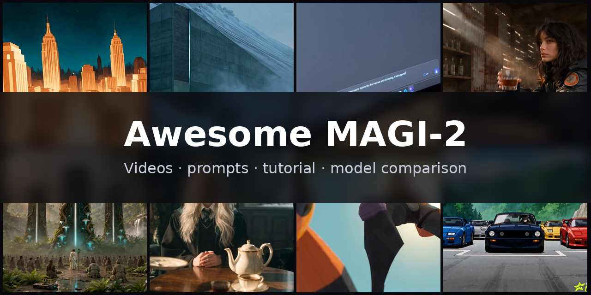](https://www.sandbase.ai/lab/ai-videos/magi-2?utm_source=github&utm_medium=readme&utm_campaign=awesome-magi-2&utm_content=banner)

A curated list of **MAGI-2 examples**: videos, prompts and clips made with MAGI-2, the video model from Sand.ai, announced on November 24, 2026. Anime, short films, action, music videos, ads and showcases, each one credited to its creator and linked to the original post, with the prompt wherever the creator shared it.

**115 videos** from **93 creators** · **10** with the creator's prompt · synced daily from [SandBase Lab](https://www.sandbase.ai/lab/ai-videos/magi-2?utm_source=github&utm_medium=readme&utm_campaign=awesome-magi-2&utm_content=stats)

## Start here

| I want to… | Go to |
|---|---|
| Watch the videos | [Browse by category](#contents) below, or [play them full-size on SandBase Lab](https://www.sandbase.ai/lab/ai-videos/magi-2?utm_source=github&utm_medium=readme&utm_campaign=awesome-magi-2&utm_content=quickstart) |
| Copy a prompt | [Prompt index](docs/prompts.md): every video that comes with its prompt |
| Write your own prompt | [Prompt guide](docs/prompt-guide.md): 7 patterns and a fill-in template |
| Make a video | [Tutorial](docs/tutorial.md): prompt → clip, with the SandBase CLI call |
| Check the evidence | [MAGI-2 model comparison](docs/model-comparison.md): what is measured and what creators reported |
| Try it now | [Run MAGI-2 in the Lab arena](https://www.sandbase.ai/arena/text-to-video?models=sandai%2Fmagi-2%2Ftext-to-video&utm_source=github&utm_medium=readme&utm_campaign=awesome-magi-2&utm_content=quickstart), next to other models |

<a id="contents"></a>

## Contents

- [Featured](#featured) (8)
- [Short films](#short-film) (20)
- [Music videos](#music-video) (2)
- [Anime](#anime) (20)
- [Action](#action) (8)
- [Ads](#ad) (4)
- [Tests & comparisons](#comparison) (36)
- [Model showcases](#showcase) (25)
- [Make a video with MAGI-2](#recreate)
- [FAQ](#faq)
- [Suggest a video](#contribute)

Click a preview to play the video. Click a title for the post, the prompt and **Recreate** on SandBase Lab. **@handle** links to the creator's post on X.

<a id="featured"></a>

## Featured

<table>
<tr><td width="33%" valign="top"><a href="https://www.sandbase.ai/lab/media/x/magi-2/2125445425520083116/video.mp4"></a><br><a href="https://www.sandbase.ai/lab/ai-videos/magi-2/2125445425520083116?utm_source=github&utm_medium=readme&utm_campaign=awesome-magi-2&utm_content=card"><b>A creator style ad for ASICS Gel Nimbus</b></a><br><sub><a href="https://x.com/Sheldon056/status/2125445425520083116">@Sheldon056</a></sub></td><td width="33%" valign="top"><a href="https://www.sandbase.ai/lab/media/x/magi-2/2125354482565280090/video.mp4">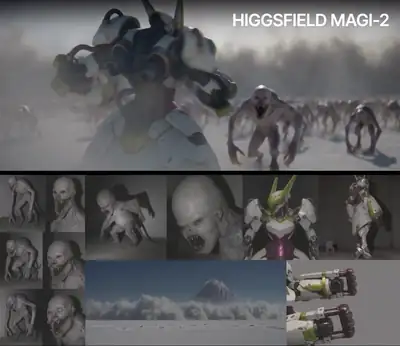</a><br><a href="https://www.sandbase.ai/lab/ai-videos/magi-2/2125354482565280090?utm_source=github&utm_medium=readme&utm_campaign=awesome-magi-2&utm_content=card"><b>Movie trailer created with MAGI-2</b></a><br><sub><a href="https://x.com/mattshumer_/status/2125354482565280090">@mattshumer_</a></sub></td><td width="33%" valign="top"><a href="https://www.sandbase.ai/lab/media/x/magi-2/2125372572170908050/video.mp4">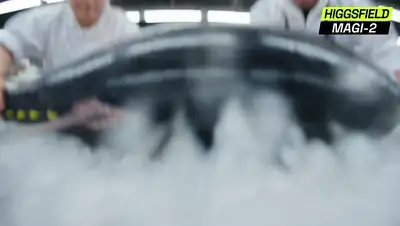</a><br><a href="https://www.sandbase.ai/lab/ai-videos/magi-2/2125372572170908050?utm_source=github&utm_medium=readme&utm_campaign=awesome-magi-2&utm_content=card"><b>A Japanese chef sharpening a knife</b></a><br><sub><a href="https://x.com/gkxspace/status/2125372572170908050">@gkxspace</a></sub></td></tr>
<tr><td width="33%" valign="top"><a href="https://www.sandbase.ai/lab/media/x/magi-2/2125531570622828617/video.mp4">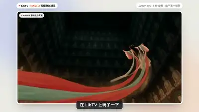</a><br><a href="https://www.sandbase.ai/lab/ai-videos/magi-2/2125531570622828617?utm_source=github&utm_medium=readme&utm_campaign=awesome-magi-2&utm_content=card"><b>Code to video and video to code demonstration</b></a><br><sub><a href="https://x.com/op7418/status/2125531570622828617">@op7418</a></sub></td><td width="33%" valign="top"><a href="https://www.sandbase.ai/lab/media/x/magi-2/2125562735350169860/video.mp4"></a><br><a href="https://www.sandbase.ai/lab/ai-videos/magi-2/2125562735350169860?utm_source=github&utm_medium=readme&utm_campaign=awesome-magi-2&utm_content=card"><b>Animated mountain train disaster scene</b></a><br><sub><a href="https://x.com/john_my07/status/2125562735350169860">@john_my07</a></sub></td><td width="33%" valign="top"><a href="https://www.sandbase.ai/lab/media/x/magi-2/2125574502285529485/video.mp4">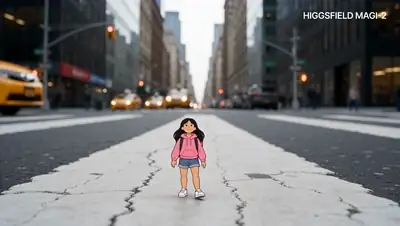</a><br><a href="https://www.sandbase.ai/lab/ai-videos/magi-2/2125574502285529485?utm_source=github&utm_medium=readme&utm_campaign=awesome-magi-2&utm_content=card"><b>Miniature delivery girl exploring a giant city</b></a><br><sub><a href="https://x.com/AIwithSynthia/status/2125574502285529485">@AIwithSynthia</a> · <a href="https://www.sandbase.ai/lab/ai-videos/magi-2/2125574502285529485?utm_source=github&utm_medium=readme&utm_campaign=awesome-magi-2&utm_content=card">prompt</a></sub></td></tr>
<tr><td width="33%" valign="top"><a href="https://www.sandbase.ai/lab/media/x/magi-2/2125373412910747712/video.mp4">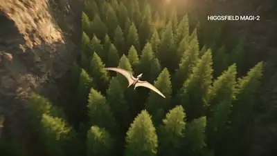</a><br><a href="https://www.sandbase.ai/lab/ai-videos/magi-2/2125373412910747712?utm_source=github&utm_medium=readme&utm_campaign=awesome-magi-2&utm_content=card"><b>Continuous FPV drone shot escaping giant dinosaurs</b></a><br><sub><a href="https://x.com/abulu8/status/2125373412910747712">@abulu8</a> · <a href="https://www.sandbase.ai/lab/ai-videos/magi-2/2125373412910747712?utm_source=github&utm_medium=readme&utm_campaign=awesome-magi-2&utm_content=card">prompt</a></sub></td><td width="33%" valign="top"><a href="https://www.sandbase.ai/lab/media/x/magi-2/2125493514045899110/video.mp4">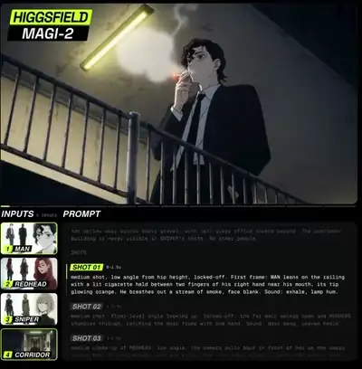</a><br><a href="https://www.sandbase.ai/lab/ai-videos/magi-2/2125493514045899110?utm_source=github&utm_medium=readme&utm_campaign=awesome-magi-2&utm_content=card"><b>Cinematic scene test of character expressions and motion</b></a><br><sub><a href="https://x.com/PUNPUNinuhime/status/2125493514045899110">@PUNPUNinuhime</a></sub></td></tr>
</table>

<a id="short-film"></a>

## Short films

<table>
<tr><td width="33%" valign="top"><a href="https://www.sandbase.ai/lab/media/x/magi-2/2125317814466883892/video.mp4">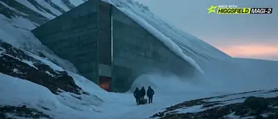</a><br><a href="https://www.sandbase.ai/lab/ai-videos/magi-2/2125317814466883892?utm_source=github&utm_medium=readme&utm_campaign=awesome-magi-2&utm_content=card"><b>A mysterious scene inside a seed vault</b></a><br><sub><a href="https://x.com/MaAyyoub/status/2125317814466883892">@MaAyyoub</a></sub></td><td width="33%" valign="top"><a href="https://www.sandbase.ai/lab/media/x/magi-2/2125327227672006799/video.mp4">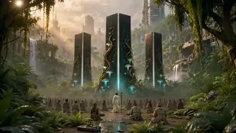</a><br><a href="https://www.sandbase.ai/lab/ai-videos/magi-2/2125327227672006799?utm_source=github&utm_medium=readme&utm_campaign=awesome-magi-2&utm_content=card"><b>Nature reclaiming civilization and ancient technology</b></a><br><sub><a href="https://x.com/mad_mask/status/2125327227672006799">@mad_mask</a></sub></td><td width="33%" valign="top"><a href="https://www.sandbase.ai/lab/media/x/magi-2/2125330702766166098/video.mp4"></a><br><a href="https://www.sandbase.ai/lab/ai-videos/magi-2/2125330702766166098?utm_source=github&utm_medium=readme&utm_campaign=awesome-magi-2&utm_content=card"><b>A girl eating a feared castle lord&#x27;s cake</b></a><br><sub><a href="https://x.com/keren_studio/status/2125330702766166098">@keren_studio</a></sub></td></tr>
<tr><td width="33%" valign="top"><a href="https://www.sandbase.ai/lab/media/x/magi-2/2125330766276268137/video.mp4">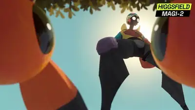</a><br><a href="https://www.sandbase.ai/lab/ai-videos/magi-2/2125330766276268137?utm_source=github&utm_medium=readme&utm_campaign=awesome-magi-2&utm_content=card"><b>A 3D animation created from Blender graybox</b></a><br><sub><a href="https://x.com/Saccc_c/status/2125330766276268137">@Saccc_c</a></sub></td><td width="33%" valign="top"><a href="https://www.sandbase.ai/lab/media/x/magi-2/2125354482565280090/video.mp4"></a><br><a href="https://www.sandbase.ai/lab/ai-videos/magi-2/2125354482565280090?utm_source=github&utm_medium=readme&utm_campaign=awesome-magi-2&utm_content=card"><b>Movie trailer created with MAGI-2</b></a><br><sub><a href="https://x.com/mattshumer_/status/2125354482565280090">@mattshumer_</a></sub></td><td width="33%" valign="top"><a href="https://www.sandbase.ai/lab/media/x/magi-2/2125432548251816142/video.mp4"></a><br><a href="https://www.sandbase.ai/lab/ai-videos/magi-2/2125432548251816142?utm_source=github&utm_medium=readme&utm_campaign=awesome-magi-2&utm_content=card"><b>Woman and a whale splashing in the ocean</b></a><br><sub><a href="https://x.com/Nishit_alt/status/2125432548251816142">@Nishit_alt</a></sub></td></tr>
</table>

<details>
<summary><b>Show all 20</b></summary>

<table>
<tr><td width="33%" valign="top"><a href="https://www.sandbase.ai/lab/media/x/magi-2/2125442556008014168/video.mp4"></a><br><a href="https://www.sandbase.ai/lab/ai-videos/magi-2/2125442556008014168?utm_source=github&utm_medium=readme&utm_campaign=awesome-magi-2&utm_content=card"><b>Day two of a McDonald&#x27;s intern</b></a><br><sub><a href="https://x.com/RobberCat_SOL/status/2125442556008014168">@RobberCat_SOL</a></sub></td><td width="33%" valign="top"><a href="https://www.sandbase.ai/lab/media/x/magi-2/2125476205222871475/video.mp4"></a><br><a href="https://www.sandbase.ai/lab/ai-videos/magi-2/2125476205222871475?utm_source=github&utm_medium=readme&utm_campaign=awesome-magi-2&utm_content=card"><b>A little kitten on a rainy night</b></a><br><sub><a href="https://x.com/Chengzilhy/status/2125476205222871475">@Chengzilhy</a></sub></td><td width="33%" valign="top"><a href="https://www.sandbase.ai/lab/media/x/magi-2/2125481156280013184/video.mp4"></a><br><a href="https://www.sandbase.ai/lab/ai-videos/magi-2/2125481156280013184?utm_source=github&utm_medium=readme&utm_campaign=awesome-magi-2&utm_content=card"><b>A McDonald&#x27;s intern preparing a Happy Meal</b></a><br><sub><a href="https://x.com/RobberCat_SOL/status/2125481156280013184">@RobberCat_SOL</a></sub></td></tr>
<tr><td width="33%" valign="top"><a href="https://www.sandbase.ai/lab/media/x/magi-2/2125493514045899110/video.mp4"></a><br><a href="https://www.sandbase.ai/lab/ai-videos/magi-2/2125493514045899110?utm_source=github&utm_medium=readme&utm_campaign=awesome-magi-2&utm_content=card"><b>Cinematic scene test of character expressions and motion</b></a><br><sub><a href="https://x.com/PUNPUNinuhime/status/2125493514045899110">@PUNPUNinuhime</a></sub></td><td width="33%" valign="top"><a href="https://www.sandbase.ai/lab/media/x/magi-2/2125501492862042357/video.mp4">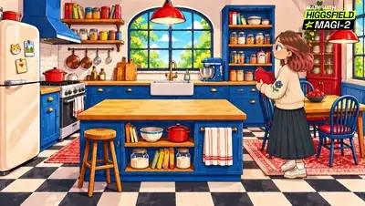</a><br><a href="https://www.sandbase.ai/lab/ai-videos/magi-2/2125501492862042357?utm_source=github&utm_medium=readme&utm_campaign=awesome-magi-2&utm_content=card"><b>A chaotic baking adventure with animated characters</b></a><br><sub><a href="https://x.com/chatgptpaglu/status/2125501492862042357">@chatgptpaglu</a></sub></td><td width="33%" valign="top"><a href="https://www.sandbase.ai/lab/media/x/magi-2/2125505796272517604/video.mp4">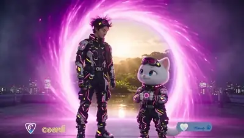</a><br><a href="https://www.sandbase.ai/lab/ai-videos/magi-2/2125505796272517604?utm_source=github&utm_medium=readme&utm_campaign=awesome-magi-2&utm_content=card"><b>Time travelers journeying across different historical eras</b></a><br><sub><a href="https://x.com/821R/status/2125505796272517604">@821R</a></sub></td></tr>
<tr><td width="33%" valign="top"><a href="https://www.sandbase.ai/lab/media/x/magi-2/2125530535724523969/video.mp4">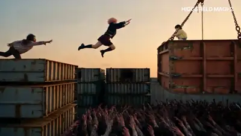</a><br><a href="https://www.sandbase.ai/lab/ai-videos/magi-2/2125530535724523969?utm_source=github&utm_medium=readme&utm_campaign=awesome-magi-2&utm_content=card"><b>A shipyard escape narrative clip</b></a><br><sub><a href="https://x.com/LioraSolveil/status/2125530535724523969">@LioraSolveil</a></sub></td><td width="33%" valign="top"><a href="https://www.sandbase.ai/lab/media/x/magi-2/2125533977536876728/video.mp4">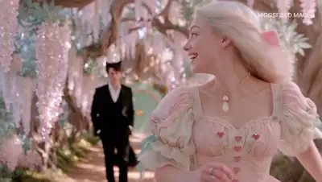</a><br><a href="https://www.sandbase.ai/lab/ai-videos/magi-2/2125533977536876728?utm_source=github&utm_medium=readme&utm_campaign=awesome-magi-2&utm_content=card"><b>Tom Riddle walking calmly in dreamcore style</b></a><br><sub><a href="https://x.com/keren_studio/status/2125533977536876728">@keren_studio</a></sub></td><td width="33%" valign="top"><a href="https://www.sandbase.ai/lab/media/x/magi-2/2125569587077165234/video.mp4"></a><br><a href="https://www.sandbase.ai/lab/ai-videos/magi-2/2125569587077165234?utm_source=github&utm_medium=readme&utm_campaign=awesome-magi-2&utm_content=card"><b>Contrasting black and white wizards casting spells</b></a><br><sub><a href="https://x.com/KT_first_story/status/2125569587077165234">@KT_first_story</a></sub></td></tr>
<tr><td width="33%" valign="top"><a href="https://www.sandbase.ai/lab/media/x/magi-2/2125570338167898208/video.mp4"></a><br><a href="https://www.sandbase.ai/lab/ai-videos/magi-2/2125570338167898208?utm_source=github&utm_medium=readme&utm_campaign=awesome-magi-2&utm_content=card"><b>A short film about enduring love for Shiva</b></a><br><sub><a href="https://x.com/NVTDanh/status/2125570338167898208">@NVTDanh</a></sub></td><td width="33%" valign="top"><a href="https://www.sandbase.ai/lab/media/x/magi-2/2125573012976185797/video.mp4"></a><br><a href="https://www.sandbase.ai/lab/ai-videos/magi-2/2125573012976185797?utm_source=github&utm_medium=readme&utm_campaign=awesome-magi-2&utm_content=card"><b>People helping others in everyday life</b></a><br><sub><a href="https://x.com/keneth_ai/status/2125573012976185797">@keneth_ai</a></sub></td><td width="33%" valign="top"><a href="https://www.sandbase.ai/lab/media/x/magi-2/2125581050017358275/video.mp4">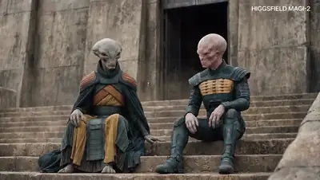</a><br><a href="https://www.sandbase.ai/lab/ai-videos/magi-2/2125581050017358275?utm_source=github&utm_medium=readme&utm_campaign=awesome-magi-2&utm_content=card"><b>Original characters with dialogue and lip sync</b></a><br><sub><a href="https://x.com/gridzzle/status/2125581050017358275">@gridzzle</a></sub></td></tr>
<tr><td width="33%" valign="top"><a href="https://www.sandbase.ai/lab/media/x/magi-2/2125592366203752905/video.mp4">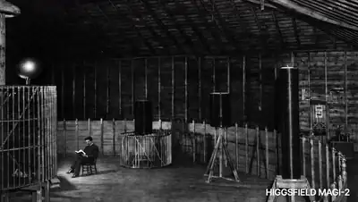</a><br><a href="https://www.sandbase.ai/lab/ai-videos/magi-2/2125592366203752905?utm_source=github&utm_medium=readme&utm_campaign=awesome-magi-2&utm_content=card"><b>A photographic tribute to Nikola Tesla</b></a><br><sub><a href="https://x.com/Peymannaderi_/status/2125592366203752905">@Peymannaderi_</a></sub></td><td width="33%" valign="top"><a href="https://www.sandbase.ai/lab/media/x/magi-2/2125593409360675146/video.mp4">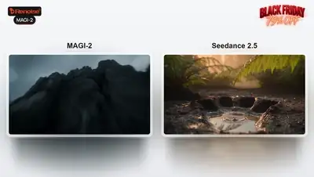</a><br><a href="https://www.sandbase.ai/lab/ai-videos/magi-2/2125593409360675146?utm_source=github&utm_medium=readme&utm_campaign=awesome-magi-2&utm_content=card"><b>Dinosaur and fantasy style cinematic short films</b></a><br><sub><a href="https://x.com/EianLu/status/2125593409360675146">@EianLu</a></sub></td></tr>
</table>

</details>

<a id="music-video"></a>

## Music videos

<table>
<tr><td width="33%" valign="top"><a href="https://www.sandbase.ai/lab/media/x/magi-2/2125479042761789699/video.mp4"></a><br><a href="https://www.sandbase.ai/lab/ai-videos/magi-2/2125479042761789699?utm_source=github&utm_medium=readme&utm_campaign=awesome-magi-2&utm_content=card"><b>Horu singing a birthday song in Korean</b></a><br><sub><a href="https://x.com/hype_boyo/status/2125479042761789699">@hype_boyo</a></sub></td><td width="33%" valign="top"><a href="https://www.sandbase.ai/lab/media/x/magi-2/2125504100670530040/video.mp4"></a><br><a href="https://www.sandbase.ai/lab/ai-videos/magi-2/2125504100670530040?utm_source=github&utm_medium=readme&utm_campaign=awesome-magi-2&utm_content=card"><b>Cel-shaded anime music video with synchronized beats</b></a><br><sub><a href="https://x.com/criscxuan/status/2125504100670530040">@criscxuan</a> · <a href="https://www.sandbase.ai/lab/ai-videos/magi-2/2125504100670530040?utm_source=github&utm_medium=readme&utm_campaign=awesome-magi-2&utm_content=card">prompt</a></sub></td></tr>
</table>

<a id="anime"></a>

## Anime

<table>
<tr><td width="33%" valign="top"><a href="https://www.sandbase.ai/lab/media/x/magi-2/2125341667511443497/video.mp4"></a><br><a href="https://www.sandbase.ai/lab/ai-videos/magi-2/2125341667511443497?utm_source=github&utm_medium=readme&utm_campaign=awesome-magi-2&utm_content=card"><b>A jester in a retro eighties anime race</b></a><br><sub><a href="https://x.com/VxRender/status/2125341667511443497">@VxRender</a></sub></td><td width="33%" valign="top"><a href="https://www.sandbase.ai/lab/media/x/magi-2/2125390876759515433/video.mp4">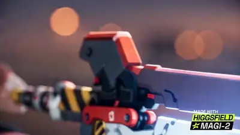</a><br><a href="https://www.sandbase.ai/lab/ai-videos/magi-2/2125390876759515433?utm_source=github&utm_medium=readme&utm_campaign=awesome-magi-2&utm_content=card"><b>Anime action scene set in a night harbor</b></a><br><sub><a href="https://x.com/akakuma0219/status/2125390876759515433">@akakuma0219</a></sub></td><td width="33%" valign="top"><a href="https://www.sandbase.ai/lab/media/x/magi-2/2125419982586773546/video.mp4">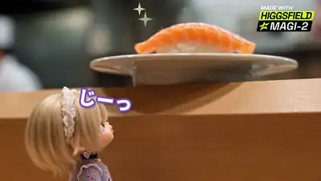</a><br><a href="https://www.sandbase.ai/lab/ai-videos/magi-2/2125419982586773546?utm_source=github&utm_medium=readme&utm_campaign=awesome-magi-2&utm_content=card"><b>Character Kucho eating sushi from a conveyor belt</b></a><br><sub><a href="https://x.com/picassong_art/status/2125419982586773546">@picassong_art</a></sub></td></tr>
<tr><td width="33%" valign="top"><a href="https://www.sandbase.ai/lab/media/x/magi-2/2125426273619198280/video.mp4">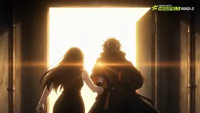</a><br><a href="https://www.sandbase.ai/lab/ai-videos/magi-2/2125426273619198280?utm_source=github&utm_medium=readme&utm_campaign=awesome-magi-2&utm_content=card"><b>Anime girl on a wet rooftop at sunrise</b></a><br><sub><a href="https://x.com/Iancu_ai/status/2125426273619198280">@Iancu_ai</a></sub></td><td width="33%" valign="top"><a href="https://www.sandbase.ai/lab/media/x/magi-2/2125430483018563681/video.mp4"></a><br><a href="https://www.sandbase.ai/lab/ai-videos/magi-2/2125430483018563681?utm_source=github&utm_medium=readme&utm_campaign=awesome-magi-2&utm_content=card"><b>Short anime scene featuring Japanese dialogue</b></a><br><sub><a href="https://x.com/SSSS_CRYPTOMAN/status/2125430483018563681">@SSSS_CRYPTOMAN</a></sub></td><td width="33%" valign="top"><a href="https://www.sandbase.ai/lab/media/x/magi-2/2125458532518834417/video.mp4"></a><br><a href="https://www.sandbase.ai/lab/ai-videos/magi-2/2125458532518834417?utm_source=github&utm_medium=readme&utm_campaign=awesome-magi-2&utm_content=card"><b>Short animation generated with MAGI-2</b></a><br><sub><a href="https://x.com/shinyitv/status/2125458532518834417">@shinyitv</a></sub></td></tr>
</table>

<details>
<summary><b>Show all 20</b></summary>

<table>
<tr><td width="33%" valign="top"><a href="https://www.sandbase.ai/lab/media/x/magi-2/2125468064527638994/video.mp4"></a><br><a href="https://www.sandbase.ai/lab/ai-videos/magi-2/2125468064527638994?utm_source=github&utm_medium=readme&utm_campaign=awesome-magi-2&utm_content=card"><b>Arcane style anime featuring character Misa</b></a><br><sub><a href="https://x.com/hetzerLin/status/2125468064527638994">@hetzerLin</a></sub></td><td width="33%" valign="top"><a href="https://www.sandbase.ai/lab/media/x/magi-2/2125471875086327853/video.mp4">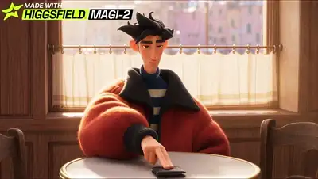</a><br><a href="https://www.sandbase.ai/lab/ai-videos/magi-2/2125471875086327853?utm_source=github&utm_medium=readme&utm_campaign=awesome-magi-2&utm_content=card"><b>An animation video created with MAGI-2</b></a><br><sub><a href="https://x.com/byaiden_vu/status/2125471875086327853">@byaiden_vu</a></sub></td><td width="33%" valign="top"><a href="https://www.sandbase.ai/lab/media/x/magi-2/2125482836048363992/video.mp4"></a><br><a href="https://www.sandbase.ai/lab/ai-videos/magi-2/2125482836048363992?utm_source=github&utm_medium=readme&utm_campaign=awesome-magi-2&utm_content=card"><b>A tsundere girl spending her day out</b></a><br><sub><a href="https://x.com/shishirdotai/status/2125482836048363992">@shishirdotai</a></sub></td></tr>
<tr><td width="33%" valign="top"><a href="https://www.sandbase.ai/lab/media/x/magi-2/2125483093041746213/video.mp4"></a><br><a href="https://www.sandbase.ai/lab/ai-videos/magi-2/2125483093041746213?utm_source=github&utm_medium=readme&utm_campaign=awesome-magi-2&utm_content=card"><b>A romantic anime scene set in Tokyo</b></a><br><sub><a href="https://x.com/MayorKingAI/status/2125483093041746213">@MayorKingAI</a></sub></td><td width="33%" valign="top"><a href="https://www.sandbase.ai/lab/media/x/magi-2/2125487471731343776/video.mp4">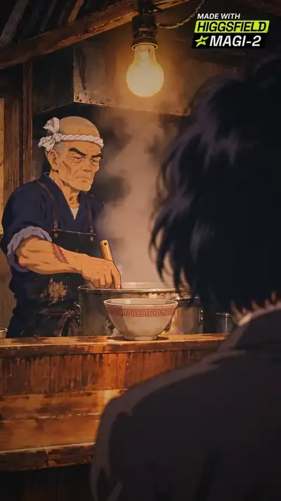</a><br><a href="https://www.sandbase.ai/lab/ai-videos/magi-2/2125487471731343776?utm_source=github&utm_medium=readme&utm_campaign=awesome-magi-2&utm_content=card"><b>Late night ramen bowl in classic anime style</b></a><br><sub><a href="https://x.com/PixelNinjaArt/status/2125487471731343776">@PixelNinjaArt</a></sub></td><td width="33%" valign="top"><a href="https://www.sandbase.ai/lab/media/x/magi-2/2125488966644515055/video.mp4">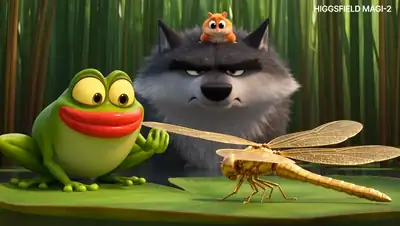</a><br><a href="https://www.sandbase.ai/lab/ai-videos/magi-2/2125488966644515055?utm_source=github&utm_medium=readme&utm_campaign=awesome-magi-2&utm_content=card"><b>The great wetland waterfall chaos</b></a><br><sub><a href="https://x.com/john_my07/status/2125488966644515055">@john_my07</a></sub></td></tr>
<tr><td width="33%" valign="top"><a href="https://www.sandbase.ai/lab/media/x/magi-2/2125497820518199324/video.mp4">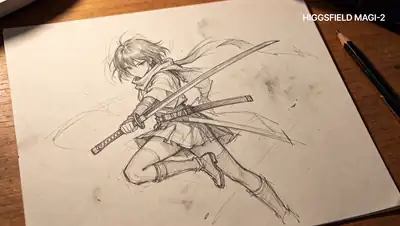</a><br><a href="https://www.sandbase.ai/lab/ai-videos/magi-2/2125497820518199324?utm_source=github&utm_medium=readme&utm_campaign=awesome-magi-2&utm_content=card"><b>Character evolving from pencil sketch to anime</b></a><br><sub><a href="https://x.com/nrvisionai/status/2125497820518199324">@nrvisionai</a></sub></td><td width="33%" valign="top"><a href="https://www.sandbase.ai/lab/media/x/magi-2/2125522773258952776/video.mp4"></a><br><a href="https://www.sandbase.ai/lab/ai-videos/magi-2/2125522773258952776?utm_source=github&utm_medium=readme&utm_campaign=awesome-magi-2&utm_content=card"><b>A young girl cooking pancakes for her father</b></a><br><sub><a href="https://x.com/AIwithkhan/status/2125522773258952776">@AIwithkhan</a> · <a href="https://www.sandbase.ai/lab/ai-videos/magi-2/2125522773258952776?utm_source=github&utm_medium=readme&utm_campaign=awesome-magi-2&utm_content=card">prompt</a></sub></td><td width="33%" valign="top"><a href="https://www.sandbase.ai/lab/media/x/magi-2/2125540743473209389/video.mp4"></a><br><a href="https://www.sandbase.ai/lab/ai-videos/magi-2/2125540743473209389?utm_source=github&utm_medium=readme&utm_campaign=awesome-magi-2&utm_content=card"><b>Nika taking control in One Piece scene</b></a><br><sub><a href="https://x.com/FotachuARGUY/status/2125540743473209389">@FotachuARGUY</a></sub></td></tr>
<tr><td width="33%" valign="top"><a href="https://www.sandbase.ai/lab/media/x/magi-2/2125550173392965727/video.mp4"></a><br><a href="https://www.sandbase.ai/lab/ai-videos/magi-2/2125550173392965727?utm_source=github&utm_medium=readme&utm_campaign=awesome-magi-2&utm_content=card"><b>A friendly cat showing familiar behavior</b></a><br><sub><a href="https://x.com/shishirdotai/status/2125550173392965727">@shishirdotai</a></sub></td><td width="33%" valign="top"><a href="https://www.sandbase.ai/lab/media/x/magi-2/2125562735350169860/video.mp4"></a><br><a href="https://www.sandbase.ai/lab/ai-videos/magi-2/2125562735350169860?utm_source=github&utm_medium=readme&utm_campaign=awesome-magi-2&utm_content=card"><b>Animated mountain train disaster scene</b></a><br><sub><a href="https://x.com/john_my07/status/2125562735350169860">@john_my07</a></sub></td><td width="33%" valign="top"><a href="https://www.sandbase.ai/lab/media/x/magi-2/2125574276204179746/video.mp4"></a><br><a href="https://www.sandbase.ai/lab/ai-videos/magi-2/2125574276204179746?utm_source=github&utm_medium=readme&utm_campaign=awesome-magi-2&utm_content=card"><b>Nineties hand-painted noir animation with Gemini lights</b></a><br><sub><a href="https://x.com/dwlsdigital/status/2125574276204179746">@dwlsdigital</a></sub></td></tr>
<tr><td width="33%" valign="top"><a href="https://www.sandbase.ai/lab/media/x/magi-2/2125574502285529485/video.mp4"></a><br><a href="https://www.sandbase.ai/lab/ai-videos/magi-2/2125574502285529485?utm_source=github&utm_medium=readme&utm_campaign=awesome-magi-2&utm_content=card"><b>Miniature delivery girl exploring a giant city</b></a><br><sub><a href="https://x.com/AIwithSynthia/status/2125574502285529485">@AIwithSynthia</a> · <a href="https://www.sandbase.ai/lab/ai-videos/magi-2/2125574502285529485?utm_source=github&utm_medium=readme&utm_campaign=awesome-magi-2&utm_content=card">prompt</a></sub></td><td width="33%" valign="top"><a href="https://www.sandbase.ai/lab/media/x/magi-2/2125582782768218113/video.mp4"></a><br><a href="https://www.sandbase.ai/lab/ai-videos/magi-2/2125582782768218113?utm_source=github&utm_medium=readme&utm_campaign=awesome-magi-2&utm_content=card"><b>An anime video created in beta test</b></a><br><sub><a href="https://x.com/punkuma_ai/status/2125582782768218113">@punkuma_ai</a></sub></td></tr>
</table>

</details>

<a id="action"></a>

## Action

<table>
<tr><td width="33%" valign="top"><a href="https://www.sandbase.ai/lab/media/x/magi-2/2125373412910747712/video.mp4"></a><br><a href="https://www.sandbase.ai/lab/ai-videos/magi-2/2125373412910747712?utm_source=github&utm_medium=readme&utm_campaign=awesome-magi-2&utm_content=card"><b>Continuous FPV drone shot escaping giant dinosaurs</b></a><br><sub><a href="https://x.com/abulu8/status/2125373412910747712">@abulu8</a> · <a href="https://www.sandbase.ai/lab/ai-videos/magi-2/2125373412910747712?utm_source=github&utm_medium=readme&utm_campaign=awesome-magi-2&utm_content=card">prompt</a></sub></td><td width="33%" valign="top"><a href="https://www.sandbase.ai/lab/media/x/magi-2/2125423153149292782/video.mp4"></a><br><a href="https://www.sandbase.ai/lab/ai-videos/magi-2/2125423153149292782?utm_source=github&utm_medium=readme&utm_campaign=awesome-magi-2&utm_content=card"><b>Martial arts fight scene generated with MAGI-2</b></a><br><sub><a href="https://x.com/LIAMSTAI/status/2125423153149292782">@LIAMSTAI</a></sub></td><td width="33%" valign="top"><a href="https://www.sandbase.ai/lab/media/x/magi-2/2125434723187220849/video.mp4"></a><br><a href="https://www.sandbase.ai/lab/ai-videos/magi-2/2125434723187220849?utm_source=github&utm_medium=readme&utm_campaign=awesome-magi-2&utm_content=card"><b>Riding at a skate park</b></a><br><sub><a href="https://x.com/mick_cawaz/status/2125434723187220849">@mick_cawaz</a></sub></td></tr>
<tr><td width="33%" valign="top"><a href="https://www.sandbase.ai/lab/media/x/magi-2/2125493803372986578/video.mp4">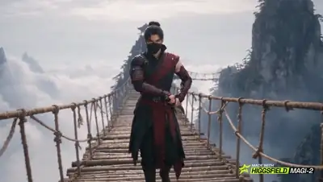</a><br><a href="https://www.sandbase.ai/lab/ai-videos/magi-2/2125493803372986578?utm_source=github&utm_medium=readme&utm_campaign=awesome-magi-2&utm_content=card"><b>High-altitude bridge swordplay and aerial leaps</b></a><br><sub><a href="https://x.com/Dheepanratnam/status/2125493803372986578">@Dheepanratnam</a></sub></td><td width="33%" valign="top"><a href="https://www.sandbase.ai/lab/media/x/magi-2/2125537498659225849/video.mp4">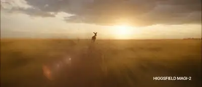</a><br><a href="https://www.sandbase.ai/lab/ai-videos/magi-2/2125537498659225849?utm_source=github&utm_medium=readme&utm_campaign=awesome-magi-2&utm_content=card"><b>A high-speed chase across the African savannah</b></a><br><sub><a href="https://x.com/abulu8/status/2125537498659225849">@abulu8</a> · <a href="https://www.sandbase.ai/lab/ai-videos/magi-2/2125537498659225849?utm_source=github&utm_medium=readme&utm_campaign=awesome-magi-2&utm_content=card">prompt</a></sub></td><td width="33%" valign="top"><a href="https://www.sandbase.ai/lab/media/x/magi-2/2125541311352893643/video.mp4">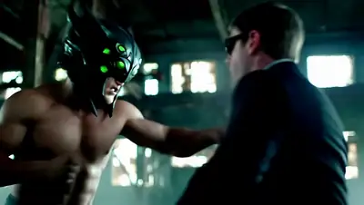</a><br><a href="https://www.sandbase.ai/lab/ai-videos/magi-2/2125541311352893643?utm_source=github&utm_medium=readme&utm_campaign=awesome-magi-2&utm_content=card"><b>Rapid punch rush ending with finishing blow</b></a><br><sub><a href="https://x.com/akazomesirou/status/2125541311352893643">@akazomesirou</a></sub></td></tr>
</table>

<details>
<summary><b>Show all 8</b></summary>

<table>
<tr><td width="33%" valign="top"><a href="https://www.sandbase.ai/lab/media/x/magi-2/2125555019709816858/video.mp4">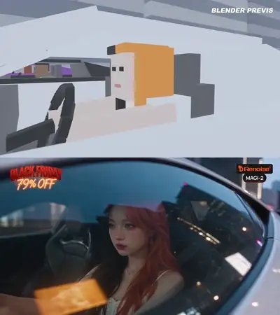</a><br><a href="https://www.sandbase.ai/lab/ai-videos/magi-2/2125555019709816858?utm_source=github&utm_medium=readme&utm_campaign=awesome-magi-2&utm_content=card"><b>Continuous camera shot through three supercars and city</b></a><br><sub><a href="https://x.com/renoiseai/status/2125555019709816858">@renoiseai</a></sub></td><td width="33%" valign="top"><a href="https://www.sandbase.ai/lab/media/x/magi-2/2125560157916524939/video.mp4"></a><br><a href="https://www.sandbase.ai/lab/ai-videos/magi-2/2125560157916524939?utm_source=github&utm_medium=readme&utm_campaign=awesome-magi-2&utm_content=card"><b>One shot video of a fast furry cat</b></a><br><sub><a href="https://x.com/mirochill/status/2125560157916524939">@mirochill</a></sub></td></tr>
</table>

</details>

<a id="ad"></a>

## Ads

<table>
<tr><td width="33%" valign="top"><a href="https://www.sandbase.ai/lab/media/x/magi-2/2125320648679723494/video.mp4">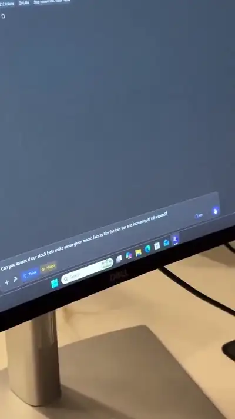</a><br><a href="https://www.sandbase.ai/lab/ai-videos/magi-2/2125320648679723494?utm_source=github&utm_medium=readme&utm_campaign=awesome-magi-2&utm_content=card"><b>Fifty variations of the same video ad</b></a><br><sub><a href="https://x.com/SteticIA/status/2125320648679723494">@SteticIA</a></sub></td><td width="33%" valign="top"><a href="https://www.sandbase.ai/lab/media/x/magi-2/2125445425520083116/video.mp4"></a><br><a href="https://www.sandbase.ai/lab/ai-videos/magi-2/2125445425520083116?utm_source=github&utm_medium=readme&utm_campaign=awesome-magi-2&utm_content=card"><b>A creator style ad for ASICS Gel Nimbus</b></a><br><sub><a href="https://x.com/Sheldon056/status/2125445425520083116">@Sheldon056</a></sub></td><td width="33%" valign="top"><a href="https://www.sandbase.ai/lab/media/x/magi-2/2125526833785614640/video.mp4">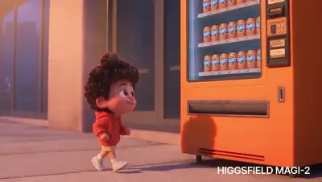</a><br><a href="https://www.sandbase.ai/lab/ai-videos/magi-2/2125526833785614640?utm_source=github&utm_medium=readme&utm_campaign=awesome-magi-2&utm_content=card"><b>A lucky moment with a Fanta drink</b></a><br><sub><a href="https://x.com/Sheldon056/status/2125526833785614640">@Sheldon056</a></sub></td></tr>
<tr><td width="33%" valign="top"><a href="https://www.sandbase.ai/lab/media/x/magi-2/2125557298135245012/video.mp4">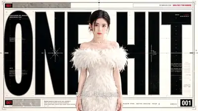</a><br><a href="https://www.sandbase.ai/lab/ai-videos/magi-2/2125557298135245012?utm_source=github&utm_medium=readme&utm_campaign=awesome-magi-2&utm_content=card"><b>A fashion commercial showcasing changing outfits</b></a><br><sub><a href="https://x.com/joshesye/status/2125557298135245012">@joshesye</a> · <a href="https://www.sandbase.ai/lab/ai-videos/magi-2/2125557298135245012?utm_source=github&utm_medium=readme&utm_campaign=awesome-magi-2&utm_content=card">prompt</a></sub></td></tr>
</table>

<a id="comparison"></a>

## Tests & comparisons

<table>
<tr><td width="33%" valign="top"><a href="https://www.sandbase.ai/lab/media/x/magi-2/2125299456316715315/video.mp4">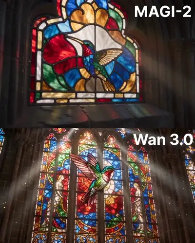</a><br><a href="https://www.sandbase.ai/lab/ai-videos/magi-2/2125299456316715315?utm_source=github&utm_medium=readme&utm_campaign=awesome-magi-2&utm_content=card"><b>Side-by-side comparison of Wan 3.0 and MAGI-2</b></a><br><sub><a href="https://x.com/nicravesh/status/2125299456316715315">@nicravesh</a></sub></td><td width="33%" valign="top"><a href="https://www.sandbase.ai/lab/media/x/magi-2/2125308210081058962/video.mp4"></a><br><a href="https://www.sandbase.ai/lab/ai-videos/magi-2/2125308210081058962?utm_source=github&utm_medium=readme&utm_campaign=awesome-magi-2&utm_content=card"><b>A rotating camera shot through the city</b></a><br><sub><a href="https://x.com/karankendre/status/2125308210081058962">@karankendre</a></sub></td><td width="33%" valign="top"><a href="https://www.sandbase.ai/lab/media/x/magi-2/2125312991549947955/video.mp4"></a><br><a href="https://www.sandbase.ai/lab/ai-videos/magi-2/2125312991549947955?utm_source=github&utm_medium=readme&utm_campaign=awesome-magi-2&utm_content=card"><b>Trying to find flaws in MAGI-2</b></a><br><sub><a href="https://x.com/albacnt/status/2125312991549947955">@albacnt</a></sub></td></tr>
<tr><td width="33%" valign="top"><a href="https://www.sandbase.ai/lab/media/x/magi-2/2125327070548897820/video.mp4"></a><br><a href="https://www.sandbase.ai/lab/ai-videos/magi-2/2125327070548897820?utm_source=github&utm_medium=readme&utm_campaign=awesome-magi-2&utm_content=card"><b>Two characters across two distinct environments</b></a><br><sub><a href="https://x.com/ozansihay/status/2125327070548897820">@ozansihay</a></sub></td><td width="33%" valign="top"><a href="https://www.sandbase.ai/lab/media/x/magi-2/2125333632818827622/video.mp4"></a><br><a href="https://www.sandbase.ai/lab/ai-videos/magi-2/2125333632818827622?utm_source=github&utm_medium=readme&utm_campaign=awesome-magi-2&utm_content=card"><b>Video generation quality test with MAGI-2</b></a><br><sub><a href="https://x.com/AI__TSUBAKI/status/2125333632818827622">@AI__TSUBAKI</a></sub></td><td width="33%" valign="top"><a href="https://www.sandbase.ai/lab/media/x/magi-2/2125342186514301268/video.mp4">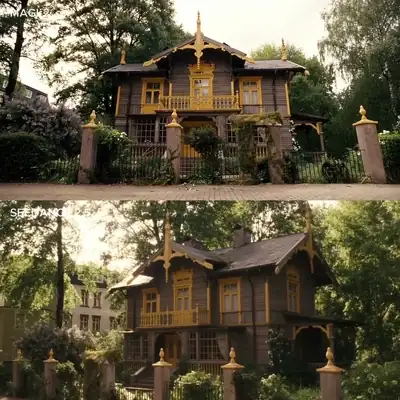</a><br><a href="https://www.sandbase.ai/lab/ai-videos/magi-2/2125342186514301268?utm_source=github&utm_medium=readme&utm_campaign=awesome-magi-2&utm_content=card"><b>Side-by-side comparison of two video models</b></a><br><sub><a href="https://x.com/maxxmalist/status/2125342186514301268">@maxxmalist</a></sub></td></tr>
</table>

<details>
<summary><b>Show all 36</b></summary>

<table>
<tr><td width="33%" valign="top"><a href="https://www.sandbase.ai/lab/media/x/magi-2/2125376901862596749/video.mp4">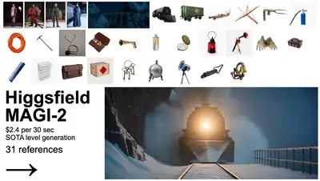</a><br><a href="https://www.sandbase.ai/lab/ai-videos/magi-2/2125376901862596749?utm_source=github&utm_medium=readme&utm_campaign=awesome-magi-2&utm_content=card"><b>Consistent characters and locations from thirty-one reference images</b></a><br><sub><a href="https://x.com/robinstetic/status/2125376901862596749">@robinstetic</a></sub></td><td width="33%" valign="top"><a href="https://www.sandbase.ai/lab/media/x/magi-2/2125386397439996348/video.mp4">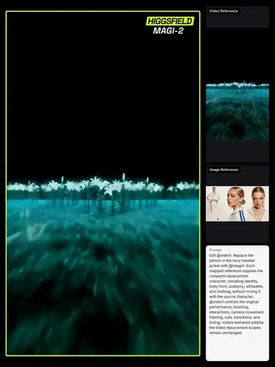</a><br><a href="https://www.sandbase.ai/lab/ai-videos/magi-2/2125386397439996348?utm_source=github&utm_medium=readme&utm_campaign=awesome-magi-2&utm_content=card"><b>Character swap transition preserving original movement</b></a><br><sub><a href="https://x.com/VxRender/status/2125386397439996348">@VxRender</a></sub></td><td width="33%" valign="top"><a href="https://www.sandbase.ai/lab/media/x/magi-2/2125413847783887284/video.mp4">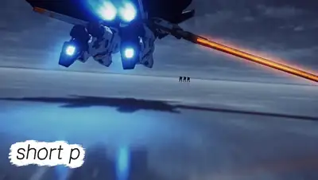</a><br><a href="https://www.sandbase.ai/lab/ai-videos/magi-2/2125413847783887284?utm_source=github&utm_medium=readme&utm_campaign=awesome-magi-2&utm_content=card"><b>Prompt responsiveness and composition test</b></a><br><sub><a href="https://x.com/TechTalkNAVI/status/2125413847783887284">@TechTalkNAVI</a></sub></td></tr>
<tr><td width="33%" valign="top"><a href="https://www.sandbase.ai/lab/media/x/magi-2/2125416761260708023/video.mp4">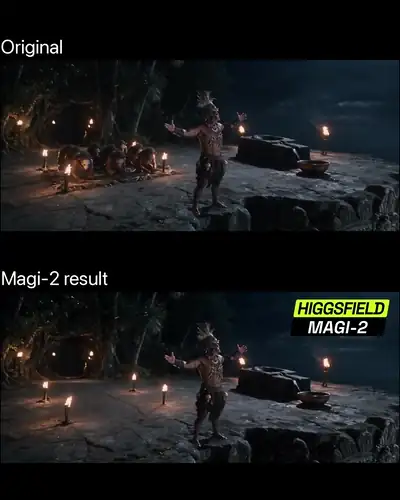</a><br><a href="https://www.sandbase.ai/lab/ai-videos/magi-2/2125416761260708023?utm_source=github&utm_medium=readme&utm_campaign=awesome-magi-2&utm_content=card"><b>Removing background figures behind a character</b></a><br><sub><a href="https://x.com/CHIBIKURO_QnQ/status/2125416761260708023">@CHIBIKURO_QnQ</a></sub></td><td width="33%" valign="top"><a href="https://www.sandbase.ai/lab/media/x/magi-2/2125425240218210510/video.mp4">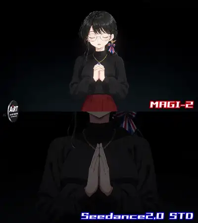</a><br><a href="https://www.sandbase.ai/lab/ai-videos/magi-2/2125425240218210510?utm_source=github&utm_medium=readme&utm_campaign=awesome-magi-2&utm_content=card"><b>Model comparison using identical prompts and references</b></a><br><sub><a href="https://x.com/AutoIntelliMode/status/2125425240218210510">@AutoIntelliMode</a></sub></td><td width="33%" valign="top"><a href="https://www.sandbase.ai/lab/media/x/magi-2/2125427427488989259/video.mp4">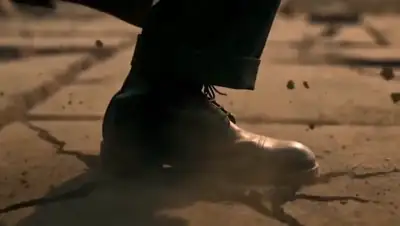</a><br><a href="https://www.sandbase.ai/lab/ai-videos/magi-2/2125427427488989259?utm_source=github&utm_medium=readme&utm_campaign=awesome-magi-2&utm_content=card"><b>Comparison of Seedance 2 and MAGI-2 with martial arts</b></a><br><sub><a href="https://x.com/LIAMSTAI/status/2125427427488989259">@LIAMSTAI</a></sub></td></tr>
<tr><td width="33%" valign="top"><a href="https://www.sandbase.ai/lab/media/x/magi-2/2125431625991524398/video.mp4"></a><br><a href="https://www.sandbase.ai/lab/ai-videos/magi-2/2125431625991524398?utm_source=github&utm_medium=readme&utm_campaign=awesome-magi-2&utm_content=card"><b>Multi angle camera test with outfit transition</b></a><br><sub><a href="https://x.com/TanLuAI/status/2125431625991524398">@TanLuAI</a></sub></td><td width="33%" valign="top"><a href="https://www.sandbase.ai/lab/media/x/magi-2/2125448095991464044/video.mp4">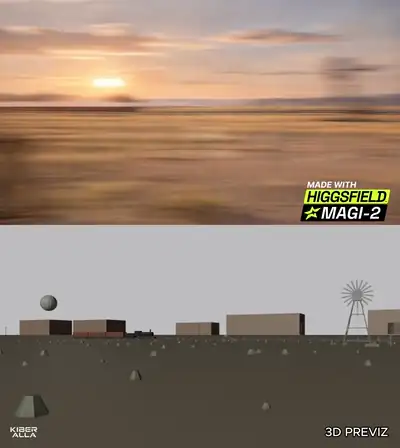</a><br><a href="https://www.sandbase.ai/lab/ai-videos/magi-2/2125448095991464044?utm_source=github&utm_medium=readme&utm_campaign=awesome-magi-2&utm_content=card"><b>A 3D previz blocking and generated video</b></a><br><sub><a href="https://x.com/Kiber_Alla/status/2125448095991464044">@Kiber_Alla</a></sub></td><td width="33%" valign="top"><a href="https://www.sandbase.ai/lab/media/x/magi-2/2125450088411758854/video.mp4"></a><br><a href="https://www.sandbase.ai/lab/ai-videos/magi-2/2125450088411758854?utm_source=github&utm_medium=readme&utm_campaign=awesome-magi-2&utm_content=card"><b>Shanghai university students wearing school uniforms</b></a><br><sub><a href="https://x.com/caravfxaigc/status/2125450088411758854">@caravfxaigc</a></sub></td></tr>
<tr><td width="33%" valign="top"><a href="https://www.sandbase.ai/lab/media/x/magi-2/2125480141241622629/video.mp4">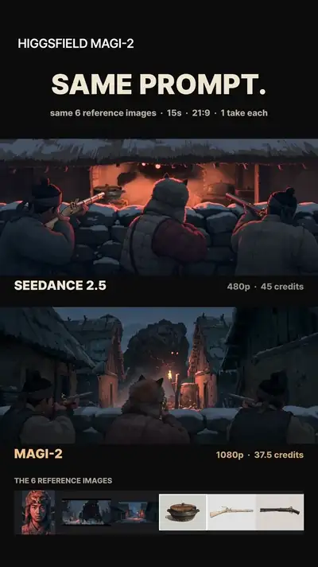</a><br><a href="https://www.sandbase.ai/lab/ai-videos/magi-2/2125480141241622629?utm_source=github&utm_medium=readme&utm_campaign=awesome-magi-2&utm_content=card"><b>Side by side comparison of Seedance and MAGI-2</b></a><br><sub><a href="https://x.com/hype_boyo/status/2125480141241622629">@hype_boyo</a></sub></td><td width="33%" valign="top"><a href="https://www.sandbase.ai/lab/media/x/magi-2/2125480417847353448/video.mp4"></a><br><a href="https://www.sandbase.ai/lab/ai-videos/magi-2/2125480417847353448?utm_source=github&utm_medium=readme&utm_campaign=awesome-magi-2&utm_content=card"><b>Text to video test featuring actor Huang Xuan</b></a><br><sub><a href="https://x.com/johnAGI168/status/2125480417847353448">@johnAGI168</a> · <a href="https://www.sandbase.ai/lab/ai-videos/magi-2/2125480417847353448?utm_source=github&utm_medium=readme&utm_campaign=awesome-magi-2&utm_content=card">prompt</a></sub></td><td width="33%" valign="top"><a href="https://www.sandbase.ai/lab/media/x/magi-2/2125490344548880712/video.mp4"></a><br><a href="https://www.sandbase.ai/lab/ai-videos/magi-2/2125490344548880712?utm_source=github&utm_medium=readme&utm_campaign=awesome-magi-2&utm_content=card"><b>Dusk atmosphere and lighting consistency test</b></a><br><sub><a href="https://x.com/Arvin010717/status/2125490344548880712">@Arvin010717</a></sub></td></tr>
<tr><td width="33%" valign="top"><a href="https://www.sandbase.ai/lab/media/x/magi-2/2125491702081429591/video.mp4"></a><br><a href="https://www.sandbase.ai/lab/ai-videos/magi-2/2125491702081429591?utm_source=github&utm_medium=readme&utm_campaign=awesome-magi-2&utm_content=card"><b>Comparison between MAGI-2 and Seedance 2.5</b></a><br><sub><a href="https://x.com/xuzzio/status/2125491702081429591">@xuzzio</a></sub></td><td width="33%" valign="top"><a href="https://www.sandbase.ai/lab/media/x/magi-2/2125506931460874329/video.mp4">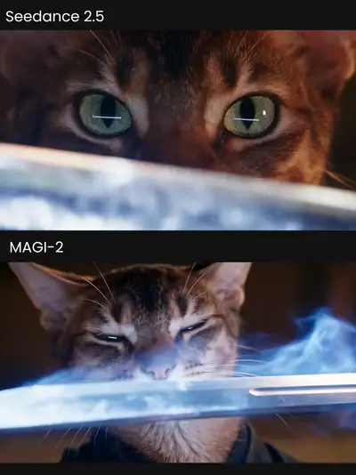</a><br><a href="https://www.sandbase.ai/lab/ai-videos/magi-2/2125506931460874329?utm_source=github&utm_medium=readme&utm_campaign=awesome-magi-2&utm_content=card"><b>Fight scene comparison between MAGI-2 and Seedance</b></a><br><sub><a href="https://x.com/caravfxaigc/status/2125506931460874329">@caravfxaigc</a></sub></td><td width="33%" valign="top"><a href="https://www.sandbase.ai/lab/media/x/magi-2/2125509495296340424/video.mp4">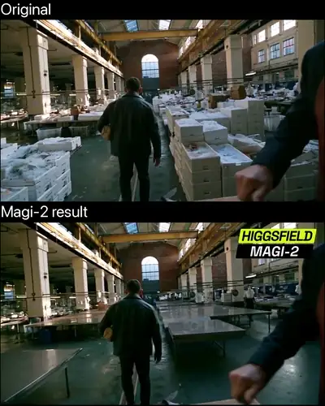</a><br><a href="https://www.sandbase.ai/lab/ai-videos/magi-2/2125509495296340424?utm_source=github&utm_medium=readme&utm_campaign=awesome-magi-2&utm_content=card"><b>Removing crates from real footage with MAGI-2</b></a><br><sub><a href="https://x.com/vert_ink/status/2125509495296340424">@vert_ink</a></sub></td></tr>
<tr><td width="33%" valign="top"><a href="https://www.sandbase.ai/lab/media/x/magi-2/2125513487967539581/video.mp4">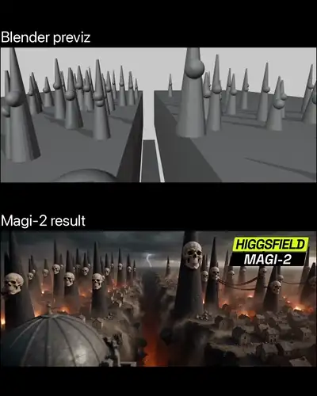</a><br><a href="https://www.sandbase.ai/lab/ai-videos/magi-2/2125513487967539581?utm_source=github&utm_medium=readme&utm_campaign=awesome-magi-2&utm_content=card"><b>Animation generated from a Blender previz model</b></a><br><sub><a href="https://x.com/KT_first_story/status/2125513487967539581">@KT_first_story</a></sub></td><td width="33%" valign="top"><a href="https://www.sandbase.ai/lab/media/x/magi-2/2125514831092699490/video.mp4">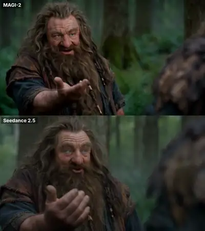</a><br><a href="https://www.sandbase.ai/lab/ai-videos/magi-2/2125514831092699490?utm_source=github&utm_medium=readme&utm_campaign=awesome-magi-2&utm_content=card"><b>Comparison between MAGI-2 and Seedance 2.5</b></a><br><sub><a href="https://x.com/AibeginnerR8/status/2125514831092699490">@AibeginnerR8</a></sub></td><td width="33%" valign="top"><a href="https://www.sandbase.ai/lab/media/x/magi-2/2125518990554382581/video.mp4"></a><br><a href="https://www.sandbase.ai/lab/ai-videos/magi-2/2125518990554382581?utm_source=github&utm_medium=readme&utm_campaign=awesome-magi-2&utm_content=card"><b>Shadow boxing motion test comparison</b></a><br><sub><a href="https://x.com/FrenchTechnical/status/2125518990554382581">@FrenchTechnical</a></sub></td></tr>
<tr><td width="33%" valign="top"><a href="https://www.sandbase.ai/lab/media/x/magi-2/2125519033160360126/video.mp4">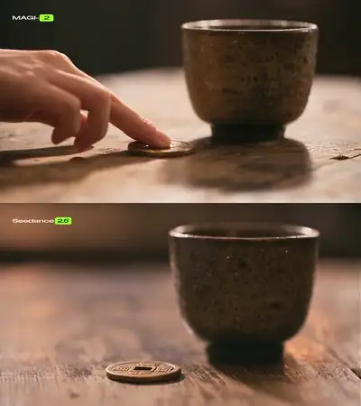</a><br><a href="https://www.sandbase.ai/lab/ai-videos/magi-2/2125519033160360126?utm_source=github&utm_medium=readme&utm_campaign=awesome-magi-2&utm_content=card"><b>Video generation comparison between Seedance and MAGI-2</b></a><br><sub><a href="https://x.com/Zyz250600461/status/2125519033160360126">@Zyz250600461</a></sub></td><td width="33%" valign="top"><a href="https://www.sandbase.ai/lab/media/x/magi-2/2125519521427681660/video.mp4"></a><br><a href="https://www.sandbase.ai/lab/ai-videos/magi-2/2125519521427681660?utm_source=github&utm_medium=readme&utm_campaign=awesome-magi-2&utm_content=card"><b>Video to video camera transition comparison</b></a><br><sub><a href="https://x.com/johnAGI168/status/2125519521427681660">@johnAGI168</a></sub></td><td width="33%" valign="top"><a href="https://www.sandbase.ai/lab/media/x/magi-2/2125535227250618548/video.mp4"></a><br><a href="https://www.sandbase.ai/lab/ai-videos/magi-2/2125535227250618548?utm_source=github&utm_medium=readme&utm_campaign=awesome-magi-2&utm_content=card"><b>Comparison between MAGI-2 and Seedance</b></a><br><sub><a href="https://x.com/Gorden_Sun/status/2125535227250618548">@Gorden_Sun</a></sub></td></tr>
<tr><td width="33%" valign="top"><a href="https://www.sandbase.ai/lab/media/x/magi-2/2125536244444848627/video.mp4">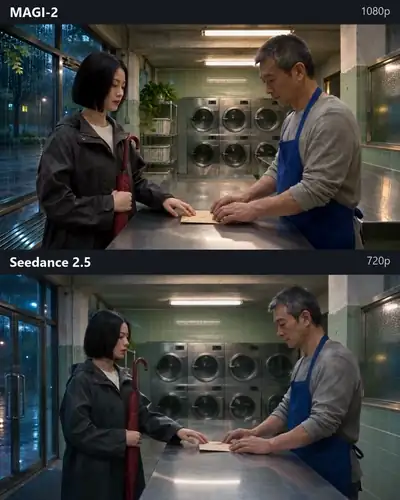</a><br><a href="https://www.sandbase.ai/lab/ai-videos/magi-2/2125536244444848627?utm_source=github&utm_medium=readme&utm_campaign=awesome-magi-2&utm_content=card"><b>Side by side video comparison with Seedance</b></a><br><sub><a href="https://x.com/DDJCXX/status/2125536244444848627">@DDJCXX</a></sub></td><td width="33%" valign="top"><a href="https://www.sandbase.ai/lab/media/x/magi-2/2125554952777216498/video.mp4">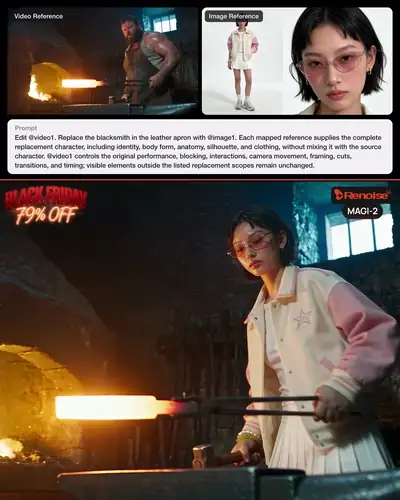</a><br><a href="https://www.sandbase.ai/lab/ai-videos/magi-2/2125554952777216498?utm_source=github&utm_medium=readme&utm_campaign=awesome-magi-2&utm_content=card"><b>Character swap of a blacksmith in a forge</b></a><br><sub><a href="https://x.com/renoiseai/status/2125554952777216498">@renoiseai</a></sub></td><td width="33%" valign="top"><a href="https://www.sandbase.ai/lab/media/x/magi-2/2125563502521889155/video.mp4">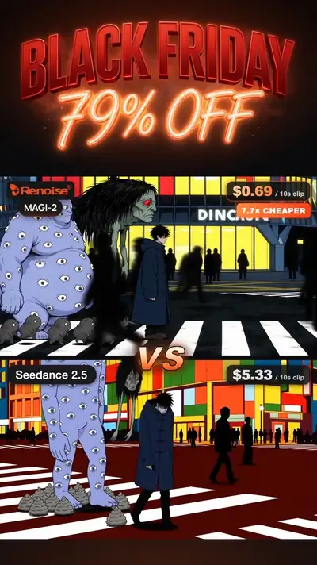</a><br><a href="https://www.sandbase.ai/lab/ai-videos/magi-2/2125563502521889155?utm_source=github&utm_medium=readme&utm_campaign=awesome-magi-2&utm_content=card"><b>Unseen monsters in Shibuya late at night</b></a><br><sub><a href="https://x.com/renoiseai/status/2125563502521889155">@renoiseai</a></sub></td></tr>
<tr><td width="33%" valign="top"><a href="https://www.sandbase.ai/lab/media/x/magi-2/2125563788841931136/video.mp4">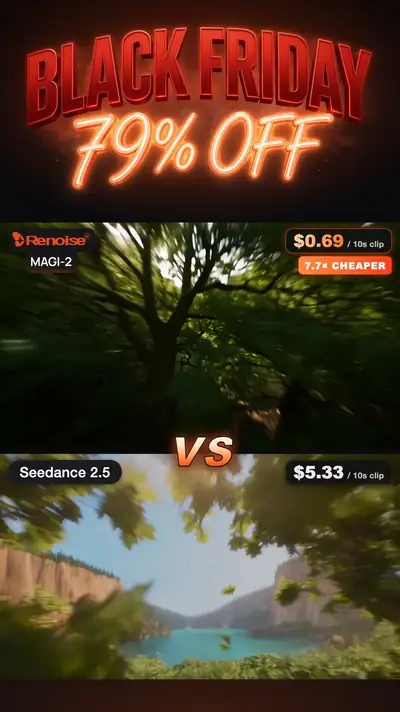</a><br><a href="https://www.sandbase.ai/lab/ai-videos/magi-2/2125563788841931136?utm_source=github&utm_medium=readme&utm_campaign=awesome-magi-2&utm_content=card"><b>Continuous flight through nature to a waterfall</b></a><br><sub><a href="https://x.com/renoiseai/status/2125563788841931136">@renoiseai</a></sub></td><td width="33%" valign="top"><a href="https://www.sandbase.ai/lab/media/x/magi-2/2125565381180117363/video.mp4"></a><br><a href="https://www.sandbase.ai/lab/ai-videos/magi-2/2125565381180117363?utm_source=github&utm_medium=readme&utm_campaign=awesome-magi-2&utm_content=card"><b>Testing physics and texture quality in MAGI-2</b></a><br><sub><a href="https://x.com/gillesguerraz/status/2125565381180117363">@gillesguerraz</a></sub></td><td width="33%" valign="top"><a href="https://www.sandbase.ai/lab/media/x/magi-2/2125573645942870347/video.mp4"></a><br><a href="https://www.sandbase.ai/lab/ai-videos/magi-2/2125573645942870347?utm_source=github&utm_medium=readme&utm_campaign=awesome-magi-2&utm_content=card"><b>Side-by-side comparison of Seedance and MAGI-2</b></a><br><sub><a href="https://x.com/JSFILMZ0412/status/2125573645942870347">@JSFILMZ0412</a></sub></td></tr>
<tr><td width="33%" valign="top"><a href="https://www.sandbase.ai/lab/media/x/magi-2/2125574249859699095/video.mp4"></a><br><a href="https://www.sandbase.ai/lab/ai-videos/magi-2/2125574249859699095?utm_source=github&utm_medium=readme&utm_campaign=awesome-magi-2&utm_content=card"><b>Comparison between MAGI-2 and Seedance 2.5</b></a><br><sub><a href="https://x.com/VibeEverything/status/2125574249859699095">@VibeEverything</a></sub></td><td width="33%" valign="top"><a href="https://www.sandbase.ai/lab/media/x/magi-2/2125576031352623274/video.mp4"></a><br><a href="https://www.sandbase.ai/lab/ai-videos/magi-2/2125576031352623274?utm_source=github&utm_medium=readme&utm_campaign=awesome-magi-2&utm_content=card"><b>Prompt test using MAGI-2 on WaveSpeed</b></a><br><sub><a href="https://x.com/PhotogenicWeekE/status/2125576031352623274">@PhotogenicWeekE</a></sub></td><td width="33%" valign="top"><a href="https://www.sandbase.ai/lab/media/x/magi-2/2125578530272821680/video.mp4"></a><br><a href="https://www.sandbase.ai/lab/ai-videos/magi-2/2125578530272821680?utm_source=github&utm_medium=readme&utm_campaign=awesome-magi-2&utm_content=card"><b>Image to video test of human skin texture</b></a><br><sub><a href="https://x.com/johnAGI168/status/2125578530272821680">@johnAGI168</a> · <a href="https://www.sandbase.ai/lab/ai-videos/magi-2/2125578530272821680?utm_source=github&utm_medium=readme&utm_campaign=awesome-magi-2&utm_content=card">prompt</a></sub></td></tr>
</table>

</details>

<a id="showcase"></a>

## Model showcases

<table>
<tr><td width="33%" valign="top"><a href="https://www.sandbase.ai/lab/media/x/magi-2/2125311652274778201/video.mp4"></a><br><a href="https://www.sandbase.ai/lab/ai-videos/magi-2/2125311652274778201?utm_source=github&utm_medium=readme&utm_campaign=awesome-magi-2&utm_content=card"><b>Affordable AI video generation demo with MAGI-2</b></a><br><sub><a href="https://x.com/cesargomz29/status/2125311652274778201">@cesargomz29</a></sub></td><td width="33%" valign="top"><a href="https://www.sandbase.ai/lab/media/x/magi-2/2125316971034259573/video.mp4"></a><br><a href="https://www.sandbase.ai/lab/ai-videos/magi-2/2125316971034259573?utm_source=github&utm_medium=readme&utm_campaign=awesome-magi-2&utm_content=card"><b>Old video tools reacting to MAGI-2 launch</b></a><br><sub><a href="https://x.com/kevindatas/status/2125316971034259573">@kevindatas</a></sub></td><td width="33%" valign="top"><a href="https://www.sandbase.ai/lab/media/x/magi-2/2125372572170908050/video.mp4"></a><br><a href="https://www.sandbase.ai/lab/ai-videos/magi-2/2125372572170908050?utm_source=github&utm_medium=readme&utm_campaign=awesome-magi-2&utm_content=card"><b>A Japanese chef sharpening a knife</b></a><br><sub><a href="https://x.com/gkxspace/status/2125372572170908050">@gkxspace</a></sub></td></tr>
<tr><td width="33%" valign="top"><a href="https://www.sandbase.ai/lab/media/x/magi-2/2125376166504575454/video.mp4"></a><br><a href="https://www.sandbase.ai/lab/ai-videos/magi-2/2125376166504575454?utm_source=github&utm_medium=readme&utm_campaign=awesome-magi-2&utm_content=card"><b>Generating a scene from a 3D layout</b></a><br><sub><a href="https://x.com/biabuilds/status/2125376166504575454">@biabuilds</a></sub></td><td width="33%" valign="top"><a href="https://www.sandbase.ai/lab/media/x/magi-2/2125384722159411357/video.mp4"></a><br><a href="https://www.sandbase.ai/lab/ai-videos/magi-2/2125384722159411357?utm_source=github&utm_medium=readme&utm_campaign=awesome-magi-2&utm_content=card"><b>MAGI-2 video model release showcase</b></a><br><sub><a href="https://x.com/BubbleBrain/status/2125384722159411357">@BubbleBrain</a> · <a href="https://www.sandbase.ai/lab/ai-videos/magi-2/2125384722159411357?utm_source=github&utm_medium=readme&utm_campaign=awesome-magi-2&utm_content=card">prompt</a></sub></td><td width="33%" valign="top"><a href="https://www.sandbase.ai/lab/media/x/magi-2/2125385739743748338/video.mp4"></a><br><a href="https://www.sandbase.ai/lab/ai-videos/magi-2/2125385739743748338?utm_source=github&utm_medium=readme&utm_campaign=awesome-magi-2&utm_content=card"><b>High dynamic range video output test</b></a><br><sub><a href="https://x.com/groovestreetgen/status/2125385739743748338">@groovestreetgen</a></sub></td></tr>
</table>

<details>
<summary><b>Show all 25</b></summary>

<table>
<tr><td width="33%" valign="top"><a href="https://www.sandbase.ai/lab/media/x/magi-2/2125395738154905901/video.mp4"></a><br><a href="https://www.sandbase.ai/lab/ai-videos/magi-2/2125395738154905901?utm_source=github&utm_medium=readme&utm_campaign=awesome-magi-2&utm_content=card"><b>A 1080p test video generated with MAGI-2</b></a><br><sub><a href="https://x.com/EEJ_OOXO/status/2125395738154905901">@EEJ_OOXO</a></sub></td><td width="33%" valign="top"><a href="https://www.sandbase.ai/lab/media/x/magi-2/2125403257191166078/video.mp4"></a><br><a href="https://www.sandbase.ai/lab/ai-videos/magi-2/2125403257191166078?utm_source=github&utm_medium=readme&utm_campaign=awesome-magi-2&utm_content=card"><b>Camera movement and character consistency demonstration</b></a><br><sub><a href="https://x.com/YapayZekaSerisi/status/2125403257191166078">@YapayZekaSerisi</a></sub></td><td width="33%" valign="top"><a href="https://www.sandbase.ai/lab/media/x/magi-2/2125413926360002756/video.mp4"></a><br><a href="https://www.sandbase.ai/lab/ai-videos/magi-2/2125413926360002756?utm_source=github&utm_medium=readme&utm_campaign=awesome-magi-2&utm_content=card"><b>Static silhouette brought to life from single image</b></a><br><sub><a href="https://x.com/xc5_/status/2125413926360002756">@xc5_</a></sub></td></tr>
<tr><td width="33%" valign="top"><a href="https://www.sandbase.ai/lab/media/x/magi-2/2125420811360350469/video.mp4"></a><br><a href="https://www.sandbase.ai/lab/ai-videos/magi-2/2125420811360350469?utm_source=github&utm_medium=readme&utm_campaign=awesome-magi-2&utm_content=card"><b>Character flight scene generated from a 3D previz</b></a><br><sub><a href="https://x.com/KanaWorks_AI/status/2125420811360350469">@KanaWorks_AI</a></sub></td><td width="33%" valign="top"><a href="https://www.sandbase.ai/lab/media/x/magi-2/2125462868942524875/video.mp4"></a><br><a href="https://www.sandbase.ai/lab/ai-videos/magi-2/2125462868942524875?utm_source=github&utm_medium=readme&utm_campaign=awesome-magi-2&utm_content=card"><b>Removing a title logo over starry background</b></a><br><sub><a href="https://x.com/TechTalkNAVI/status/2125462868942524875">@TechTalkNAVI</a></sub></td><td width="33%" valign="top"><a href="https://www.sandbase.ai/lab/media/x/magi-2/2125467884772073900/video.mp4"></a><br><a href="https://www.sandbase.ai/lab/ai-videos/magi-2/2125467884772073900?utm_source=github&utm_medium=readme&utm_campaign=awesome-magi-2&utm_content=card"><b>Motion and spatial acceleration test in MAGI-2</b></a><br><sub><a href="https://x.com/HexxRL/status/2125467884772073900">@HexxRL</a></sub></td></tr>
<tr><td width="33%" valign="top"><a href="https://www.sandbase.ai/lab/media/x/magi-2/2125471804252930227/video.mp4"></a><br><a href="https://www.sandbase.ai/lab/ai-videos/magi-2/2125471804252930227?utm_source=github&utm_medium=readme&utm_campaign=awesome-magi-2&utm_content=card"><b>The impossible pink balloon chaos</b></a><br><sub><a href="https://x.com/AIwithSynthia/status/2125471804252930227">@AIwithSynthia</a></sub></td><td width="33%" valign="top"><a href="https://www.sandbase.ai/lab/media/x/magi-2/2125475667513123047/video.mp4"></a><br><a href="https://www.sandbase.ai/lab/ai-videos/magi-2/2125475667513123047?utm_source=github&utm_medium=readme&utm_campaign=awesome-magi-2&utm_content=card"><b>Eight different emotions shown in a single shot</b></a><br><sub><a href="https://x.com/Nishit_alt/status/2125475667513123047">@Nishit_alt</a></sub></td><td width="33%" valign="top"><a href="https://www.sandbase.ai/lab/media/x/magi-2/2125483710472389041/video.mp4"></a><br><a href="https://www.sandbase.ai/lab/ai-videos/magi-2/2125483710472389041?utm_source=github&utm_medium=readme&utm_campaign=awesome-magi-2&utm_content=card"><b>Continuous scene with character consistency and camera motion</b></a><br><sub><a href="https://x.com/Hacknaut/status/2125483710472389041">@Hacknaut</a></sub></td></tr>
<tr><td width="33%" valign="top"><a href="https://www.sandbase.ai/lab/media/x/magi-2/2125485914583650669/video.mp4"></a><br><a href="https://www.sandbase.ai/lab/ai-videos/magi-2/2125485914583650669?utm_source=github&utm_medium=readme&utm_campaign=awesome-magi-2&utm_content=card"><b>A video titled Kindness</b></a><br><sub><a href="https://x.com/keneth_ai/status/2125485914583650669">@keneth_ai</a></sub></td><td width="33%" valign="top"><a href="https://www.sandbase.ai/lab/media/x/magi-2/2125514443706519673/video.mp4"></a><br><a href="https://www.sandbase.ai/lab/ai-videos/magi-2/2125514443706519673?utm_source=github&utm_medium=readme&utm_campaign=awesome-magi-2&utm_content=card"><b>A thirty second test clip generated with MAGI-2</b></a><br><sub><a href="https://x.com/maxescu/status/2125514443706519673">@maxescu</a></sub></td><td width="33%" valign="top"><a href="https://www.sandbase.ai/lab/media/x/magi-2/2125531570622828617/video.mp4"></a><br><a href="https://www.sandbase.ai/lab/ai-videos/magi-2/2125531570622828617?utm_source=github&utm_medium=readme&utm_campaign=awesome-magi-2&utm_content=card"><b>Code to video and video to code demonstration</b></a><br><sub><a href="https://x.com/op7418/status/2125531570622828617">@op7418</a></sub></td></tr>
<tr><td width="33%" valign="top"><a href="https://www.sandbase.ai/lab/media/x/magi-2/2125540673411846150/video.mp4"></a><br><a href="https://www.sandbase.ai/lab/ai-videos/magi-2/2125540673411846150?utm_source=github&utm_medium=readme&utm_campaign=awesome-magi-2&utm_content=card"><b>First video generation test using MAGI-2</b></a><br><sub><a href="https://x.com/notjazii/status/2125540673411846150">@notjazii</a></sub></td><td width="33%" valign="top"><a href="https://www.sandbase.ai/lab/media/x/magi-2/2125545266262749194/video.mp4"></a><br><a href="https://www.sandbase.ai/lab/ai-videos/magi-2/2125545266262749194?utm_source=github&utm_medium=readme&utm_campaign=awesome-magi-2&utm_content=card"><b>Character generation from a single character sheet</b></a><br><sub><a href="https://x.com/Mayz1169/status/2125545266262749194">@Mayz1169</a></sub></td><td width="33%" valign="top"><a href="https://www.sandbase.ai/lab/media/x/magi-2/2125546518979678392/video.mp4"></a><br><a href="https://www.sandbase.ai/lab/ai-videos/magi-2/2125546518979678392?utm_source=github&utm_medium=readme&utm_campaign=awesome-magi-2&utm_content=card"><b>A test generation using MAGI-2 on Higgsfield</b></a><br><sub><a href="https://x.com/AppsAndFlows/status/2125546518979678392">@AppsAndFlows</a></sub></td></tr>
<tr><td width="33%" valign="top"><a href="https://www.sandbase.ai/lab/media/x/magi-2/2125562954020216989/video.mp4"></a><br><a href="https://www.sandbase.ai/lab/ai-videos/magi-2/2125562954020216989?utm_source=github&utm_medium=readme&utm_campaign=awesome-magi-2&utm_content=card"><b>Character swapping with identical motion for twin video</b></a><br><sub><a href="https://x.com/kaedehimemiya/status/2125562954020216989">@kaedehimemiya</a></sub></td><td width="33%" valign="top"><a href="https://www.sandbase.ai/lab/media/x/magi-2/2125592808845345017/video.mp4"></a><br><a href="https://www.sandbase.ai/lab/ai-videos/magi-2/2125592808845345017?utm_source=github&utm_medium=readme&utm_campaign=awesome-magi-2&utm_content=card"><b>An AI video generated using MAGI-2</b></a><br><sub><a href="https://x.com/EHuanglu/status/2125592808845345017">@EHuanglu</a></sub></td><td width="33%" valign="top"><a href="https://www.sandbase.ai/lab/media/x/magi-2/2125595504130363603/video.mp4"></a><br><a href="https://www.sandbase.ai/lab/ai-videos/magi-2/2125595504130363603?utm_source=github&utm_medium=readme&utm_campaign=awesome-magi-2&utm_content=card"><b>Visual experiment combining niji 8 and MAGI-2</b></a><br><sub><a href="https://x.com/Iancu_ai/status/2125595504130363603">@Iancu_ai</a></sub></td></tr>
<tr><td width="33%" valign="top"><a href="https://www.sandbase.ai/lab/media/x/magi-2/2125596457604444568/video.mp4"></a><br><a href="https://www.sandbase.ai/lab/ai-videos/magi-2/2125596457604444568?utm_source=github&utm_medium=readme&utm_campaign=awesome-magi-2&utm_content=card"><b>Capability testing of MAGI-2 video generation</b></a><br><sub><a href="https://x.com/Kiber_Alla/status/2125596457604444568">@Kiber_Alla</a> · <a href="https://www.sandbase.ai/lab/ai-videos/magi-2/2125596457604444568?utm_source=github&utm_medium=readme&utm_campaign=awesome-magi-2&utm_content=card">prompt</a></sub></td></tr>
</table>

</details>

**[See all 115 on SandBase Lab →](https://www.sandbase.ai/lab/ai-videos/magi-2?utm_source=github&utm_medium=readme&utm_campaign=awesome-magi-2&utm_content=section)**

<a id="recreate"></a>

## Make a video with MAGI-2

Every video page on [SandBase Lab](https://www.sandbase.ai/lab/ai-videos/magi-2?utm_source=github&utm_medium=readme&utm_campaign=awesome-magi-2&utm_content=recreate) links to the original X post and, when the creator shared one, the prompt.

On SandBase, MAGI-2 is `sandai/magi-2/text-to-video`. Create a key in the [console](https://www.sandbase.ai/console/keys?utm_source=github&utm_medium=readme&utm_campaign=awesome-magi-2) and export it as `SANDBASE_API_KEY`, put `{"prompt": "…", "duration": 5}` in `prompt.json`, and run:

```bash
npx -y @sandbaseai/cli@latest run sandbase_sandai_magi_2_text_to_video -f prompt.json -w -o result.json
```

`-w` waits for the clip and `result.json` holds its URL. Full walkthrough: [tutorial](docs/tutorial.md). Pricing: [model page](https://www.sandbase.ai/model/sandai/magi-2/text-to-video?utm_source=github&utm_medium=readme&utm_campaign=awesome-magi-2).

<a id="faq"></a>

## FAQ

### What is MAGI-2?

MAGI-2 is the video model from Sand.ai, announced on November 24, 2026. On SandBase it is `sandai/magi-2/text-to-video`. The list price is 0.08 per second of duration, so a default 5-second clip is 0.40. Source: `sandbase inspect sandai/magi-2/text-to-video`.

### How are these MAGI-2 videos made?

The clips are video output, and each card is a finished piece from the creator's post. Five of the ten posts that shared a prompt name Higgsfield, and all five carry the #HiggsfieldPartner tag. Other posts only say they used MAGI-2. Each card links to the creator's original post.

### Where do I find the prompt for a video?

Videos tagged **prompt** come with the creator's prompt on their Lab page. The [prompt index](docs/prompts.md) lists all of them.

### How do I write a good MAGI-2 prompt?

Describe one shot or one sequence in plain terms: the format and style, the subject, the camera and the timing. Several posts state rules explicitly: one continuous take with no cuts, no reversed motion, or a timed shot list. Details and a template: [prompt guide](docs/prompt-guide.md).

### How do I use the MAGI-2 API?

On SandBase the model id is `sandai/magi-2/text-to-video`. Run it with the SandBase CLI, as in [Make a video](#make-a-video-with-magi-2); `sandbase inspect` lists the input fields. See the [model page](https://www.sandbase.ai/model/sandai/magi-2/text-to-video?utm_source=github&utm_medium=readme&utm_campaign=awesome-magi-2).

### Is MAGI-2 better than Seedance 2.5 or other video models?

Nothing is measured yet: this list has no Lab measurement of MAGI-2. One creator's own test found 1080p much cheaper than Seedance 2.5 and not far from Seedance 2.5 at 480p, with no figures given. Another found real-person skin in an image-to-video test less natural. Details and what is still unknown: [model comparison](docs/model-comparison.md).

### How much does one video cost?

The list price is 0.40 for a default 5-second clip, at 0.08 per second of duration (SandBase inspect). The creator posts in this list do not state what they paid, so no creator-reported cost range is given yet.

### Can I reuse these videos?

No, not by default. They belong to their creators. See [MEDIA-RIGHTS](MEDIA-RIGHTS.md).

<a id="contribute"></a>

## Suggest a video

Know a MAGI-2 creation that should be here? [Open a submission](https://github.com/sandbase-lab/awesome-magi-2/issues/new?template=submit-video.yml) with the original X post. Accepted posts are added on SandBase Lab and show up here on the next daily sync. If this list helped you, a ⭐ helps others find it.

## Credits & rights

Every video, prompt and post belongs to its creator. Cards credit the author and link to the original post. The MIT license covers this repository's scripts only. To correct a credit or remove a video, see [MEDIA-RIGHTS](MEDIA-RIGHTS.md).

Not affiliated with or endorsed by Sand.ai.

---

Maintained by [SandBase Lab](https://www.sandbase.ai/lab/?utm_source=github&utm_medium=readme&utm_campaign=awesome-magi-2) · [All AI video collections](https://www.sandbase.ai/lab/ai-videos?utm_source=github&utm_medium=readme&utm_campaign=awesome-magi-2)
