# Awesome MAGI-2

[English](README.md) · 简体中文

[](https://awesome.re) [](#contents) [](docs/zh-CN/prompts.md) [](https://github.com/sandbase-lab/awesome-magi-2/actions/workflows/sync.yml) [](https://www.sandbase.ai/model/sandai/magi-2/text-to-video?utm_source=github&utm_medium=readme&utm_campaign=awesome-magi-2)

[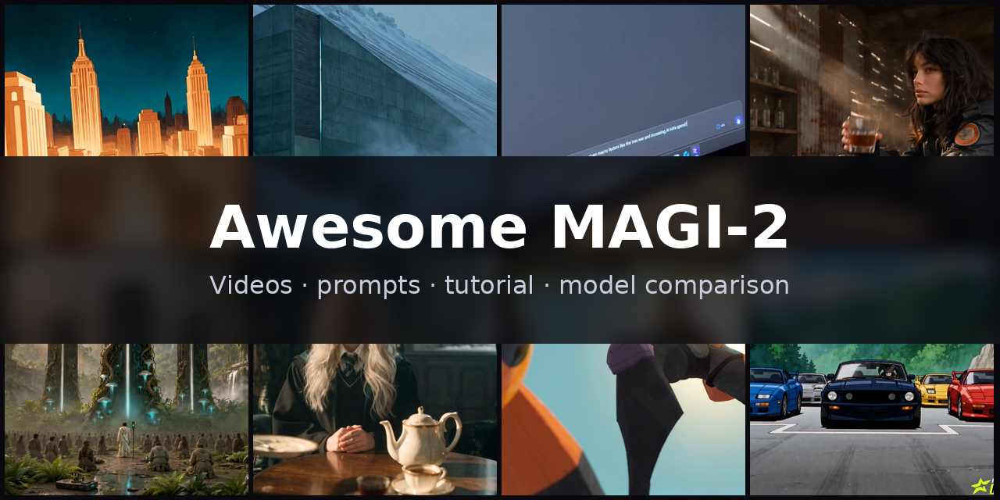](https://www.sandbase.ai/lab/ai-videos/magi-2?lang=zh-CN&utm_source=github&utm_medium=readme&utm_campaign=awesome-magi-2&utm_content=banner)

精选 **MAGI-2 案例**合集：用 Sand.ai 的视频模型 MAGI-2 做出的视频、提示词和片段，2026 年 11 月 24 日发布。包括动画、短片、动作、音乐视频、广告和模型展示，每条都注明作者并链接原帖，作者公开提示词的一并列出。

共 **398 条视频**，来自 **226 位创作者** · **73 条**附作者提示词 · 每天从 [SandBase Lab](https://www.sandbase.ai/lab/ai-videos/magi-2?lang=zh-CN&utm_source=github&utm_medium=readme&utm_campaign=awesome-magi-2&utm_content=stats) 同步

## 从这里开始

| 我想… | 去这里 |
|---|---|
| 看视频 | 在下方 [按分类浏览](#contents)，或 [在 SandBase Lab 大屏播放](https://www.sandbase.ai/lab/ai-videos/magi-2?lang=zh-CN&utm_source=github&utm_medium=readme&utm_campaign=awesome-magi-2&utm_content=quickstart) |
| 复制提示词 | [提示词索引](docs/zh-CN/prompts.md)：所有附带提示词的视频 |
| 自己写提示词 | [提示词写法](docs/zh-CN/prompt-guide.md)：7 条写法和一个填空模板 |
| 做一个视频 | [教程](docs/zh-CN/tutorial.md)：提示词 → 视频片段，含 SandBase CLI 调用 |
| 了解证据 | [MAGI-2 模型对比](docs/zh-CN/model-comparison.md)：哪些是实测，哪些是创作者报告 |
| 马上试试 | [在 Lab 竞技场运行 MAGI-2](https://www.sandbase.ai/arena/text-to-video?models=sandai%2Fmagi-2%2Ftext-to-video&lang=zh-CN&utm_source=github&utm_medium=readme&utm_campaign=awesome-magi-2&utm_content=quickstart)，和其他模型并排对比 |

<a id="contents"></a>

## 目录

- [精选](#featured) (8)
- [短片](#short-film) (129)
- [音乐视频](#music-video) (5)
- [动画](#anime) (61)
- [动作](#action) (39)
- [广告](#ad) (11)
- [测试对比](#comparison) (73)
- [模型展示](#showcase) (80)
- [用 MAGI-2 做视频](#recreate)
- [常见问题](#faq)
- [推荐作品](#contribute)

点击预览图播放视频；点击标题前往 SandBase Lab 查看原帖、提示词，并一键 **复刻**；**@作者** 链接到 X 原帖。

<a id="featured"></a>

## 精选

<table>
<tr><td width="33%" valign="top"><a href="https://www.sandbase.ai/lab/media/x/magi-2/2125828754916167998/video.mp4"></a><br><a href="https://www.sandbase.ai/lab/ai-videos/magi-2/2125828754916167998?lang=zh-CN&utm_source=github&utm_medium=readme&utm_campaign=awesome-magi-2&utm_content=card"><b>偶像风格的练腿日健身视频博客</b></a><br><sub><a href="https://x.com/doctorwasif/status/2125828754916167998">@doctorwasif</a></sub></td><td width="33%" valign="top"><a href="https://www.sandbase.ai/lab/media/x/magi-2/2125488966644515055/video.mp4"></a><br><a href="https://www.sandbase.ai/lab/ai-videos/magi-2/2125488966644515055?lang=zh-CN&utm_source=github&utm_medium=readme&utm_campaign=awesome-magi-2&utm_content=card"><b>湿地大瀑布的混乱奇观</b></a><br><sub><a href="https://x.com/john_my07/status/2125488966644515055">@john_my07</a></sub></td><td width="33%" valign="top"><a href="https://www.sandbase.ai/lab/media/x/magi-2/2125445425520083116/video.mp4">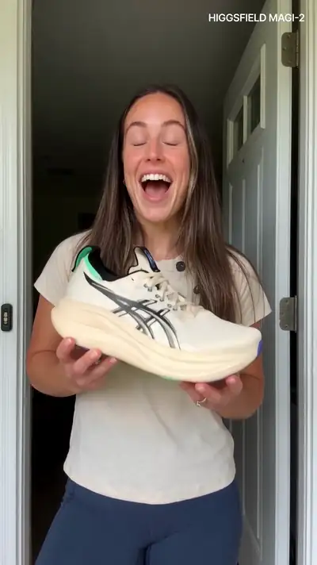</a><br><a href="https://www.sandbase.ai/lab/ai-videos/magi-2/2125445425520083116?lang=zh-CN&utm_source=github&utm_medium=readme&utm_campaign=awesome-magi-2&utm_content=card"><b>亚瑟士跑鞋创作者风格广告</b></a><br><sub><a href="https://x.com/Sheldon056/status/2125445425520083116">@Sheldon056</a></sub></td></tr>
<tr><td width="33%" valign="top"><a href="https://www.sandbase.ai/lab/media/x/magi-2/2125330766276268137/video.mp4">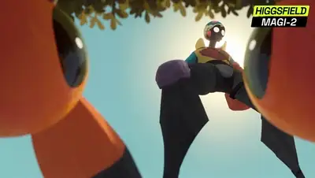</a><br><a href="https://www.sandbase.ai/lab/ai-videos/magi-2/2125330766276268137?lang=zh-CN&utm_source=github&utm_medium=readme&utm_campaign=awesome-magi-2&utm_content=card"><b>基于 Blender 白模生成的 3D 动画场景</b></a><br><sub><a href="https://x.com/Saccc_c/status/2125330766276268137">@Saccc_c</a></sub></td><td width="33%" valign="top"><a href="https://www.sandbase.ai/lab/media/x/magi-2/2125522773258952776/video.mp4"></a><br><a href="https://www.sandbase.ai/lab/ai-videos/magi-2/2125522773258952776?lang=zh-CN&utm_source=github&utm_medium=readme&utm_campaign=awesome-magi-2&utm_content=card"><b>为父亲制作煎饼的小女孩</b></a><br><sub><a href="https://x.com/AIwithkhan/status/2125522773258952776">@AIwithkhan</a> · <a href="https://www.sandbase.ai/lab/ai-videos/magi-2/2125522773258952776?lang=zh-CN&utm_source=github&utm_medium=readme&utm_campaign=awesome-magi-2&utm_content=card">提示词</a></sub></td><td width="33%" valign="top"><a href="https://www.sandbase.ai/lab/media/x/magi-2/2125821453266546701/video.mp4"></a><br><a href="https://www.sandbase.ai/lab/ai-videos/magi-2/2125821453266546701?lang=zh-CN&utm_source=github&utm_medium=readme&utm_campaign=awesome-magi-2&utm_content=card"><b>影院级3D赤壁风格动画广告</b></a><br><sub><a href="https://x.com/AIwithSynthia/status/2125821453266546701">@AIwithSynthia</a> · <a href="https://www.sandbase.ai/lab/ai-videos/magi-2/2125821453266546701?lang=zh-CN&utm_source=github&utm_medium=readme&utm_campaign=awesome-magi-2&utm_content=card">提示词</a></sub></td></tr>
<tr><td width="33%" valign="top"><a href="https://www.sandbase.ai/lab/media/x/magi-2/2125966161892479140/video.mp4">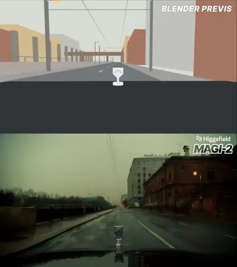</a><br><a href="https://www.sandbase.ai/lab/ai-videos/magi-2/2125966161892479140?lang=zh-CN&utm_source=github&utm_medium=readme&utm_campaign=awesome-magi-2&utm_content=card"><b>Blender预览转化为逼真电影感画面</b></a><br><sub><a href="https://x.com/ChillaiKalan__/status/2125966161892479140">@ChillaiKalan__</a></sub></td><td width="33%" valign="top"><a href="https://www.sandbase.ai/lab/media/x/magi-2/2125372572170908050/video.mp4">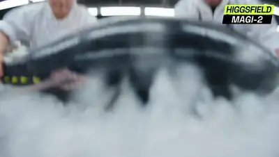</a><br><a href="https://www.sandbase.ai/lab/ai-videos/magi-2/2125372572170908050?lang=zh-CN&utm_source=github&utm_medium=readme&utm_campaign=awesome-magi-2&utm_content=card"><b>日料主厨磨刀特写</b></a><br><sub><a href="https://x.com/gkxspace/status/2125372572170908050">@gkxspace</a></sub></td></tr>
</table>

<a id="short-film"></a>

## 短片

<table>
<tr><td width="33%" valign="top"><a href="https://www.sandbase.ai/lab/media/x/magi-2/2125317814466883892/video.mp4">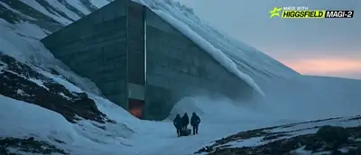</a><br><a href="https://www.sandbase.ai/lab/ai-videos/magi-2/2125317814466883892?lang=zh-CN&utm_source=github&utm_medium=readme&utm_campaign=awesome-magi-2&utm_content=card"><b>一座神秘种子库内的场景</b></a><br><sub><a href="https://x.com/MaAyyoub/status/2125317814466883892">@MaAyyoub</a></sub></td><td width="33%" valign="top"><a href="https://www.sandbase.ai/lab/media/x/magi-2/2125327227672006799/video.mp4"></a><br><a href="https://www.sandbase.ai/lab/ai-videos/magi-2/2125327227672006799?lang=zh-CN&utm_source=github&utm_medium=readme&utm_campaign=awesome-magi-2&utm_content=card"><b>自然重新占领人类文明与古老科技</b></a><br><sub><a href="https://x.com/mad_mask/status/2125327227672006799">@mad_mask</a></sub></td><td width="33%" valign="top"><a href="https://www.sandbase.ai/lab/media/x/magi-2/2125330702766166098/video.mp4"></a><br><a href="https://www.sandbase.ai/lab/ai-videos/magi-2/2125330702766166098?lang=zh-CN&utm_source=github&utm_medium=readme&utm_campaign=awesome-magi-2&utm_content=card"><b>女孩吃掉让全城堡敬畏之人的蛋糕</b></a><br><sub><a href="https://x.com/keren_studio/status/2125330702766166098">@keren_studio</a></sub></td></tr>
<tr><td width="33%" valign="top"><a href="https://www.sandbase.ai/lab/media/x/magi-2/2125330766276268137/video.mp4"></a><br><a href="https://www.sandbase.ai/lab/ai-videos/magi-2/2125330766276268137?lang=zh-CN&utm_source=github&utm_medium=readme&utm_campaign=awesome-magi-2&utm_content=card"><b>基于 Blender 白模生成的 3D 动画场景</b></a><br><sub><a href="https://x.com/Saccc_c/status/2125330766276268137">@Saccc_c</a></sub></td><td width="33%" valign="top"><a href="https://www.sandbase.ai/lab/media/x/magi-2/2125354482565280090/video.mp4">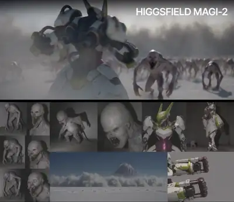</a><br><a href="https://www.sandbase.ai/lab/ai-videos/magi-2/2125354482565280090?lang=zh-CN&utm_source=github&utm_medium=readme&utm_campaign=awesome-magi-2&utm_content=card"><b>使用MAGI-2制作的电影预告片</b></a><br><sub><a href="https://x.com/mattshumer_/status/2125354482565280090">@mattshumer_</a></sub></td><td width="33%" valign="top"><a href="https://www.sandbase.ai/lab/media/x/magi-2/2125432548251816142/video.mp4"></a><br><a href="https://www.sandbase.ai/lab/ai-videos/magi-2/2125432548251816142?lang=zh-CN&utm_source=github&utm_medium=readme&utm_campaign=awesome-magi-2&utm_content=card"><b>女人与在海洋中飞溅的鲸鱼</b></a><br><sub><a href="https://x.com/Nishit_alt/status/2125432548251816142">@Nishit_alt</a></sub></td></tr>
</table>

<details>
<summary><b>展开全部 129 条</b></summary>

<table>
<tr><td width="33%" valign="top"><a href="https://www.sandbase.ai/lab/media/x/magi-2/2125442556008014168/video.mp4"></a><br><a href="https://www.sandbase.ai/lab/ai-videos/magi-2/2125442556008014168?lang=zh-CN&utm_source=github&utm_medium=readme&utm_campaign=awesome-magi-2&utm_content=card"><b>麦当劳实习生的第二天</b></a><br><sub><a href="https://x.com/RobberCat_SOL/status/2125442556008014168">@RobberCat_SOL</a></sub></td><td width="33%" valign="top"><a href="https://www.sandbase.ai/lab/media/x/magi-2/2125476205222871475/video.mp4"></a><br><a href="https://www.sandbase.ai/lab/ai-videos/magi-2/2125476205222871475?lang=zh-CN&utm_source=github&utm_medium=readme&utm_campaign=awesome-magi-2&utm_content=card"><b>雨夜里的一只小猫咪</b></a><br><sub><a href="https://x.com/Chengzilhy/status/2125476205222871475">@Chengzilhy</a></sub></td><td width="33%" valign="top"><a href="https://www.sandbase.ai/lab/media/x/magi-2/2125481156280013184/video.mp4"></a><br><a href="https://www.sandbase.ai/lab/ai-videos/magi-2/2125481156280013184?lang=zh-CN&utm_source=github&utm_medium=readme&utm_campaign=awesome-magi-2&utm_content=card"><b>麦当劳实习生制作开心乐园餐</b></a><br><sub><a href="https://x.com/RobberCat_SOL/status/2125481156280013184">@RobberCat_SOL</a></sub></td></tr>
<tr><td width="33%" valign="top"><a href="https://www.sandbase.ai/lab/media/x/magi-2/2125493514045899110/video.mp4">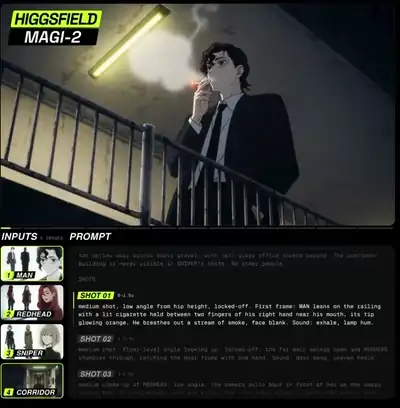</a><br><a href="https://www.sandbase.ai/lab/ai-videos/magi-2/2125493514045899110?lang=zh-CN&utm_source=github&utm_medium=readme&utm_campaign=awesome-magi-2&utm_content=card"><b>角色表情与动作的电影感场景测试</b></a><br><sub><a href="https://x.com/PUNPUNinuhime/status/2125493514045899110">@PUNPUNinuhime</a></sub></td><td width="33%" valign="top"><a href="https://www.sandbase.ai/lab/media/x/magi-2/2125501492862042357/video.mp4">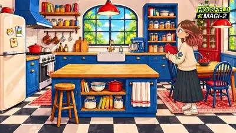</a><br><a href="https://www.sandbase.ai/lab/ai-videos/magi-2/2125501492862042357?lang=zh-CN&utm_source=github&utm_medium=readme&utm_campaign=awesome-magi-2&utm_content=card"><b>充满混乱的烘焙冒险故事</b></a><br><sub><a href="https://x.com/chatgptpaglu/status/2125501492862042357">@chatgptpaglu</a></sub></td><td width="33%" valign="top"><a href="https://www.sandbase.ai/lab/media/x/magi-2/2125505796272517604/video.mp4"></a><br><a href="https://www.sandbase.ai/lab/ai-videos/magi-2/2125505796272517604?lang=zh-CN&utm_source=github&utm_medium=readme&utm_campaign=awesome-magi-2&utm_content=card"><b>穿梭于不同时代的时间旅行者</b></a><br><sub><a href="https://x.com/821R/status/2125505796272517604">@821R</a></sub></td></tr>
<tr><td width="33%" valign="top"><a href="https://www.sandbase.ai/lab/media/x/magi-2/2125530535724523969/video.mp4"></a><br><a href="https://www.sandbase.ai/lab/ai-videos/magi-2/2125530535724523969?lang=zh-CN&utm_source=github&utm_medium=readme&utm_campaign=awesome-magi-2&utm_content=card"><b>船厂逃生剧情叙事短片</b></a><br><sub><a href="https://x.com/LioraSolveil/status/2125530535724523969">@LioraSolveil</a></sub></td><td width="33%" valign="top"><a href="https://www.sandbase.ai/lab/media/x/magi-2/2125533977536876728/video.mp4">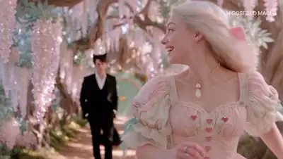</a><br><a href="https://www.sandbase.ai/lab/ai-videos/magi-2/2125533977536876728?lang=zh-CN&utm_source=github&utm_medium=readme&utm_campaign=awesome-magi-2&utm_content=card"><b>梦核风格中从容漫步的汤姆里德尔</b></a><br><sub><a href="https://x.com/keren_studio/status/2125533977536876728">@keren_studio</a></sub></td><td width="33%" valign="top"><a href="https://www.sandbase.ai/lab/media/x/magi-2/2125568290336682284/video.mp4">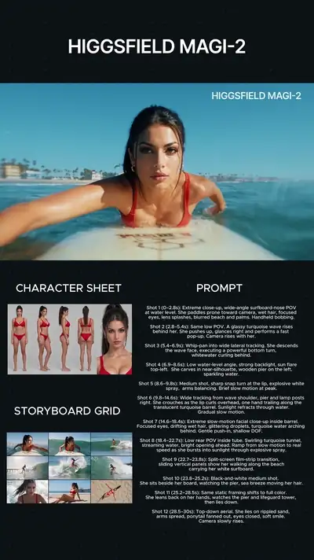</a><br><a href="https://www.sandbase.ai/lab/ai-videos/magi-2/2125568290336682284?lang=zh-CN&utm_source=github&utm_medium=readme&utm_campaign=awesome-magi-2&utm_content=card"><b>使用MAGI-2制作的三十秒冲浪短片</b></a><br><sub><a href="https://x.com/Daeng_Tinggi/status/2125568290336682284">@Daeng_Tinggi</a> · <a href="https://www.sandbase.ai/lab/ai-videos/magi-2/2125568290336682284?lang=zh-CN&utm_source=github&utm_medium=readme&utm_campaign=awesome-magi-2&utm_content=card">提示词</a></sub></td></tr>
<tr><td width="33%" valign="top"><a href="https://www.sandbase.ai/lab/media/x/magi-2/2125569587077165234/video.mp4"></a><br><a href="https://www.sandbase.ai/lab/ai-videos/magi-2/2125569587077165234?lang=zh-CN&utm_source=github&utm_medium=readme&utm_campaign=awesome-magi-2&utm_content=card"><b>黑白两位魔法师施法的对比场景</b></a><br><sub><a href="https://x.com/KT_first_story/status/2125569587077165234">@KT_first_story</a></sub></td><td width="33%" valign="top"><a href="https://www.sandbase.ai/lab/media/x/magi-2/2125570338167898208/video.mp4"></a><br><a href="https://www.sandbase.ai/lab/ai-videos/magi-2/2125570338167898208?lang=zh-CN&utm_source=github&utm_medium=readme&utm_campaign=awesome-magi-2&utm_content=card"><b>关于历经岁月考验的爱情短片</b></a><br><sub><a href="https://x.com/NVTDanh/status/2125570338167898208">@NVTDanh</a></sub></td><td width="33%" valign="top"><a href="https://www.sandbase.ai/lab/media/x/magi-2/2125573012976185797/video.mp4"></a><br><a href="https://www.sandbase.ai/lab/ai-videos/magi-2/2125573012976185797?lang=zh-CN&utm_source=github&utm_medium=readme&utm_campaign=awesome-magi-2&utm_content=card"><b>日常生活中的互相帮助</b></a><br><sub><a href="https://x.com/keneth_ai/status/2125573012976185797">@keneth_ai</a></sub></td></tr>
<tr><td width="33%" valign="top"><a href="https://www.sandbase.ai/lab/media/x/magi-2/2125581050017358275/video.mp4">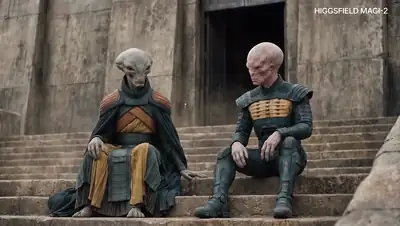</a><br><a href="https://www.sandbase.ai/lab/ai-videos/magi-2/2125581050017358275?lang=zh-CN&utm_source=github&utm_medium=readme&utm_campaign=awesome-magi-2&utm_content=card"><b>具备对白与口型同步的原创角色</b></a><br><sub><a href="https://x.com/gridzzle/status/2125581050017358275">@gridzzle</a></sub></td><td width="33%" valign="top"><a href="https://www.sandbase.ai/lab/media/x/magi-2/2125592366203752905/video.mp4"></a><br><a href="https://www.sandbase.ai/lab/ai-videos/magi-2/2125592366203752905?lang=zh-CN&utm_source=github&utm_medium=readme&utm_campaign=awesome-magi-2&utm_content=card"><b>致敬尼古拉特斯拉的摄影视觉短片</b></a><br><sub><a href="https://x.com/Peymannaderi_/status/2125592366203752905">@Peymannaderi_</a></sub></td><td width="33%" valign="top"><a href="https://www.sandbase.ai/lab/media/x/magi-2/2125593409360675146/video.mp4">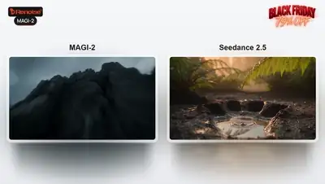</a><br><a href="https://www.sandbase.ai/lab/ai-videos/magi-2/2125593409360675146?lang=zh-CN&utm_source=github&utm_medium=readme&utm_campaign=awesome-magi-2&utm_content=card"><b>恐龙与奇幻风格电影感短片</b></a><br><sub><a href="https://x.com/EianLu/status/2125593409360675146">@EianLu</a></sub></td></tr>
<tr><td width="33%" valign="top"><a href="https://www.sandbase.ai/lab/media/x/magi-2/2125640284830835088/video.mp4"></a><br><a href="https://www.sandbase.ai/lab/ai-videos/magi-2/2125640284830835088?lang=zh-CN&utm_source=github&utm_medium=readme&utm_campaign=awesome-magi-2&utm_content=card"><b>废弃宅邸中拉弓瞄准的年轻女子</b></a><br><sub><a href="https://x.com/AIwithkhan/status/2125640284830835088">@AIwithkhan</a> · <a href="https://www.sandbase.ai/lab/ai-videos/magi-2/2125640284830835088?lang=zh-CN&utm_source=github&utm_medium=readme&utm_campaign=awesome-magi-2&utm_content=card">提示词</a></sub></td><td width="33%" valign="top"><a href="https://www.sandbase.ai/lab/media/x/magi-2/2125653509475614753/video.mp4"></a><br><a href="https://www.sandbase.ai/lab/ai-videos/magi-2/2125653509475614753?lang=zh-CN&utm_source=github&utm_medium=readme&utm_campaign=awesome-magi-2&utm_content=card"><b>在丛林中偷取恐龙蛋的故事</b></a><br><sub><a href="https://x.com/minstorylab01/status/2125653509475614753">@minstorylab01</a></sub></td><td width="33%" valign="top"><a href="https://www.sandbase.ai/lab/media/x/magi-2/2125660850102960522/video.mp4"></a><br><a href="https://www.sandbase.ai/lab/ai-videos/magi-2/2125660850102960522?lang=zh-CN&utm_source=github&utm_medium=readme&utm_campaign=awesome-magi-2&utm_content=card"><b>音乐家在烈火中演奏最后的交响曲</b></a><br><sub><a href="https://x.com/nicravesh/status/2125660850102960522">@nicravesh</a></sub></td></tr>
<tr><td width="33%" valign="top"><a href="https://www.sandbase.ai/lab/media/x/magi-2/2125673356015927750/video.mp4"></a><br><a href="https://www.sandbase.ai/lab/ai-videos/magi-2/2125673356015927750?lang=zh-CN&utm_source=github&utm_medium=readme&utm_campaign=awesome-magi-2&utm_content=card"><b>带有时间戳提示的三段式叙事短片</b></a><br><sub><a href="https://x.com/MaAyyoub/status/2125673356015927750">@MaAyyoub</a> · <a href="https://www.sandbase.ai/lab/ai-videos/magi-2/2125673356015927750?lang=zh-CN&utm_source=github&utm_medium=readme&utm_campaign=awesome-magi-2&utm_content=card">提示词</a></sub></td><td width="33%" valign="top"><a href="https://www.sandbase.ai/lab/media/x/magi-2/2125673751346070006/video.mp4">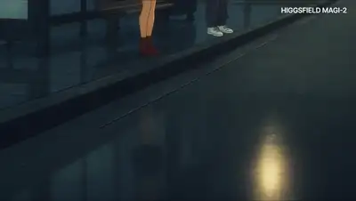</a><br><a href="https://www.sandbase.ai/lab/ai-videos/magi-2/2125673751346070006?lang=zh-CN&utm_source=github&utm_medium=readme&utm_campaign=awesome-magi-2&utm_content=card"><b>微风吹走雨伞的温柔浪漫场景</b></a><br><sub><a href="https://x.com/visualaeonart/status/2125673751346070006">@visualaeonart</a></sub></td><td width="33%" valign="top"><a href="https://www.sandbase.ai/lab/media/x/magi-2/2125677639524327594/video.mp4">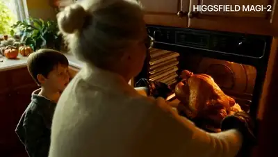</a><br><a href="https://www.sandbase.ai/lab/ai-videos/magi-2/2125677639524327594?lang=zh-CN&utm_source=github&utm_medium=readme&utm_campaign=awesome-magi-2&utm_content=card"><b>感恩节厨房中的烹饪与对话场景</b></a><br><sub><a href="https://x.com/WolfRiccardo/status/2125677639524327594">@WolfRiccardo</a></sub></td></tr>
<tr><td width="33%" valign="top"><a href="https://www.sandbase.ai/lab/media/x/magi-2/2125680623973232695/video.mp4">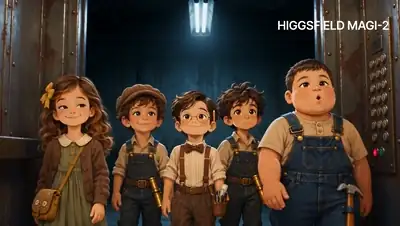</a><br><a href="https://www.sandbase.ai/lab/ai-videos/magi-2/2125680623973232695?lang=zh-CN&utm_source=github&utm_medium=readme&utm_campaign=awesome-magi-2&utm_content=card"><b>一段意想不到的电梯乘坐场景</b></a><br><sub><a href="https://x.com/Gwsubsa/status/2125680623973232695">@Gwsubsa</a></sub></td><td width="33%" valign="top"><a href="https://www.sandbase.ai/lab/media/x/magi-2/2125680792135147811/video.mp4">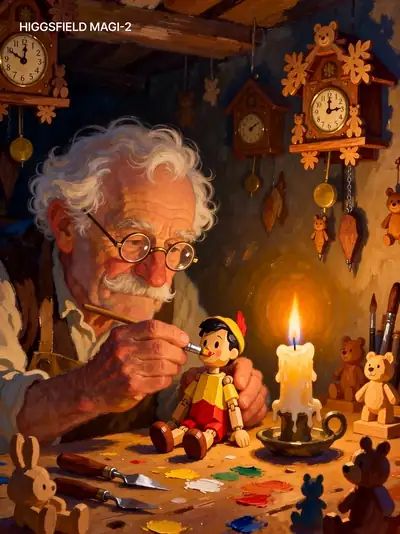</a><br><a href="https://www.sandbase.ai/lab/ai-videos/magi-2/2125680792135147811?lang=zh-CN&utm_source=github&utm_medium=readme&utm_campaign=awesome-magi-2&utm_content=card"><b>魔法光芒中被赋予生命的木偶</b></a><br><sub><a href="https://x.com/art_muse/status/2125680792135147811">@art_muse</a></sub></td><td width="33%" valign="top"><a href="https://www.sandbase.ai/lab/media/x/magi-2/2125682704738050112/video.mp4">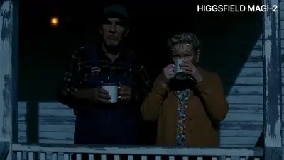</a><br><a href="https://www.sandbase.ai/lab/ai-videos/magi-2/2125682704738050112?lang=zh-CN&utm_source=github&utm_medium=readme&utm_campaign=awesome-magi-2&utm_content=card"><b>一位厌倦噪音的农夫在农场上的反应</b></a><br><sub><a href="https://x.com/WolfRiccardo/status/2125682704738050112">@WolfRiccardo</a></sub></td></tr>
<tr><td width="33%" valign="top"><a href="https://www.sandbase.ai/lab/media/x/magi-2/2125683333044826621/video.mp4"></a><br><a href="https://www.sandbase.ai/lab/ai-videos/magi-2/2125683333044826621?lang=zh-CN&utm_source=github&utm_medium=readme&utm_campaign=awesome-magi-2&utm_content=card"><b>二十五年之后的同一个孩子</b></a><br><sub><a href="https://x.com/WolfRiccardo/status/2125683333044826621">@WolfRiccardo</a></sub></td><td width="33%" valign="top"><a href="https://www.sandbase.ai/lab/media/x/magi-2/2125684541205663865/video.mp4">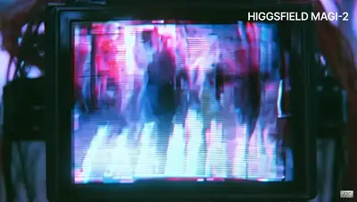</a><br><a href="https://www.sandbase.ai/lab/ai-videos/magi-2/2125684541205663865?lang=zh-CN&utm_source=github&utm_medium=readme&utm_campaign=awesome-magi-2&utm_content=card"><b>科幻电影感短片幽灵信号</b></a><br><sub><a href="https://x.com/iX00AI/status/2125684541205663865">@iX00AI</a></sub></td><td width="33%" valign="top"><a href="https://www.sandbase.ai/lab/media/x/magi-2/2125686209464914163/video.mp4"></a><br><a href="https://www.sandbase.ai/lab/ai-videos/magi-2/2125686209464914163?lang=zh-CN&utm_source=github&utm_medium=readme&utm_campaign=awesome-magi-2&utm_content=card"><b>两个微型小人在超市引发混乱</b></a><br><sub><a href="https://x.com/FutureVibesAi/status/2125686209464914163">@FutureVibesAi</a></sub></td></tr>
<tr><td width="33%" valign="top"><a href="https://www.sandbase.ai/lab/media/x/magi-2/2125686599149081081/video.mp4">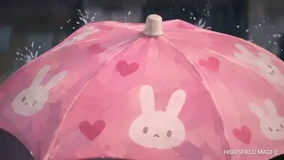</a><br><a href="https://www.sandbase.ai/lab/ai-videos/magi-2/2125686599149081081?lang=zh-CN&utm_source=github&utm_medium=readme&utm_campaign=awesome-magi-2&utm_content=card"><b>街头收取庇护费的故事</b></a><br><sub><a href="https://x.com/PixelNinjaArt/status/2125686599149081081">@PixelNinjaArt</a></sub></td><td width="33%" valign="top"><a href="https://www.sandbase.ai/lab/media/x/magi-2/2125696793073832399/video.mp4">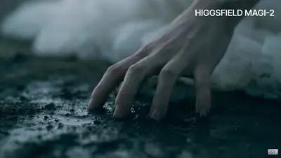</a><br><a href="https://www.sandbase.ai/lab/ai-videos/magi-2/2125696793073832399?lang=zh-CN&utm_source=github&utm_medium=readme&utm_campaign=awesome-magi-2&utm_content=card"><b>电影感短片灰烬之纱</b></a><br><sub><a href="https://x.com/iX00AI/status/2125696793073832399">@iX00AI</a></sub></td><td width="33%" valign="top"><a href="https://www.sandbase.ai/lab/media/x/magi-2/2125698949482680353/video.mp4">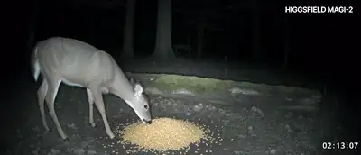</a><br><a href="https://www.sandbase.ai/lab/ai-videos/magi-2/2125698949482680353?lang=zh-CN&utm_source=github&utm_medium=readme&utm_campaign=awesome-magi-2&utm_content=card"><b>一系列红外线追踪摄像机短片</b></a><br><sub><a href="https://x.com/PeterKL87/status/2125698949482680353">@PeterKL87</a></sub></td></tr>
<tr><td width="33%" valign="top"><a href="https://www.sandbase.ai/lab/media/x/magi-2/2125701889702457524/video.mp4"></a><br><a href="https://www.sandbase.ai/lab/ai-videos/magi-2/2125701889702457524?lang=zh-CN&utm_source=github&utm_medium=readme&utm_campaign=awesome-magi-2&utm_content=card"><b>可爱的3D宠物动画短片系列</b></a><br><sub><a href="https://x.com/Dheepanratnam/status/2125701889702457524">@Dheepanratnam</a> · <a href="https://www.sandbase.ai/lab/ai-videos/magi-2/2125701889702457524?lang=zh-CN&utm_source=github&utm_medium=readme&utm_campaign=awesome-magi-2&utm_content=card">提示词</a></sub></td><td width="33%" valign="top"><a href="https://www.sandbase.ai/lab/media/x/magi-2/2125708444166656496/video.mp4">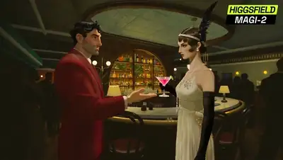</a><br><a href="https://www.sandbase.ai/lab/ai-videos/magi-2/2125708444166656496?lang=zh-CN&utm_source=github&utm_medium=readme&utm_campaign=awesome-magi-2&utm_content=card"><b>一个人在酒吧中被拒绝的场景</b></a><br><sub><a href="https://x.com/TechieBySA/status/2125708444166656496">@TechieBySA</a></sub></td><td width="33%" valign="top"><a href="https://www.sandbase.ai/lab/media/x/magi-2/2125709428217319442/video.mp4"></a><br><a href="https://www.sandbase.ai/lab/ai-videos/magi-2/2125709428217319442?lang=zh-CN&utm_source=github&utm_medium=readme&utm_campaign=awesome-magi-2&utm_content=card"><b>使用MAGI-2创作的电影感幻想角色</b></a><br><sub><a href="https://x.com/InfinityArts300/status/2125709428217319442">@InfinityArts300</a></sub></td></tr>
<tr><td width="33%" valign="top"><a href="https://www.sandbase.ai/lab/media/x/magi-2/2125710847066702053/video.mp4"></a><br><a href="https://www.sandbase.ai/lab/ai-videos/magi-2/2125710847066702053?lang=zh-CN&utm_source=github&utm_medium=readme&utm_campaign=awesome-magi-2&utm_content=card"><b>一个角色躲避湖水抽离的场景</b></a><br><sub><a href="https://x.com/PromptSin/status/2125710847066702053">@PromptSin</a></sub></td><td width="33%" valign="top"><a href="https://www.sandbase.ai/lab/media/x/magi-2/2125711197039182120/video.mp4">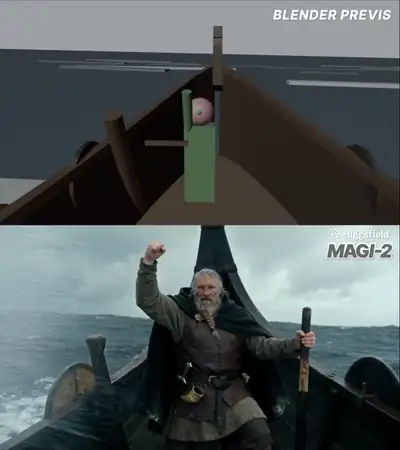</a><br><a href="https://www.sandbase.ai/lab/ai-videos/magi-2/2125711197039182120?lang=zh-CN&utm_source=github&utm_medium=readme&utm_campaign=awesome-magi-2&utm_content=card"><b>使用MAGI-2制作风暴海景的工作流</b></a><br><sub><a href="https://x.com/rewind02/status/2125711197039182120">@rewind02</a></sub></td><td width="33%" valign="top"><a href="https://www.sandbase.ai/lab/media/x/magi-2/2125714018245726704/video.mp4">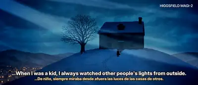</a><br><a href="https://www.sandbase.ai/lab/ai-videos/magi-2/2125714018245726704?lang=zh-CN&utm_source=github&utm_medium=readme&utm_campaign=awesome-magi-2&utm_content=card"><b>由MAGI-2制作的叙事场景</b></a><br><sub><a href="https://x.com/NACHOS2D_/status/2125714018245726704">@NACHOS2D_</a></sub></td></tr>
<tr><td width="33%" valign="top"><a href="https://www.sandbase.ai/lab/media/x/magi-2/2125718798603079866/video.mp4">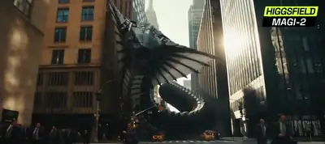</a><br><a href="https://www.sandbase.ai/lab/ai-videos/magi-2/2125718798603079866?lang=zh-CN&utm_source=github&utm_medium=readme&utm_campaign=awesome-magi-2&utm_content=card"><b>使用Higgsfield MAGI-2创作的短片</b></a><br><sub><a href="https://x.com/mattshumer_/status/2125718798603079866">@mattshumer_</a></sub></td><td width="33%" valign="top"><a href="https://www.sandbase.ai/lab/media/x/magi-2/2125719837158883770/video.mp4"></a><br><a href="https://www.sandbase.ai/lab/ai-videos/magi-2/2125719837158883770?lang=zh-CN&utm_source=github&utm_medium=readme&utm_campaign=awesome-magi-2&utm_content=card"><b>充满超现实生物的雾中渡轮场景</b></a><br><sub><a href="https://x.com/PeterKL87/status/2125719837158883770">@PeterKL87</a></sub></td><td width="33%" valign="top"><a href="https://www.sandbase.ai/lab/media/x/magi-2/2125722448368951719/video.mp4"></a><br><a href="https://www.sandbase.ai/lab/ai-videos/magi-2/2125722448368951719?lang=zh-CN&utm_source=github&utm_medium=readme&utm_campaign=awesome-magi-2&utm_content=card"><b>两个角色对话的短片场景</b></a><br><sub><a href="https://x.com/HelmyPad/status/2125722448368951719">@HelmyPad</a></sub></td></tr>
<tr><td width="33%" valign="top"><a href="https://www.sandbase.ai/lab/media/x/magi-2/2125724109849985037/video.mp4">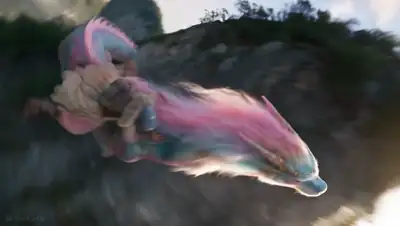</a><br><a href="https://www.sandbase.ai/lab/ai-videos/magi-2/2125724109849985037?lang=zh-CN&utm_source=github&utm_medium=readme&utm_campaign=awesome-magi-2&utm_content=card"><b>一条无需降落伞的飞龙</b></a><br><sub><a href="https://x.com/minuitIA/status/2125724109849985037">@minuitIA</a></sub></td><td width="33%" valign="top"><a href="https://www.sandbase.ai/lab/media/x/magi-2/2125726724285710731/video.mp4"></a><br><a href="https://www.sandbase.ai/lab/ai-videos/magi-2/2125726724285710731?lang=zh-CN&utm_source=github&utm_medium=readme&utm_campaign=awesome-magi-2&utm_content=card"><b>夜行蒸汽火车穿越梦幻旅程</b></a><br><sub><a href="https://x.com/Reina_Bunny_ai/status/2125726724285710731">@Reina_Bunny_ai</a></sub></td><td width="33%" valign="top"><a href="https://www.sandbase.ai/lab/media/x/magi-2/2125727587465105681/video.mp4"></a><br><a href="https://www.sandbase.ai/lab/ai-videos/magi-2/2125727587465105681?lang=zh-CN&utm_source=github&utm_medium=readme&utm_campaign=awesome-magi-2&utm_content=card"><b>雨中屋檐上的微型猫武士</b></a><br><sub><a href="https://x.com/aresotik/status/2125727587465105681">@aresotik</a></sub></td></tr>
<tr><td width="33%" valign="top"><a href="https://www.sandbase.ai/lab/media/x/magi-2/2125727709238358236/video.mp4"></a><br><a href="https://www.sandbase.ai/lab/ai-videos/magi-2/2125727709238358236?lang=zh-CN&utm_source=github&utm_medium=readme&utm_campaign=awesome-magi-2&utm_content=card"><b>桌面上的微缩城市栩栩如生</b></a><br><sub><a href="https://x.com/zentalksai/status/2125727709238358236">@zentalksai</a></sub></td><td width="33%" valign="top"><a href="https://www.sandbase.ai/lab/media/x/magi-2/2125728269802873216/video.mp4">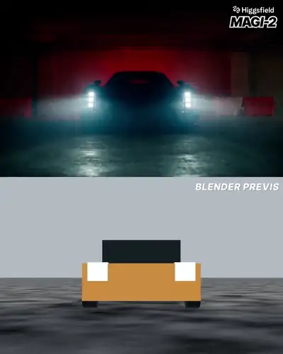</a><br><a href="https://www.sandbase.ai/lab/ai-videos/magi-2/2125728269802873216?lang=zh-CN&utm_source=github&utm_medium=readme&utm_campaign=awesome-magi-2&utm_content=card"><b>使用MAGI-2制作的夜间追车场景</b></a><br><sub><a href="https://x.com/marcusyul/status/2125728269802873216">@marcusyul</a></sub></td><td width="33%" valign="top"><a href="https://www.sandbase.ai/lab/media/x/magi-2/2125728385154625937/video.mp4">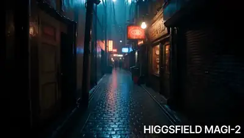</a><br><a href="https://www.sandbase.ai/lab/ai-videos/magi-2/2125728385154625937?lang=zh-CN&utm_source=github&utm_medium=readme&utm_campaign=awesome-magi-2&utm_content=card"><b>名为秘密之门的电影感影像</b></a><br><sub><a href="https://x.com/YaReYaRu30Life/status/2125728385154625937">@YaReYaRu30Life</a></sub></td></tr>
<tr><td width="33%" valign="top"><a href="https://www.sandbase.ai/lab/media/x/magi-2/2125729470518620360/video.mp4"></a><br><a href="https://www.sandbase.ai/lab/ai-videos/magi-2/2125729470518620360?lang=zh-CN&utm_source=github&utm_medium=readme&utm_campaign=awesome-magi-2&utm_content=card"><b>使用MAGI-2创作的人物场景</b></a><br><sub><a href="https://x.com/YapayZekaSerisi/status/2125729470518620360">@YapayZekaSerisi</a></sub></td><td width="33%" valign="top"><a href="https://www.sandbase.ai/lab/media/x/magi-2/2125730219499962783/video.mp4"></a><br><a href="https://www.sandbase.ai/lab/ai-videos/magi-2/2125730219499962783?lang=zh-CN&utm_source=github&utm_medium=readme&utm_campaign=awesome-magi-2&utm_content=card"><b>一对情侣享受城市夜间约会</b></a><br><sub><a href="https://x.com/NyaiiBubu/status/2125730219499962783">@NyaiiBubu</a></sub></td><td width="33%" valign="top"><a href="https://www.sandbase.ai/lab/media/x/magi-2/2125731256126357821/video.mp4">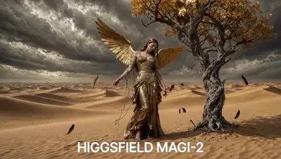</a><br><a href="https://www.sandbase.ai/lab/ai-videos/magi-2/2125731256126357821?lang=zh-CN&utm_source=github&utm_medium=readme&utm_campaign=awesome-magi-2&utm_content=card"><b>保持角色细节的诗意神话序列</b></a><br><sub><a href="https://x.com/carolletta/status/2125731256126357821">@carolletta</a></sub></td></tr>
<tr><td width="33%" valign="top"><a href="https://www.sandbase.ai/lab/media/x/magi-2/2125736996014526777/video.mp4"></a><br><a href="https://www.sandbase.ai/lab/ai-videos/magi-2/2125736996014526777?lang=zh-CN&utm_source=github&utm_medium=readme&utm_campaign=awesome-magi-2&utm_content=card"><b>超级英雄学习飞行的小短片</b></a><br><sub><a href="https://x.com/visualaeonart/status/2125736996014526777">@visualaeonart</a></sub></td><td width="33%" valign="top"><a href="https://www.sandbase.ai/lab/media/x/magi-2/2125740485121826867/video.mp4"></a><br><a href="https://www.sandbase.ai/lab/ai-videos/magi-2/2125740485121826867?lang=zh-CN&utm_source=github&utm_medium=readme&utm_campaign=awesome-magi-2&utm_content=card"><b>企鹅与同伴在云端翱翔</b></a><br><sub><a href="https://x.com/dave392750/status/2125740485121826867">@dave392750</a></sub></td><td width="33%" valign="top"><a href="https://www.sandbase.ai/lab/media/x/magi-2/2125741082227155176/video.mp4">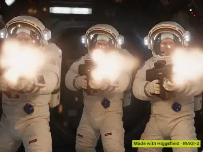</a><br><a href="https://www.sandbase.ai/lab/ai-videos/magi-2/2125741082227155176?lang=zh-CN&utm_source=github&utm_medium=readme&utm_campaign=awesome-magi-2&utm_content=card"><b>太空任务期间爆发的外星天灾</b></a><br><sub><a href="https://x.com/alextalksai/status/2125741082227155176">@alextalksai</a></sub></td></tr>
<tr><td width="33%" valign="top"><a href="https://www.sandbase.ai/lab/media/x/magi-2/2125741880738742546/video.mp4"></a><br><a href="https://www.sandbase.ai/lab/ai-videos/magi-2/2125741880738742546?lang=zh-CN&utm_source=github&utm_medium=readme&utm_campaign=awesome-magi-2&utm_content=card"><b>一个人跳进自己的漫画书世界</b></a><br><sub><a href="https://x.com/999toba/status/2125741880738742546">@999toba</a></sub></td><td width="33%" valign="top"><a href="https://www.sandbase.ai/lab/media/x/magi-2/2125742329164149062/video.mp4">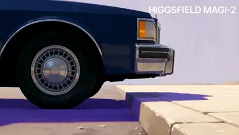</a><br><a href="https://www.sandbase.ai/lab/ai-videos/magi-2/2125742329164149062?lang=zh-CN&utm_source=github&utm_medium=readme&utm_campaign=awesome-magi-2&utm_content=card"><b>银行金库抢劫与逃脱场景</b></a><br><sub><a href="https://x.com/keneth_ai/status/2125742329164149062">@keneth_ai</a></sub></td><td width="33%" valign="top"><a href="https://www.sandbase.ai/lab/media/x/magi-2/2125743359788712138/video.mp4"></a><br><a href="https://www.sandbase.ai/lab/ai-videos/magi-2/2125743359788712138?lang=zh-CN&utm_source=github&utm_medium=readme&utm_campaign=awesome-magi-2&utm_content=card"><b>九十年代圣诞电影风格求婚现场</b></a><br><sub><a href="https://x.com/LioraSolveil/status/2125743359788712138">@LioraSolveil</a></sub></td></tr>
<tr><td width="33%" valign="top"><a href="https://www.sandbase.ai/lab/media/x/magi-2/2125749020324929905/video.mp4">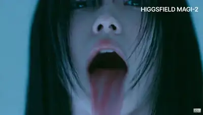</a><br><a href="https://www.sandbase.ai/lab/ai-videos/magi-2/2125749020324929905?lang=zh-CN&utm_source=github&utm_medium=readme&utm_campaign=awesome-magi-2&utm_content=card"><b>一段日本恐怖电影主题的短片</b></a><br><sub><a href="https://x.com/iX00AI/status/2125749020324929905">@iX00AI</a></sub></td><td width="33%" valign="top"><a href="https://www.sandbase.ai/lab/media/x/magi-2/2125749135953596689/video.mp4">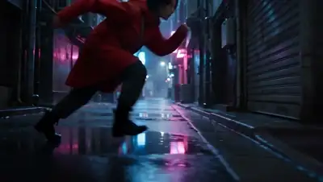</a><br><a href="https://www.sandbase.ai/lab/ai-videos/magi-2/2125749135953596689?lang=zh-CN&utm_source=github&utm_medium=readme&utm_campaign=awesome-magi-2&utm_content=card"><b>穿越五个世界的长镜头连贯短片</b></a><br><sub><a href="https://x.com/harrisonitsme/status/2125749135953596689">@harrisonitsme</a></sub></td><td width="33%" valign="top"><a href="https://www.sandbase.ai/lab/media/x/magi-2/2125751298981249452/video.mp4"></a><br><a href="https://www.sandbase.ai/lab/ai-videos/magi-2/2125751298981249452?lang=zh-CN&utm_source=github&utm_medium=readme&utm_campaign=awesome-magi-2&utm_content=card"><b>一段关于角色归家的叙事短片</b></a><br><sub><a href="https://x.com/HelmyPad/status/2125751298981249452">@HelmyPad</a></sub></td></tr>
<tr><td width="33%" valign="top"><a href="https://www.sandbase.ai/lab/media/x/magi-2/2125756210079318458/video.mp4">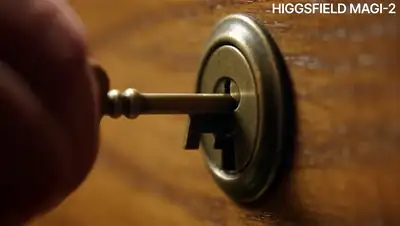</a><br><a href="https://www.sandbase.ai/lab/ai-videos/magi-2/2125756210079318458?lang=zh-CN&utm_source=github&utm_medium=readme&utm_campaign=awesome-magi-2&utm_content=card"><b>守护感恩节秘密食谱的祖母</b></a><br><sub><a href="https://x.com/airina_xyz/status/2125756210079318458">@airina_xyz</a> · <a href="https://www.sandbase.ai/lab/ai-videos/magi-2/2125756210079318458?lang=zh-CN&utm_source=github&utm_medium=readme&utm_campaign=awesome-magi-2&utm_content=card">提示词</a></sub></td><td width="33%" valign="top"><a href="https://www.sandbase.ai/lab/media/x/magi-2/2125760471340839051/video.mp4">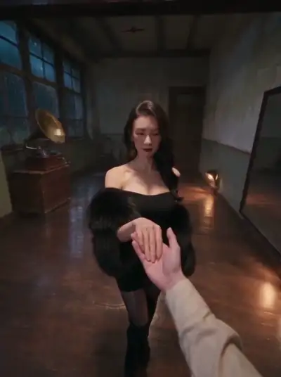</a><br><a href="https://www.sandbase.ai/lab/ai-videos/magi-2/2125760471340839051?lang=zh-CN&utm_source=github&utm_medium=readme&utm_campaign=awesome-magi-2&utm_content=card"><b>无底洞中与神秘女子的第一人称邂逅</b></a><br><sub><a href="https://x.com/john87445528/status/2125760471340839051">@john87445528</a> · <a href="https://www.sandbase.ai/lab/ai-videos/magi-2/2125760471340839051?lang=zh-CN&utm_source=github&utm_medium=readme&utm_campaign=awesome-magi-2&utm_content=card">提示词</a></sub></td><td width="33%" valign="top"><a href="https://www.sandbase.ai/lab/media/x/magi-2/2125761364677529817/video.mp4"></a><br><a href="https://www.sandbase.ai/lab/ai-videos/magi-2/2125761364677529817?lang=zh-CN&utm_source=github&utm_medium=readme&utm_campaign=awesome-magi-2&utm_content=card"><b>七十年代香港武侠电影风格片段</b></a><br><sub><a href="https://x.com/abulu8/status/2125761364677529817">@abulu8</a> · <a href="https://www.sandbase.ai/lab/ai-videos/magi-2/2125761364677529817?lang=zh-CN&utm_source=github&utm_medium=readme&utm_campaign=awesome-magi-2&utm_content=card">提示词</a></sub></td></tr>
<tr><td width="33%" valign="top"><a href="https://www.sandbase.ai/lab/media/x/magi-2/2125761755200868452/video.mp4"></a><br><a href="https://www.sandbase.ai/lab/ai-videos/magi-2/2125761755200868452?lang=zh-CN&utm_source=github&utm_medium=readme&utm_campaign=awesome-magi-2&utm_content=card"><b>以月亮为主题的电影感短片</b></a><br><sub><a href="https://x.com/whorange__/status/2125761755200868452">@whorange__</a></sub></td><td width="33%" valign="top"><a href="https://www.sandbase.ai/lab/media/x/magi-2/2125768541739888815/video.mp4">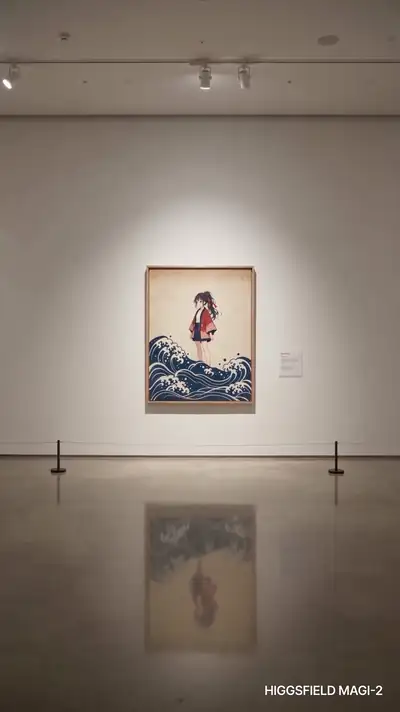</a><br><a href="https://www.sandbase.ai/lab/ai-videos/magi-2/2125768541739888815?lang=zh-CN&utm_source=github&utm_medium=readme&utm_campaign=awesome-magi-2&utm_content=card"><b>浮世绘女孩跳入现实美术馆</b></a><br><sub><a href="https://x.com/kiAI_stable/status/2125768541739888815">@kiAI_stable</a></sub></td><td width="33%" valign="top"><a href="https://www.sandbase.ai/lab/media/x/magi-2/2125772255292694966/video.mp4"></a><br><a href="https://www.sandbase.ai/lab/ai-videos/magi-2/2125772255292694966?lang=zh-CN&utm_source=github&utm_medium=readme&utm_campaign=awesome-magi-2&utm_content=card"><b>企鹅为受伤小鸟系上围巾</b></a><br><sub><a href="https://x.com/dave392750/status/2125772255292694966">@dave392750</a></sub></td></tr>
<tr><td width="33%" valign="top"><a href="https://www.sandbase.ai/lab/media/x/magi-2/2125774357423440083/video.mp4"></a><br><a href="https://www.sandbase.ai/lab/ai-videos/magi-2/2125774357423440083?lang=zh-CN&utm_source=github&utm_medium=readme&utm_campaign=awesome-magi-2&utm_content=card"><b>拉里与莱昂在玩GTA6</b></a><br><sub><a href="https://x.com/sithdaddyx/status/2125774357423440083">@sithdaddyx</a></sub></td><td width="33%" valign="top"><a href="https://www.sandbase.ai/lab/media/x/magi-2/2125774898253516897/video.mp4"></a><br><a href="https://www.sandbase.ai/lab/ai-videos/magi-2/2125774898253516897?lang=zh-CN&utm_source=github&utm_medium=readme&utm_campaign=awesome-magi-2&utm_content=card"><b>手持镜头下的惊喜求婚</b></a><br><sub><a href="https://x.com/saniaspeaks_/status/2125774898253516897">@saniaspeaks_</a></sub></td><td width="33%" valign="top"><a href="https://www.sandbase.ai/lab/media/x/magi-2/2125775156190777534/video.mp4">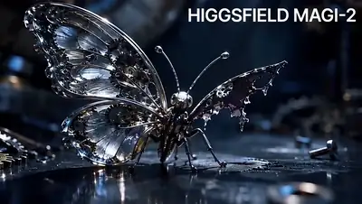</a><br><a href="https://www.sandbase.ai/lab/ai-videos/magi-2/2125775156190777534?lang=zh-CN&utm_source=github&utm_medium=readme&utm_campaign=awesome-magi-2&utm_content=card"><b>微型机械生物寻找遗失翅膀的短片</b></a><br><sub><a href="https://x.com/PUNPUNinuhime/status/2125775156190777534">@PUNPUNinuhime</a></sub></td></tr>
<tr><td width="33%" valign="top"><a href="https://www.sandbase.ai/lab/media/x/magi-2/2125776505397711336/video.mp4"></a><br><a href="https://www.sandbase.ai/lab/ai-videos/magi-2/2125776505397711336?lang=zh-CN&utm_source=github&utm_medium=readme&utm_campaign=awesome-magi-2&utm_content=card"><b>麦当劳实习生在第四天提出辞职</b></a><br><sub><a href="https://x.com/RobberCat_SOL/status/2125776505397711336">@RobberCat_SOL</a></sub></td><td width="33%" valign="top"><a href="https://www.sandbase.ai/lab/media/x/magi-2/2125778594903507200/video.mp4">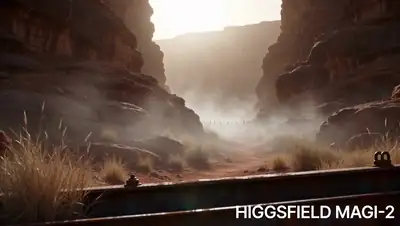</a><br><a href="https://www.sandbase.ai/lab/ai-videos/magi-2/2125778594903507200?lang=zh-CN&utm_source=github&utm_medium=readme&utm_campaign=awesome-magi-2&utm_content=card"><b>包含机械龙的电影感预告片</b></a><br><sub><a href="https://x.com/YaReYaRu30Life/status/2125778594903507200">@YaReYaRu30Life</a></sub></td><td width="33%" valign="top"><a href="https://www.sandbase.ai/lab/media/x/magi-2/2125781724592558544/video.mp4"></a><br><a href="https://www.sandbase.ai/lab/ai-videos/magi-2/2125781724592558544?lang=zh-CN&utm_source=github&utm_medium=readme&utm_campaign=awesome-magi-2&utm_content=card"><b>丧尸与吃韩式包子的角色</b></a><br><sub><a href="https://x.com/checheluna3/status/2125781724592558544">@checheluna3</a></sub></td></tr>
<tr><td width="33%" valign="top"><a href="https://www.sandbase.ai/lab/media/x/magi-2/2125782957831127463/video.mp4"></a><br><a href="https://www.sandbase.ai/lab/ai-videos/magi-2/2125782957831127463?lang=zh-CN&utm_source=github&utm_medium=readme&utm_campaign=awesome-magi-2&utm_content=card"><b>历史名人共同游览纽约市</b></a><br><sub><a href="https://x.com/kantakanta1233/status/2125782957831127463">@kantakanta1233</a></sub></td><td width="33%" valign="top"><a href="https://www.sandbase.ai/lab/media/x/magi-2/2125787143440302193/video.mp4"></a><br><a href="https://www.sandbase.ai/lab/ai-videos/magi-2/2125787143440302193?lang=zh-CN&utm_source=github&utm_medium=readme&utm_campaign=awesome-magi-2&utm_content=card"><b>单镜头一镜到底的清晨准备日常</b></a><br><sub><a href="https://x.com/ai_japan_muse/status/2125787143440302193">@ai_japan_muse</a></sub></td><td width="33%" valign="top"><a href="https://www.sandbase.ai/lab/media/x/magi-2/2125787327113105863/video.mp4"></a><br><a href="https://www.sandbase.ai/lab/ai-videos/magi-2/2125787327113105863?lang=zh-CN&utm_source=github&utm_medium=readme&utm_campaign=awesome-magi-2&utm_content=card"><b>雪地中滑行的单板滑雪角色</b></a><br><sub><a href="https://x.com/tsukuyomi2021/status/2125787327113105863">@tsukuyomi2021</a></sub></td></tr>
<tr><td width="33%" valign="top"><a href="https://www.sandbase.ai/lab/media/x/magi-2/2125789075776913453/video.mp4">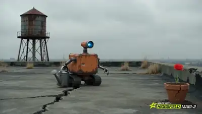</a><br><a href="https://www.sandbase.ai/lab/ai-videos/magi-2/2125789075776913453?lang=zh-CN&utm_source=github&utm_medium=readme&utm_campaign=awesome-magi-2&utm_content=card"><b>机器人雨中浇花的感人动画</b></a><br><sub><a href="https://x.com/sebatheepan/status/2125789075776913453">@sebatheepan</a></sub></td><td width="33%" valign="top"><a href="https://www.sandbase.ai/lab/media/x/magi-2/2125790406600450103/video.mp4"></a><br><a href="https://www.sandbase.ai/lab/ai-videos/magi-2/2125790406600450103?lang=zh-CN&utm_source=github&utm_medium=readme&utm_campaign=awesome-magi-2&utm_content=card"><b>角色在海边讨论应对方案</b></a><br><sub><a href="https://x.com/dave392750/status/2125790406600450103">@dave392750</a></sub></td><td width="33%" valign="top"><a href="https://www.sandbase.ai/lab/media/x/magi-2/2125791367880401140/video.mp4"></a><br><a href="https://www.sandbase.ai/lab/ai-videos/magi-2/2125791367880401140?lang=zh-CN&utm_source=github&utm_medium=readme&utm_campaign=awesome-magi-2&utm_content=card"><b>一名士兵在战壕中手持步枪</b></a><br><sub><a href="https://x.com/polijus8654/status/2125791367880401140">@polijus8654</a></sub></td></tr>
<tr><td width="33%" valign="top"><a href="https://www.sandbase.ai/lab/media/x/magi-2/2125791629982437711/video.mp4"></a><br><a href="https://www.sandbase.ai/lab/ai-videos/magi-2/2125791629982437711?lang=zh-CN&utm_source=github&utm_medium=readme&utm_campaign=awesome-magi-2&utm_content=card"><b>盲人剑客的黑暗民间传说动画片段</b></a><br><sub><a href="https://x.com/oggii_0/status/2125791629982437711">@oggii_0</a> · <a href="https://www.sandbase.ai/lab/ai-videos/magi-2/2125791629982437711?lang=zh-CN&utm_source=github&utm_medium=readme&utm_campaign=awesome-magi-2&utm_content=card">提示词</a></sub></td><td width="33%" valign="top"><a href="https://www.sandbase.ai/lab/media/x/magi-2/2125793547639259628/video.mp4"></a><br><a href="https://www.sandbase.ai/lab/ai-videos/magi-2/2125793547639259628?lang=zh-CN&utm_source=github&utm_medium=readme&utm_campaign=awesome-magi-2&utm_content=card"><b>电影质感叙事视频演示</b></a><br><sub><a href="https://x.com/TernakAI1122/status/2125793547639259628">@TernakAI1122</a></sub></td><td width="33%" valign="top"><a href="https://www.sandbase.ai/lab/media/x/magi-2/2125795305920880995/video.mp4"></a><br><a href="https://www.sandbase.ai/lab/ai-videos/magi-2/2125795305920880995?lang=zh-CN&utm_source=github&utm_medium=readme&utm_campaign=awesome-magi-2&utm_content=card"><b>地铁站内的惊悚恐怖场景</b></a><br><sub><a href="https://x.com/john_my07/status/2125795305920880995">@john_my07</a> · <a href="https://www.sandbase.ai/lab/ai-videos/magi-2/2125795305920880995?lang=zh-CN&utm_source=github&utm_medium=readme&utm_campaign=awesome-magi-2&utm_content=card">提示词</a></sub></td></tr>
<tr><td width="33%" valign="top"><a href="https://www.sandbase.ai/lab/media/x/magi-2/2125795679201304780/video.mp4"></a><br><a href="https://www.sandbase.ai/lab/ai-videos/magi-2/2125795679201304780?lang=zh-CN&utm_source=github&utm_medium=readme&utm_campaign=awesome-magi-2&utm_content=card"><b>一名女子走在巴黎雨天的早晨</b></a><br><sub><a href="https://x.com/Ciri_ai/status/2125795679201304780">@Ciri_ai</a> · <a href="https://www.sandbase.ai/lab/ai-videos/magi-2/2125795679201304780?lang=zh-CN&utm_source=github&utm_medium=readme&utm_campaign=awesome-magi-2&utm_content=card">提示词</a></sub></td><td width="33%" valign="top"><a href="https://www.sandbase.ai/lab/media/x/magi-2/2125795794926317701/video.mp4"></a><br><a href="https://www.sandbase.ai/lab/ai-videos/magi-2/2125795794926317701?lang=zh-CN&utm_source=github&utm_medium=readme&utm_campaign=awesome-magi-2&utm_content=card"><b>关于分享与友谊的温情故事</b></a><br><sub><a href="https://x.com/Sheldon056/status/2125795794926317701">@Sheldon056</a></sub></td><td width="33%" valign="top"><a href="https://www.sandbase.ai/lab/media/x/magi-2/2125796158824161579/video.mp4"></a><br><a href="https://www.sandbase.ai/lab/ai-videos/magi-2/2125796158824161579?lang=zh-CN&utm_source=github&utm_medium=readme&utm_campaign=awesome-magi-2&utm_content=card"><b>两只相互扶助的微光萤火虫</b></a><br><sub><a href="https://x.com/KT_first_story/status/2125796158824161579">@KT_first_story</a></sub></td></tr>
<tr><td width="33%" valign="top"><a href="https://www.sandbase.ai/lab/media/x/magi-2/2125796933814083982/video.mp4"></a><br><a href="https://www.sandbase.ai/lab/ai-videos/magi-2/2125796933814083982?lang=zh-CN&utm_source=github&utm_medium=readme&utm_campaign=awesome-magi-2&utm_content=card"><b>暴风雨中紧紧牵手的两只海獭</b></a><br><sub><a href="https://x.com/TechTalkNAVI/status/2125796933814083982">@TechTalkNAVI</a></sub></td><td width="33%" valign="top"><a href="https://www.sandbase.ai/lab/media/x/magi-2/2125797087359259104/video.mp4"></a><br><a href="https://www.sandbase.ai/lab/ai-videos/magi-2/2125797087359259104?lang=zh-CN&utm_source=github&utm_medium=readme&utm_campaign=awesome-magi-2&utm_content=card"><b>猫咪抢劫短片重制版</b></a><br><sub><a href="https://x.com/RobberCat_SOL/status/2125797087359259104">@RobberCat_SOL</a></sub></td><td width="33%" valign="top"><a href="https://www.sandbase.ai/lab/media/x/magi-2/2125797697567490321/video.mp4"></a><br><a href="https://www.sandbase.ai/lab/ai-videos/magi-2/2125797697567490321?lang=zh-CN&utm_source=github&utm_medium=readme&utm_campaign=awesome-magi-2&utm_content=card"><b>黑帮在电梯里遭遇致命女孩</b></a><br><sub><a href="https://x.com/ChillaiKalan__/status/2125797697567490321">@ChillaiKalan__</a></sub></td></tr>
<tr><td width="33%" valign="top"><a href="https://www.sandbase.ai/lab/media/x/magi-2/2125799461335290108/video.mp4"></a><br><a href="https://www.sandbase.ai/lab/ai-videos/magi-2/2125799461335290108?lang=zh-CN&utm_source=github&utm_medium=readme&utm_campaign=awesome-magi-2&utm_content=card"><b>一部40年代好莱坞悬疑电影片段</b></a><br><sub><a href="https://x.com/Maxime887812/status/2125799461335290108">@Maxime887812</a></sub></td><td width="33%" valign="top"><a href="https://www.sandbase.ai/lab/media/x/magi-2/2125801216781537383/video.mp4">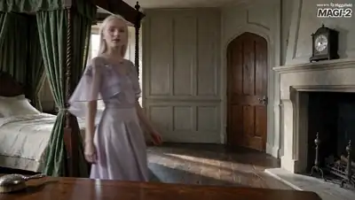</a><br><a href="https://www.sandbase.ai/lab/ai-videos/magi-2/2125801216781537383?lang=zh-CN&utm_source=github&utm_medium=readme&utm_campaign=awesome-magi-2&utm_content=card"><b>为盛大活动做准备</b></a><br><sub><a href="https://x.com/MadMax_Series/status/2125801216781537383">@MadMax_Series</a></sub></td><td width="33%" valign="top"><a href="https://www.sandbase.ai/lab/media/x/magi-2/2125801216948973612/video.mp4">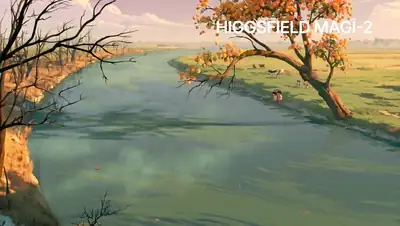</a><br><a href="https://www.sandbase.ai/lab/ai-videos/magi-2/2125801216948973612?lang=zh-CN&utm_source=github&utm_medium=readme&utm_campaign=awesome-magi-2&utm_content=card"><b>3D动画演绎克里希纳制服卡利亚毒蛇</b></a><br><sub><a href="https://x.com/Ankit_patel211/status/2125801216948973612">@Ankit_patel211</a></sub></td></tr>
<tr><td width="33%" valign="top"><a href="https://www.sandbase.ai/lab/media/x/magi-2/2125801722933137665/video.mp4"></a><br><a href="https://www.sandbase.ai/lab/ai-videos/magi-2/2125801722933137665?lang=zh-CN&utm_source=github&utm_medium=readme&utm_campaign=awesome-magi-2&utm_content=card"><b>六只柯基幼犬追逐肥皂泡</b></a><br><sub><a href="https://x.com/Bianca_AIart_mu/status/2125801722933137665">@Bianca_AIart_mu</a></sub></td><td width="33%" valign="top"><a href="https://www.sandbase.ai/lab/media/x/magi-2/2125803088523231600/video.mp4"></a><br><a href="https://www.sandbase.ai/lab/ai-videos/magi-2/2125803088523231600?lang=zh-CN&utm_source=github&utm_medium=readme&utm_campaign=awesome-magi-2&utm_content=card"><b>沿海村庄的夏日下午纪实</b></a><br><sub><a href="https://x.com/SimplyAnnisa/status/2125803088523231600">@SimplyAnnisa</a> · <a href="https://www.sandbase.ai/lab/ai-videos/magi-2/2125803088523231600?lang=zh-CN&utm_source=github&utm_medium=readme&utm_campaign=awesome-magi-2&utm_content=card">提示词</a></sub></td><td width="33%" valign="top"><a href="https://www.sandbase.ai/lab/media/x/magi-2/2125805243329908927/video.mp4">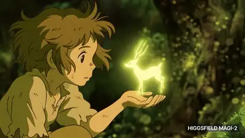</a><br><a href="https://www.sandbase.ai/lab/ai-videos/magi-2/2125805243329908927?lang=zh-CN&utm_source=github&utm_medium=readme&utm_campaign=awesome-magi-2&utm_content=card"><b>森林中的一场小小邂逅</b></a><br><sub><a href="https://x.com/neco1751662/status/2125805243329908927">@neco1751662</a></sub></td></tr>
<tr><td width="33%" valign="top"><a href="https://www.sandbase.ai/lab/media/x/magi-2/2125805598239269190/video.mp4"></a><br><a href="https://www.sandbase.ai/lab/ai-videos/magi-2/2125805598239269190?lang=zh-CN&utm_source=github&utm_medium=readme&utm_campaign=awesome-magi-2&utm_content=card"><b>烛光下的三次约会场景</b></a><br><sub><a href="https://x.com/ivanka_humeniuk/status/2125805598239269190">@ivanka_humeniuk</a> · <a href="https://www.sandbase.ai/lab/ai-videos/magi-2/2125805598239269190?lang=zh-CN&utm_source=github&utm_medium=readme&utm_campaign=awesome-magi-2&utm_content=card">提示词</a></sub></td><td width="33%" valign="top"><a href="https://www.sandbase.ai/lab/media/x/magi-2/2125811678889791810/video.mp4"></a><br><a href="https://www.sandbase.ai/lab/ai-videos/magi-2/2125811678889791810?lang=zh-CN&utm_source=github&utm_medium=readme&utm_campaign=awesome-magi-2&utm_content=card"><b>皮克斯风格的3D喜剧短片</b></a><br><sub><a href="https://x.com/AIwithkhan/status/2125811678889791810">@AIwithkhan</a> · <a href="https://www.sandbase.ai/lab/ai-videos/magi-2/2125811678889791810?lang=zh-CN&utm_source=github&utm_medium=readme&utm_campaign=awesome-magi-2&utm_content=card">提示词</a></sub></td><td width="33%" valign="top"><a href="https://www.sandbase.ai/lab/media/x/magi-2/2125816873375907897/video.mp4"></a><br><a href="https://www.sandbase.ai/lab/ai-videos/magi-2/2125816873375907897?lang=zh-CN&utm_source=github&utm_medium=readme&utm_campaign=awesome-magi-2&utm_content=card"><b>女孩在黎明追逐麻雀</b></a><br><sub><a href="https://x.com/PromptSin/status/2125816873375907897">@PromptSin</a></sub></td></tr>
<tr><td width="33%" valign="top"><a href="https://www.sandbase.ai/lab/media/x/magi-2/2125819548901474565/video.mp4"></a><br><a href="https://www.sandbase.ai/lab/ai-videos/magi-2/2125819548901474565?lang=zh-CN&utm_source=github&utm_medium=readme&utm_campaign=awesome-magi-2&utm_content=card"><b>MAGI-2制作的黑暗奇幻贤者场景</b></a><br><sub><a href="https://x.com/os_shim/status/2125819548901474565">@os_shim</a></sub></td><td width="33%" valign="top"><a href="https://www.sandbase.ai/lab/media/x/magi-2/2125822150460522526/video.mp4"></a><br><a href="https://www.sandbase.ai/lab/ai-videos/magi-2/2125822150460522526?lang=zh-CN&utm_source=github&utm_medium=readme&utm_campaign=awesome-magi-2&utm_content=card"><b>充满电影感的黑色电影风格视频</b></a><br><sub><a href="https://x.com/lansenai/status/2125822150460522526">@lansenai</a></sub></td><td width="33%" valign="top"><a href="https://www.sandbase.ai/lab/media/x/magi-2/2125828754916167998/video.mp4"></a><br><a href="https://www.sandbase.ai/lab/ai-videos/magi-2/2125828754916167998?lang=zh-CN&utm_source=github&utm_medium=readme&utm_campaign=awesome-magi-2&utm_content=card"><b>偶像风格的练腿日健身视频博客</b></a><br><sub><a href="https://x.com/doctorwasif/status/2125828754916167998">@doctorwasif</a></sub></td></tr>
<tr><td width="33%" valign="top"><a href="https://www.sandbase.ai/lab/media/x/magi-2/2125832298574590127/video.mp4">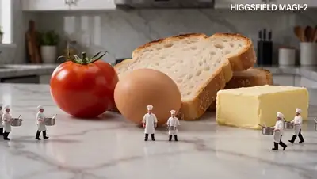</a><br><a href="https://www.sandbase.ai/lab/ai-videos/magi-2/2125832298574590127?lang=zh-CN&utm_source=github&utm_medium=readme&utm_campaign=awesome-magi-2&utm_content=card"><b>微型厨师制作巨大早餐</b></a><br><sub><a href="https://x.com/RuzainaMeer/status/2125832298574590127">@RuzainaMeer</a> · <a href="https://www.sandbase.ai/lab/ai-videos/magi-2/2125832298574590127?lang=zh-CN&utm_source=github&utm_medium=readme&utm_campaign=awesome-magi-2&utm_content=card">提示词</a></sub></td><td width="33%" valign="top"><a href="https://www.sandbase.ai/lab/media/x/magi-2/2125836368794509566/video.mp4"></a><br><a href="https://www.sandbase.ai/lab/ai-videos/magi-2/2125836368794509566?lang=zh-CN&utm_source=github&utm_medium=readme&utm_campaign=awesome-magi-2&utm_content=card"><b>两只小猫在洗车房的日常</b></a><br><sub><a href="https://x.com/Maxime887812/status/2125836368794509566">@Maxime887812</a> · <a href="https://www.sandbase.ai/lab/ai-videos/magi-2/2125836368794509566?lang=zh-CN&utm_source=github&utm_medium=readme&utm_campaign=awesome-magi-2&utm_content=card">提示词</a></sub></td><td width="33%" valign="top"><a href="https://www.sandbase.ai/lab/media/x/magi-2/2125844812167569730/video.mp4"></a><br><a href="https://www.sandbase.ai/lab/ai-videos/magi-2/2125844812167569730?lang=zh-CN&utm_source=github&utm_medium=readme&utm_campaign=awesome-magi-2&utm_content=card"><b>雪中住宅街道的冬日生活片段</b></a><br><sub><a href="https://x.com/Ciri_ai/status/2125844812167569730">@Ciri_ai</a> · <a href="https://www.sandbase.ai/lab/ai-videos/magi-2/2125844812167569730?lang=zh-CN&utm_source=github&utm_medium=readme&utm_campaign=awesome-magi-2&utm_content=card">提示词</a></sub></td></tr>
<tr><td width="33%" valign="top"><a href="https://www.sandbase.ai/lab/media/x/magi-2/2125847776127042006/video.mp4">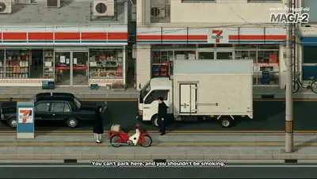</a><br><a href="https://www.sandbase.ai/lab/ai-videos/magi-2/2125847776127042006?lang=zh-CN&utm_source=github&utm_medium=readme&utm_campaign=awesome-magi-2&utm_content=card"><b>使用MAGI-2制作的短片片段</b></a><br><sub><a href="https://x.com/kiuzyx/status/2125847776127042006">@kiuzyx</a></sub></td><td width="33%" valign="top"><a href="https://www.sandbase.ai/lab/media/x/magi-2/2125848941170454811/video.mp4"></a><br><a href="https://www.sandbase.ai/lab/ai-videos/magi-2/2125848941170454811?lang=zh-CN&utm_source=github&utm_medium=readme&utm_campaign=awesome-magi-2&utm_content=card"><b>印度街道上的趣味季风混乱场景</b></a><br><sub><a href="https://x.com/FutureVibesAi/status/2125848941170454811">@FutureVibesAi</a></sub></td><td width="33%" valign="top"><a href="https://www.sandbase.ai/lab/media/x/magi-2/2125849409078645150/video.mp4"></a><br><a href="https://www.sandbase.ai/lab/ai-videos/magi-2/2125849409078645150?lang=zh-CN&utm_source=github&utm_medium=readme&utm_campaign=awesome-magi-2&utm_content=card"><b>地铁站内的丧尸惊悚短片序列</b></a><br><sub><a href="https://x.com/oggii_0/status/2125849409078645150">@oggii_0</a> · <a href="https://www.sandbase.ai/lab/ai-videos/magi-2/2125849409078645150?lang=zh-CN&utm_source=github&utm_medium=readme&utm_campaign=awesome-magi-2&utm_content=card">提示词</a></sub></td></tr>
<tr><td width="33%" valign="top"><a href="https://www.sandbase.ai/lab/media/x/magi-2/2125851271689392633/video.mp4"></a><br><a href="https://www.sandbase.ai/lab/ai-videos/magi-2/2125851271689392633?lang=zh-CN&utm_source=github&utm_medium=readme&utm_campaign=awesome-magi-2&utm_content=card"><b>一对情侣旅行的电影感视频片段</b></a><br><sub><a href="https://x.com/EEJ_OOXO/status/2125851271689392633">@EEJ_OOXO</a></sub></td><td width="33%" valign="top"><a href="https://www.sandbase.ai/lab/media/x/magi-2/2125853813294891282/video.mp4">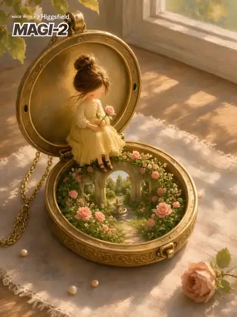</a><br><a href="https://www.sandbase.ai/lab/ai-videos/magi-2/2125853813294891282?lang=zh-CN&utm_source=github&utm_medium=readme&utm_campaign=awesome-magi-2&utm_content=card"><b>手表内部的微型花园</b></a><br><sub><a href="https://x.com/art_muse/status/2125853813294891282">@art_muse</a></sub></td><td width="33%" valign="top"><a href="https://www.sandbase.ai/lab/media/x/magi-2/2125861469677867181/video.mp4">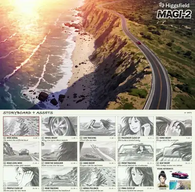</a><br><a href="https://www.sandbase.ai/lab/ai-videos/magi-2/2125861469677867181?lang=zh-CN&utm_source=github&utm_medium=readme&utm_campaign=awesome-magi-2&utm_content=card"><b>落日驾车时手指轻敲方向盘</b></a><br><sub><a href="https://x.com/AI_CyberDreams/status/2125861469677867181">@AI_CyberDreams</a></sub></td></tr>
<tr><td width="33%" valign="top"><a href="https://www.sandbase.ai/lab/media/x/magi-2/2125863211102802157/video.mp4"></a><br><a href="https://www.sandbase.ai/lab/ai-videos/magi-2/2125863211102802157?lang=zh-CN&utm_source=github&utm_medium=readme&utm_campaign=awesome-magi-2&utm_content=card"><b>一名女子匆忙赶往机场乘机的全过程</b></a><br><sub><a href="https://x.com/AIwithSynthia/status/2125863211102802157">@AIwithSynthia</a> · <a href="https://www.sandbase.ai/lab/ai-videos/magi-2/2125863211102802157?lang=zh-CN&utm_source=github&utm_medium=readme&utm_campaign=awesome-magi-2&utm_content=card">提示词</a></sub></td><td width="33%" valign="top"><a href="https://www.sandbase.ai/lab/media/x/magi-2/2125868906971607273/video.mp4"></a><br><a href="https://www.sandbase.ai/lab/ai-videos/magi-2/2125868906971607273?lang=zh-CN&utm_source=github&utm_medium=readme&utm_campaign=awesome-magi-2&utm_content=card"><b>带对口型的戏剧性坠崖剧情短片</b></a><br><sub><a href="https://x.com/johnAGI168/status/2125868906971607273">@johnAGI168</a> · <a href="https://www.sandbase.ai/lab/ai-videos/magi-2/2125868906971607273?lang=zh-CN&utm_source=github&utm_medium=readme&utm_campaign=awesome-magi-2&utm_content=card">提示词</a></sub></td><td width="33%" valign="top"><a href="https://www.sandbase.ai/lab/media/x/magi-2/2125869111775461507/video.mp4"></a><br><a href="https://www.sandbase.ai/lab/ai-videos/magi-2/2125869111775461507?lang=zh-CN&utm_source=github&utm_medium=readme&utm_campaign=awesome-magi-2&utm_content=card"><b>女子早晨忙碌日常的写实家庭录像</b></a><br><sub><a href="https://x.com/john_my07/status/2125869111775461507">@john_my07</a> · <a href="https://www.sandbase.ai/lab/ai-videos/magi-2/2125869111775461507?lang=zh-CN&utm_source=github&utm_medium=readme&utm_campaign=awesome-magi-2&utm_content=card">提示词</a></sub></td></tr>
<tr><td width="33%" valign="top"><a href="https://www.sandbase.ai/lab/media/x/magi-2/2125871302041039000/video.mp4"></a><br><a href="https://www.sandbase.ai/lab/ai-videos/magi-2/2125871302041039000?lang=zh-CN&utm_source=github&utm_medium=readme&utm_campaign=awesome-magi-2&utm_content=card"><b>巴黎咖啡馆的三镜头爱情短片</b></a><br><sub><a href="https://x.com/Maxime887812/status/2125871302041039000">@Maxime887812</a></sub></td><td width="33%" valign="top"><a href="https://www.sandbase.ai/lab/media/x/magi-2/2125873134322733507/video.mp4"></a><br><a href="https://www.sandbase.ai/lab/ai-videos/magi-2/2125873134322733507?lang=zh-CN&utm_source=github&utm_medium=readme&utm_campaign=awesome-magi-2&utm_content=card"><b>夜间随身执法记录仪拍摄的例行拦车检视</b></a><br><sub><a href="https://x.com/weiinberg/status/2125873134322733507">@weiinberg</a> · <a href="https://www.sandbase.ai/lab/ai-videos/magi-2/2125873134322733507?lang=zh-CN&utm_source=github&utm_medium=readme&utm_campaign=awesome-magi-2&utm_content=card">提示词</a></sub></td><td width="33%" valign="top"><a href="https://www.sandbase.ai/lab/media/x/magi-2/2125877422587596881/video.mp4">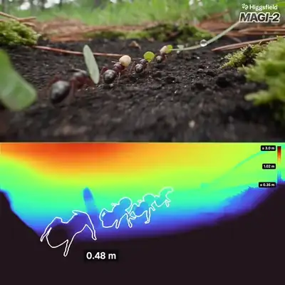</a><br><a href="https://www.sandbase.ai/lab/ai-videos/magi-2/2125877422587596881?lang=zh-CN&utm_source=github&utm_medium=readme&utm_campaign=awesome-magi-2&utm_content=card"><b>跟随蚂蚁深入蚁巢的微距镜头</b></a><br><sub><a href="https://x.com/Flkrstudio/status/2125877422587596881">@Flkrstudio</a></sub></td></tr>
<tr><td width="33%" valign="top"><a href="https://www.sandbase.ai/lab/media/x/magi-2/2125889275002495136/video.mp4"></a><br><a href="https://www.sandbase.ai/lab/ai-videos/magi-2/2125889275002495136?lang=zh-CN&utm_source=github&utm_medium=readme&utm_campaign=awesome-magi-2&utm_content=card"><b>20世纪50年代伦敦市场的复古电影场景</b></a><br><sub><a href="https://x.com/ZaraIrahh/status/2125889275002495136">@ZaraIrahh</a></sub></td><td width="33%" valign="top"><a href="https://www.sandbase.ai/lab/media/x/magi-2/2125902442277527873/video.mp4">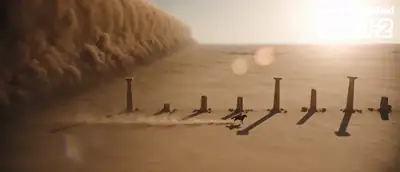</a><br><a href="https://www.sandbase.ai/lab/ai-videos/magi-2/2125902442277527873?lang=zh-CN&utm_source=github&utm_medium=readme&utm_campaign=awesome-magi-2&utm_content=card"><b>题为不害怕的15秒生成短片</b></a><br><sub><a href="https://x.com/PeterKL87/status/2125902442277527873">@PeterKL87</a></sub></td><td width="33%" valign="top"><a href="https://www.sandbase.ai/lab/media/x/magi-2/2125907956541849634/video.mp4"></a><br><a href="https://www.sandbase.ai/lab/ai-videos/magi-2/2125907956541849634?lang=zh-CN&utm_source=github&utm_medium=readme&utm_campaign=awesome-magi-2&utm_content=card"><b>体育赛事直播风格的感恩节晚餐</b></a><br><sub><a href="https://x.com/airina_xyz/status/2125907956541849634">@airina_xyz</a> · <a href="https://www.sandbase.ai/lab/ai-videos/magi-2/2125907956541849634?lang=zh-CN&utm_source=github&utm_medium=readme&utm_campaign=awesome-magi-2&utm_content=card">提示词</a></sub></td></tr>
<tr><td width="33%" valign="top"><a href="https://www.sandbase.ai/lab/media/x/magi-2/2125920173903184107/video.mp4"></a><br><a href="https://www.sandbase.ai/lab/ai-videos/magi-2/2125920173903184107?lang=zh-CN&utm_source=github&utm_medium=readme&utm_campaign=awesome-magi-2&utm_content=card"><b>发生在神秘十三层的悬疑惊悚短片</b></a><br><sub><a href="https://x.com/Hope_Ai01/status/2125920173903184107">@Hope_Ai01</a> · <a href="https://www.sandbase.ai/lab/ai-videos/magi-2/2125920173903184107?lang=zh-CN&utm_source=github&utm_medium=readme&utm_campaign=awesome-magi-2&utm_content=card">提示词</a></sub></td><td width="33%" valign="top"><a href="https://www.sandbase.ai/lab/media/x/magi-2/2125945816229859418/video.mp4"></a><br><a href="https://www.sandbase.ai/lab/ai-videos/magi-2/2125945816229859418?lang=zh-CN&utm_source=github&utm_medium=readme&utm_campaign=awesome-magi-2&utm_content=card"><b>雨天探索伦敦的英式喜剧短片</b></a><br><sub><a href="https://x.com/AIwithkhan/status/2125945816229859418">@AIwithkhan</a> · <a href="https://www.sandbase.ai/lab/ai-videos/magi-2/2125945816229859418?lang=zh-CN&utm_source=github&utm_medium=readme&utm_campaign=awesome-magi-2&utm_content=card">提示词</a></sub></td><td width="33%" valign="top"><a href="https://www.sandbase.ai/lab/media/x/magi-2/2125946885424767014/video.mp4">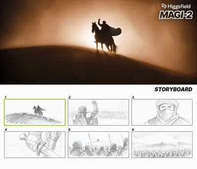</a><br><a href="https://www.sandbase.ai/lab/ai-videos/magi-2/2125946885424767014?lang=zh-CN&utm_source=github&utm_medium=readme&utm_campaign=awesome-magi-2&utm_content=card"><b>沙丘骑手与大军的分镜六镜头</b></a><br><sub><a href="https://x.com/saniaspeaks_/status/2125946885424767014">@saniaspeaks_</a></sub></td></tr>
<tr><td width="33%" valign="top"><a href="https://www.sandbase.ai/lab/media/x/magi-2/2125947103574913497/video.mp4"></a><br><a href="https://www.sandbase.ai/lab/ai-videos/magi-2/2125947103574913497?lang=zh-CN&utm_source=github&utm_medium=readme&utm_campaign=awesome-magi-2&utm_content=card"><b>关于一句迫切问候的微短片</b></a><br><sub><a href="https://x.com/voidaistudios/status/2125947103574913497">@voidaistudios</a></sub></td><td width="33%" valign="top"><a href="https://www.sandbase.ai/lab/media/x/magi-2/2125947516260844019/video.mp4"></a><br><a href="https://www.sandbase.ai/lab/ai-videos/magi-2/2125947516260844019?lang=zh-CN&utm_source=github&utm_medium=readme&utm_campaign=awesome-magi-2&utm_content=card"><b>三台机器人在雨夜服务顾客</b></a><br><sub><a href="https://x.com/CurieuxExplorer/status/2125947516260844019">@CurieuxExplorer</a></sub></td><td width="33%" valign="top"><a href="https://www.sandbase.ai/lab/media/x/magi-2/2125995165311770639/video.mp4"></a><br><a href="https://www.sandbase.ai/lab/ai-videos/magi-2/2125995165311770639?lang=zh-CN&utm_source=github&utm_medium=readme&utm_campaign=awesome-magi-2&utm_content=card"><b>一名旅客在机场航站楼匆忙狂奔的喜剧短片</b></a><br><sub><a href="https://x.com/Ciri_ai/status/2125995165311770639">@Ciri_ai</a> · <a href="https://www.sandbase.ai/lab/ai-videos/magi-2/2125995165311770639?lang=zh-CN&utm_source=github&utm_medium=readme&utm_campaign=awesome-magi-2&utm_content=card">提示词</a></sub></td></tr>
<tr><td width="33%" valign="top"><a href="https://www.sandbase.ai/lab/media/x/magi-2/2125996946049663370/video.mp4"></a><br><a href="https://www.sandbase.ai/lab/ai-videos/magi-2/2125996946049663370?lang=zh-CN&utm_source=github&utm_medium=readme&utm_campaign=awesome-magi-2&utm_content=card"><b>女子与宠物狗的慵懒早晨蒙太奇</b></a><br><sub><a href="https://x.com/oggii_0/status/2125996946049663370">@oggii_0</a> · <a href="https://www.sandbase.ai/lab/ai-videos/magi-2/2125996946049663370?lang=zh-CN&utm_source=github&utm_medium=readme&utm_campaign=awesome-magi-2&utm_content=card">提示词</a></sub></td><td width="33%" valign="top"><a href="https://www.sandbase.ai/lab/media/x/magi-2/2126017272947028182/video.mp4"></a><br><a href="https://www.sandbase.ai/lab/ai-videos/magi-2/2126017272947028182?lang=zh-CN&utm_source=github&utm_medium=readme&utm_campaign=awesome-magi-2&utm_content=card"><b>边境检查站的丧尸爆发电影场景</b></a><br><sub><a href="https://x.com/doctorwasif/status/2126017272947028182">@doctorwasif</a></sub></td><td width="33%" valign="top"><a href="https://www.sandbase.ai/lab/media/x/magi-2/2126058462056415470/video.mp4"></a><br><a href="https://www.sandbase.ai/lab/ai-videos/magi-2/2126058462056415470?lang=zh-CN&utm_source=github&utm_medium=readme&utm_campaign=awesome-magi-2&utm_content=card"><b>爱之眼情感短片</b></a><br><sub><a href="https://x.com/ImozemhePeniel/status/2126058462056415470">@ImozemhePeniel</a></sub></td></tr>
</table>

</details>

<a id="music-video"></a>

## 音乐视频

<table>
<tr><td width="33%" valign="top"><a href="https://www.sandbase.ai/lab/media/x/magi-2/2125479042761789699/video.mp4"></a><br><a href="https://www.sandbase.ai/lab/ai-videos/magi-2/2125479042761789699?lang=zh-CN&utm_source=github&utm_medium=readme&utm_campaign=awesome-magi-2&utm_content=card"><b>Horu 用韩语演唱生日快乐歌</b></a><br><sub><a href="https://x.com/hype_boyo/status/2125479042761789699">@hype_boyo</a></sub></td><td width="33%" valign="top"><a href="https://www.sandbase.ai/lab/media/x/magi-2/2125504100670530040/video.mp4"></a><br><a href="https://www.sandbase.ai/lab/ai-videos/magi-2/2125504100670530040?lang=zh-CN&utm_source=github&utm_medium=readme&utm_campaign=awesome-magi-2&utm_content=card"><b>赛璐璐风格卡点动漫音乐视频</b></a><br><sub><a href="https://x.com/criscxuan/status/2125504100670530040">@criscxuan</a> · <a href="https://www.sandbase.ai/lab/ai-videos/magi-2/2125504100670530040?lang=zh-CN&utm_source=github&utm_medium=readme&utm_campaign=awesome-magi-2&utm_content=card">提示词</a></sub></td><td width="33%" valign="top"><a href="https://www.sandbase.ai/lab/media/x/magi-2/2125802832838512782/video.mp4"></a><br><a href="https://www.sandbase.ai/lab/ai-videos/magi-2/2125802832838512782?lang=zh-CN&utm_source=github&utm_medium=readme&utm_campaign=awesome-magi-2&utm_content=card"><b>派对散场后的唯美圣诞音乐短片</b></a><br><sub><a href="https://x.com/harboriis/status/2125802832838512782">@harboriis</a> · <a href="https://www.sandbase.ai/lab/ai-videos/magi-2/2125802832838512782?lang=zh-CN&utm_source=github&utm_medium=readme&utm_campaign=awesome-magi-2&utm_content=card">提示词</a></sub></td></tr>
<tr><td width="33%" valign="top"><a href="https://www.sandbase.ai/lab/media/x/magi-2/2125843415804133685/video.mp4"></a><br><a href="https://www.sandbase.ai/lab/ai-videos/magi-2/2125843415804133685?lang=zh-CN&utm_source=github&utm_medium=readme&utm_campaign=awesome-magi-2&utm_content=card"><b>呈现四季景色的短篇音乐视频</b></a><br><sub><a href="https://x.com/AwajiAqua/status/2125843415804133685">@AwajiAqua</a></sub></td><td width="33%" valign="top"><a href="https://www.sandbase.ai/lab/media/x/magi-2/2125950365770342434/video.mp4"></a><br><a href="https://www.sandbase.ai/lab/ai-videos/magi-2/2125950365770342434?lang=zh-CN&utm_source=github&utm_medium=readme&utm_campaign=awesome-magi-2&utm_content=card"><b>具氛围感光影的电影级音乐视频片段</b></a><br><sub><a href="https://x.com/ZaraIrahh/status/2125950365770342434">@ZaraIrahh</a></sub></td></tr>
</table>

<a id="anime"></a>

## 动画

<table>
<tr><td width="33%" valign="top"><a href="https://www.sandbase.ai/lab/media/x/magi-2/2125341667511443497/video.mp4"></a><br><a href="https://www.sandbase.ai/lab/ai-videos/magi-2/2125341667511443497?lang=zh-CN&utm_source=github&utm_medium=readme&utm_campaign=awesome-magi-2&utm_content=card"><b>复古80年代动漫风格的小丑赛车</b></a><br><sub><a href="https://x.com/VxRender/status/2125341667511443497">@VxRender</a></sub></td><td width="33%" valign="top"><a href="https://www.sandbase.ai/lab/media/x/magi-2/2125390876759515433/video.mp4"></a><br><a href="https://www.sandbase.ai/lab/ai-videos/magi-2/2125390876759515433?lang=zh-CN&utm_source=github&utm_medium=readme&utm_campaign=awesome-magi-2&utm_content=card"><b>夜间港口背景的动漫动作场景</b></a><br><sub><a href="https://x.com/akakuma0219/status/2125390876759515433">@akakuma0219</a></sub></td><td width="33%" valign="top"><a href="https://www.sandbase.ai/lab/media/x/magi-2/2125419982586773546/video.mp4"></a><br><a href="https://www.sandbase.ai/lab/ai-videos/magi-2/2125419982586773546?lang=zh-CN&utm_source=github&utm_medium=readme&utm_campaign=awesome-magi-2&utm_content=card"><b>角色Kucho在传送带旁快速吃寿司</b></a><br><sub><a href="https://x.com/picassong_art/status/2125419982586773546">@picassong_art</a></sub></td></tr>
<tr><td width="33%" valign="top"><a href="https://www.sandbase.ai/lab/media/x/magi-2/2125426273619198280/video.mp4"></a><br><a href="https://www.sandbase.ai/lab/ai-videos/magi-2/2125426273619198280?lang=zh-CN&utm_source=github&utm_medium=readme&utm_campaign=awesome-magi-2&utm_content=card"><b>日出时分湿漉漉屋顶上的动漫少女</b></a><br><sub><a href="https://x.com/Iancu_ai/status/2125426273619198280">@Iancu_ai</a></sub></td><td width="33%" valign="top"><a href="https://www.sandbase.ai/lab/media/x/magi-2/2125430483018563681/video.mp4"></a><br><a href="https://www.sandbase.ai/lab/ai-videos/magi-2/2125430483018563681?lang=zh-CN&utm_source=github&utm_medium=readme&utm_campaign=awesome-magi-2&utm_content=card"><b>带有日语台词的动画短片测试</b></a><br><sub><a href="https://x.com/SSSS_CRYPTOMAN/status/2125430483018563681">@SSSS_CRYPTOMAN</a></sub></td><td width="33%" valign="top"><a href="https://www.sandbase.ai/lab/media/x/magi-2/2125458532518834417/video.mp4"></a><br><a href="https://www.sandbase.ai/lab/ai-videos/magi-2/2125458532518834417?lang=zh-CN&utm_source=github&utm_medium=readme&utm_campaign=awesome-magi-2&utm_content=card"><b>使用MAGI-2制作的短篇动画视频</b></a><br><sub><a href="https://x.com/shinyitv/status/2125458532518834417">@shinyitv</a></sub></td></tr>
</table>

<details>
<summary><b>展开全部 61 条</b></summary>

<table>
<tr><td width="33%" valign="top"><a href="https://www.sandbase.ai/lab/media/x/magi-2/2125468064527638994/video.mp4"></a><br><a href="https://www.sandbase.ai/lab/ai-videos/magi-2/2125468064527638994?lang=zh-CN&utm_source=github&utm_medium=readme&utm_campaign=awesome-magi-2&utm_content=card"><b>以角色Misa为主角的双城之战风格动漫</b></a><br><sub><a href="https://x.com/hetzerLin/status/2125468064527638994">@hetzerLin</a></sub></td><td width="33%" valign="top"><a href="https://www.sandbase.ai/lab/media/x/magi-2/2125471875086327853/video.mp4"></a><br><a href="https://www.sandbase.ai/lab/ai-videos/magi-2/2125471875086327853?lang=zh-CN&utm_source=github&utm_medium=readme&utm_campaign=awesome-magi-2&utm_content=card"><b>使用 MAGI-2 制作的动画视频</b></a><br><sub><a href="https://x.com/byaiden_vu/status/2125471875086327853">@byaiden_vu</a></sub></td><td width="33%" valign="top"><a href="https://www.sandbase.ai/lab/media/x/magi-2/2125482836048363992/video.mp4"></a><br><a href="https://www.sandbase.ai/lab/ai-videos/magi-2/2125482836048363992?lang=zh-CN&utm_source=github&utm_medium=readme&utm_campaign=awesome-magi-2&utm_content=card"><b>傲娇女孩独自度过的一天</b></a><br><sub><a href="https://x.com/shishirdotai/status/2125482836048363992">@shishirdotai</a></sub></td></tr>
<tr><td width="33%" valign="top"><a href="https://www.sandbase.ai/lab/media/x/magi-2/2125483093041746213/video.mp4"></a><br><a href="https://www.sandbase.ai/lab/ai-videos/magi-2/2125483093041746213?lang=zh-CN&utm_source=github&utm_medium=readme&utm_campaign=awesome-magi-2&utm_content=card"><b>以东京为背景的浪漫动漫场景</b></a><br><sub><a href="https://x.com/MayorKingAI/status/2125483093041746213">@MayorKingAI</a></sub></td><td width="33%" valign="top"><a href="https://www.sandbase.ai/lab/media/x/magi-2/2125487471731343776/video.mp4"></a><br><a href="https://www.sandbase.ai/lab/ai-videos/magi-2/2125487471731343776?lang=zh-CN&utm_source=github&utm_medium=readme&utm_campaign=awesome-magi-2&utm_content=card"><b>经典动画风格的新宿深夜拉面场景</b></a><br><sub><a href="https://x.com/PixelNinjaArt/status/2125487471731343776">@PixelNinjaArt</a></sub></td><td width="33%" valign="top"><a href="https://www.sandbase.ai/lab/media/x/magi-2/2125488966644515055/video.mp4"></a><br><a href="https://www.sandbase.ai/lab/ai-videos/magi-2/2125488966644515055?lang=zh-CN&utm_source=github&utm_medium=readme&utm_campaign=awesome-magi-2&utm_content=card"><b>湿地大瀑布的混乱奇观</b></a><br><sub><a href="https://x.com/john_my07/status/2125488966644515055">@john_my07</a></sub></td></tr>
<tr><td width="33%" valign="top"><a href="https://www.sandbase.ai/lab/media/x/magi-2/2125497820518199324/video.mp4"></a><br><a href="https://www.sandbase.ai/lab/ai-videos/magi-2/2125497820518199324?lang=zh-CN&utm_source=github&utm_medium=readme&utm_campaign=awesome-magi-2&utm_content=card"><b>铅笔素描到完整动画的角色风格演变</b></a><br><sub><a href="https://x.com/nrvisionai/status/2125497820518199324">@nrvisionai</a></sub></td><td width="33%" valign="top"><a href="https://www.sandbase.ai/lab/media/x/magi-2/2125522773258952776/video.mp4"></a><br><a href="https://www.sandbase.ai/lab/ai-videos/magi-2/2125522773258952776?lang=zh-CN&utm_source=github&utm_medium=readme&utm_campaign=awesome-magi-2&utm_content=card"><b>为父亲制作煎饼的小女孩</b></a><br><sub><a href="https://x.com/AIwithkhan/status/2125522773258952776">@AIwithkhan</a> · <a href="https://www.sandbase.ai/lab/ai-videos/magi-2/2125522773258952776?lang=zh-CN&utm_source=github&utm_medium=readme&utm_campaign=awesome-magi-2&utm_content=card">提示词</a></sub></td><td width="33%" valign="top"><a href="https://www.sandbase.ai/lab/media/x/magi-2/2125540743473209389/video.mp4"></a><br><a href="https://www.sandbase.ai/lab/ai-videos/magi-2/2125540743473209389?lang=zh-CN&utm_source=github&utm_medium=readme&utm_campaign=awesome-magi-2&utm_content=card"><b>海贼王中尼卡掌控局面的场景</b></a><br><sub><a href="https://x.com/FotachuARGUY/status/2125540743473209389">@FotachuARGUY</a></sub></td></tr>
<tr><td width="33%" valign="top"><a href="https://www.sandbase.ai/lab/media/x/magi-2/2125550173392965727/video.mp4"></a><br><a href="https://www.sandbase.ai/lab/ai-videos/magi-2/2125550173392965727?lang=zh-CN&utm_source=github&utm_medium=readme&utm_campaign=awesome-magi-2&utm_content=card"><b>一只展现熟悉举止的友善猫咪</b></a><br><sub><a href="https://x.com/shishirdotai/status/2125550173392965727">@shishirdotai</a></sub></td><td width="33%" valign="top"><a href="https://www.sandbase.ai/lab/media/x/magi-2/2125574276204179746/video.mp4"></a><br><a href="https://www.sandbase.ai/lab/ai-videos/magi-2/2125574276204179746?lang=zh-CN&utm_source=github&utm_medium=readme&utm_campaign=awesome-magi-2&utm_content=card"><b>九十年代手绘黑色风格霓虹动画</b></a><br><sub><a href="https://x.com/dwlsdigital/status/2125574276204179746">@dwlsdigital</a></sub></td><td width="33%" valign="top"><a href="https://www.sandbase.ai/lab/media/x/magi-2/2125574502285529485/video.mp4"></a><br><a href="https://www.sandbase.ai/lab/ai-videos/magi-2/2125574502285529485?lang=zh-CN&utm_source=github&utm_medium=readme&utm_campaign=awesome-magi-2&utm_content=card"><b>微型外卖女孩探索庞大城市街道</b></a><br><sub><a href="https://x.com/AIwithSynthia/status/2125574502285529485">@AIwithSynthia</a> · <a href="https://www.sandbase.ai/lab/ai-videos/magi-2/2125574502285529485?lang=zh-CN&utm_source=github&utm_medium=readme&utm_campaign=awesome-magi-2&utm_content=card">提示词</a></sub></td></tr>
<tr><td width="33%" valign="top"><a href="https://www.sandbase.ai/lab/media/x/magi-2/2125582782768218113/video.mp4"></a><br><a href="https://www.sandbase.ai/lab/ai-videos/magi-2/2125582782768218113?lang=zh-CN&utm_source=github&utm_medium=readme&utm_campaign=awesome-magi-2&utm_content=card"><b>在测试阶段制作的动漫视频</b></a><br><sub><a href="https://x.com/punkuma_ai/status/2125582782768218113">@punkuma_ai</a></sub></td><td width="33%" valign="top"><a href="https://www.sandbase.ai/lab/media/x/magi-2/2125615587330339222/video.mp4"></a><br><a href="https://www.sandbase.ai/lab/ai-videos/magi-2/2125615587330339222?lang=zh-CN&utm_source=github&utm_medium=readme&utm_campaign=awesome-magi-2&utm_content=card"><b>喵酱登场的动漫场景</b></a><br><sub><a href="https://x.com/shishirdotai/status/2125615587330339222">@shishirdotai</a></sub></td><td width="33%" valign="top"><a href="https://www.sandbase.ai/lab/media/x/magi-2/2125635165963862110/video.mp4"></a><br><a href="https://www.sandbase.ai/lab/ai-videos/magi-2/2125635165963862110?lang=zh-CN&utm_source=github&utm_medium=readme&utm_campaign=awesome-magi-2&utm_content=card"><b>在火车上坐在一起的浪漫计划</b></a><br><sub><a href="https://x.com/shishirdotai/status/2125635165963862110">@shishirdotai</a></sub></td></tr>
<tr><td width="33%" valign="top"><a href="https://www.sandbase.ai/lab/media/x/magi-2/2125650088341246435/video.mp4"></a><br><a href="https://www.sandbase.ai/lab/ai-videos/magi-2/2125650088341246435?lang=zh-CN&utm_source=github&utm_medium=readme&utm_campaign=awesome-magi-2&utm_content=card"><b>带着小猫滑板穿越纽约市</b></a><br><sub><a href="https://x.com/AIwithSynthia/status/2125650088341246435">@AIwithSynthia</a> · <a href="https://www.sandbase.ai/lab/ai-videos/magi-2/2125650088341246435?lang=zh-CN&utm_source=github&utm_medium=readme&utm_campaign=awesome-magi-2&utm_content=card">提示词</a></sub></td><td width="33%" valign="top"><a href="https://www.sandbase.ai/lab/media/x/magi-2/2125654313825628182/video.mp4"></a><br><a href="https://www.sandbase.ai/lab/ai-videos/magi-2/2125654313825628182?lang=zh-CN&utm_source=github&utm_medium=readme&utm_campaign=awesome-magi-2&utm_content=card"><b>微型动画角色在巨大城市中的冒险</b></a><br><sub><a href="https://x.com/john_my07/status/2125654313825628182">@john_my07</a> · <a href="https://www.sandbase.ai/lab/ai-videos/magi-2/2125654313825628182?lang=zh-CN&utm_source=github&utm_medium=readme&utm_campaign=awesome-magi-2&utm_content=card">提示词</a></sub></td><td width="33%" valign="top"><a href="https://www.sandbase.ai/lab/media/x/magi-2/2125676474820899061/video.mp4"></a><br><a href="https://www.sandbase.ai/lab/ai-videos/magi-2/2125676474820899061?lang=zh-CN&utm_source=github&utm_medium=readme&utm_campaign=awesome-magi-2&utm_content=card"><b>从二维动画过渡至写实风格的短片</b></a><br><sub><a href="https://x.com/InfinityArts300/status/2125676474820899061">@InfinityArts300</a></sub></td></tr>
<tr><td width="33%" valign="top"><a href="https://www.sandbase.ai/lab/media/x/magi-2/2125680041493471342/video.mp4"></a><br><a href="https://www.sandbase.ai/lab/ai-videos/magi-2/2125680041493471342?lang=zh-CN&utm_source=github&utm_medium=readme&utm_campaign=awesome-magi-2&utm_content=card"><b>动漫风格视频生成测试</b></a><br><sub><a href="https://x.com/RyuPixelAi/status/2125680041493471342">@RyuPixelAi</a></sub></td><td width="33%" valign="top"><a href="https://www.sandbase.ai/lab/media/x/magi-2/2125681419343314960/video.mp4"></a><br><a href="https://www.sandbase.ai/lab/ai-videos/magi-2/2125681419343314960?lang=zh-CN&utm_source=github&utm_medium=readme&utm_campaign=awesome-magi-2&utm_content=card"><b>对海贼王最新漫画情报的反应</b></a><br><sub><a href="https://x.com/cheryblackcloud/status/2125681419343314960">@cheryblackcloud</a></sub></td><td width="33%" valign="top"><a href="https://www.sandbase.ai/lab/media/x/magi-2/2125681898735505421/video.mp4"></a><br><a href="https://www.sandbase.ai/lab/ai-videos/magi-2/2125681898735505421?lang=zh-CN&utm_source=github&utm_medium=readme&utm_campaign=awesome-magi-2&utm_content=card"><b>关于永不回家的德拉科尼亚场景</b></a><br><sub><a href="https://x.com/MadMax_Series/status/2125681898735505421">@MadMax_Series</a></sub></td></tr>
<tr><td width="33%" valign="top"><a href="https://www.sandbase.ai/lab/media/x/magi-2/2125688285376778667/video.mp4"></a><br><a href="https://www.sandbase.ai/lab/ai-videos/magi-2/2125688285376778667?lang=zh-CN&utm_source=github&utm_medium=readme&utm_campaign=awesome-magi-2&utm_content=card"><b>手绘二维风格舞蹈连贯性展示</b></a><br><sub><a href="https://x.com/sebatheepan/status/2125688285376778667">@sebatheepan</a></sub></td><td width="33%" valign="top"><a href="https://www.sandbase.ai/lab/media/x/magi-2/2125692960075608506/video.mp4"></a><br><a href="https://www.sandbase.ai/lab/ai-videos/magi-2/2125692960075608506?lang=zh-CN&utm_source=github&utm_medium=readme&utm_campaign=awesome-magi-2&utm_content=card"><b>拖鞋勇者动画故事</b></a><br><sub><a href="https://x.com/AiAniAlchemist/status/2125692960075608506">@AiAniAlchemist</a></sub></td><td width="33%" valign="top"><a href="https://www.sandbase.ai/lab/media/x/magi-2/2125693569726103709/video.mp4"></a><br><a href="https://www.sandbase.ai/lab/ai-videos/magi-2/2125693569726103709?lang=zh-CN&utm_source=github&utm_medium=readme&utm_campaign=awesome-magi-2&utm_content=card"><b>无需参考图生成的动漫场景</b></a><br><sub><a href="https://x.com/mirochill/status/2125693569726103709">@mirochill</a></sub></td></tr>
<tr><td width="33%" valign="top"><a href="https://www.sandbase.ai/lab/media/x/magi-2/2125695740051931287/video.mp4"></a><br><a href="https://www.sandbase.ai/lab/ai-videos/magi-2/2125695740051931287?lang=zh-CN&utm_source=github&utm_medium=readme&utm_campaign=awesome-magi-2&utm_content=card"><b>九十年代风格动作动画惊悚片</b></a><br><sub><a href="https://x.com/00alpius/status/2125695740051931287">@00alpius</a></sub></td><td width="33%" valign="top"><a href="https://www.sandbase.ai/lab/media/x/magi-2/2125700917202956562/video.mp4"></a><br><a href="https://www.sandbase.ai/lab/ai-videos/magi-2/2125700917202956562?lang=zh-CN&utm_source=github&utm_medium=readme&utm_campaign=awesome-magi-2&utm_content=card"><b>二维角色动画片段</b></a><br><sub><a href="https://x.com/knightama/status/2125700917202956562">@knightama</a></sub></td><td width="33%" valign="top"><a href="https://www.sandbase.ai/lab/media/x/magi-2/2125714783613628426/video.mp4"></a><br><a href="https://www.sandbase.ai/lab/ai-videos/magi-2/2125714783613628426?lang=zh-CN&utm_source=github&utm_medium=readme&utm_campaign=awesome-magi-2&utm_content=card"><b>使用MAGI-2创作的动画风格短片</b></a><br><sub><a href="https://x.com/FenixTechX/status/2125714783613628426">@FenixTechX</a></sub></td></tr>
<tr><td width="33%" valign="top"><a href="https://www.sandbase.ai/lab/media/x/magi-2/2125733316347478258/video.mp4"></a><br><a href="https://www.sandbase.ai/lab/ai-videos/magi-2/2125733316347478258?lang=zh-CN&utm_source=github&utm_medium=readme&utm_campaign=awesome-magi-2&utm_content=card"><b>以日系动画风格呈现印尼风光</b></a><br><sub><a href="https://x.com/IwayanLeonardo/status/2125733316347478258">@IwayanLeonardo</a></sub></td><td width="33%" valign="top"><a href="https://www.sandbase.ai/lab/media/x/magi-2/2125739231477899698/video.mp4"></a><br><a href="https://www.sandbase.ai/lab/ai-videos/magi-2/2125739231477899698?lang=zh-CN&utm_source=github&utm_medium=readme&utm_campaign=awesome-magi-2&utm_content=card"><b>将个人原创漫画转换为动画视频</b></a><br><sub><a href="https://x.com/tsukuyomi2021/status/2125739231477899698">@tsukuyomi2021</a></sub></td><td width="33%" valign="top"><a href="https://www.sandbase.ai/lab/media/x/magi-2/2125751708731269505/video.mp4"></a><br><a href="https://www.sandbase.ai/lab/ai-videos/magi-2/2125751708731269505?lang=zh-CN&utm_source=github&utm_medium=readme&utm_campaign=awesome-magi-2&utm_content=card"><b>动漫舰长驾驶飞船进行宇宙冒险</b></a><br><sub><a href="https://x.com/xc5_/status/2125751708731269505">@xc5_</a></sub></td></tr>
<tr><td width="33%" valign="top"><a href="https://www.sandbase.ai/lab/media/x/magi-2/2125754479324852436/video.mp4"></a><br><a href="https://www.sandbase.ai/lab/ai-videos/magi-2/2125754479324852436?lang=zh-CN&utm_source=github&utm_medium=readme&utm_campaign=awesome-magi-2&utm_content=card"><b>在餐厅品尝巴西烤肉的动漫女孩</b></a><br><sub><a href="https://x.com/CHIBIKURO_QnQ/status/2125754479324852436">@CHIBIKURO_QnQ</a></sub></td><td width="33%" valign="top"><a href="https://www.sandbase.ai/lab/media/x/magi-2/2125756421702566391/video.mp4"></a><br><a href="https://www.sandbase.ai/lab/ai-videos/magi-2/2125756421702566391?lang=zh-CN&utm_source=github&utm_medium=readme&utm_campaign=awesome-magi-2&utm_content=card"><b>动漫少女在城镇中追逐气球</b></a><br><sub><a href="https://x.com/mugi_AI_Art/status/2125756421702566391">@mugi_AI_Art</a></sub></td><td width="33%" valign="top"><a href="https://www.sandbase.ai/lab/media/x/magi-2/2125765192294502911/video.mp4"></a><br><a href="https://www.sandbase.ai/lab/ai-videos/magi-2/2125765192294502911?lang=zh-CN&utm_source=github&utm_medium=readme&utm_campaign=awesome-magi-2&utm_content=card"><b>在早餐桌上滑板的微缩女孩</b></a><br><sub><a href="https://x.com/Gwsubsa/status/2125765192294502911">@Gwsubsa</a> · <a href="https://www.sandbase.ai/lab/ai-videos/magi-2/2125765192294502911?lang=zh-CN&utm_source=github&utm_medium=readme&utm_campaign=awesome-magi-2&utm_content=card">提示词</a></sub></td></tr>
<tr><td width="33%" valign="top"><a href="https://www.sandbase.ai/lab/media/x/magi-2/2125775312864842233/video.mp4"></a><br><a href="https://www.sandbase.ai/lab/ai-videos/magi-2/2125775312864842233?lang=zh-CN&utm_source=github&utm_medium=readme&utm_campaign=awesome-magi-2&utm_content=card"><b>雪夜织布的白鹤少女</b></a><br><sub><a href="https://x.com/xc5_/status/2125775312864842233">@xc5_</a></sub></td><td width="33%" valign="top"><a href="https://www.sandbase.ai/lab/media/x/magi-2/2125779677528863023/video.mp4"></a><br><a href="https://www.sandbase.ai/lab/ai-videos/magi-2/2125779677528863023?lang=zh-CN&utm_source=github&utm_medium=readme&utm_campaign=awesome-magi-2&utm_content=card"><b>动画风格的曼谷夜间街头小吃摊</b></a><br><sub><a href="https://x.com/studio_oneroom/status/2125779677528863023">@studio_oneroom</a> · <a href="https://www.sandbase.ai/lab/ai-videos/magi-2/2125779677528863023?lang=zh-CN&utm_source=github&utm_medium=readme&utm_campaign=awesome-magi-2&utm_content=card">提示词</a></sub></td><td width="33%" valign="top"><a href="https://www.sandbase.ai/lab/media/x/magi-2/2125782995969978771/video.mp4"></a><br><a href="https://www.sandbase.ai/lab/ai-videos/magi-2/2125782995969978771?lang=zh-CN&utm_source=github&utm_medium=readme&utm_campaign=awesome-magi-2&utm_content=card"><b>使用MAGI-2将角色立绘转换为动画</b></a><br><sub><a href="https://x.com/Naonekozamurai/status/2125782995969978771">@Naonekozamurai</a></sub></td></tr>
<tr><td width="33%" valign="top"><a href="https://www.sandbase.ai/lab/media/x/magi-2/2125783412732821651/video.mp4"></a><br><a href="https://www.sandbase.ai/lab/ai-videos/magi-2/2125783412732821651?lang=zh-CN&utm_source=github&utm_medium=readme&utm_campaign=awesome-magi-2&utm_content=card"><b>流畅动态与细节的动画风格探索</b></a><br><sub><a href="https://x.com/minstorylab01/status/2125783412732821651">@minstorylab01</a></sub></td><td width="33%" valign="top"><a href="https://www.sandbase.ai/lab/media/x/magi-2/2125784622084784309/video.mp4"></a><br><a href="https://www.sandbase.ai/lab/ai-videos/magi-2/2125784622084784309?lang=zh-CN&utm_source=github&utm_medium=readme&utm_campaign=awesome-magi-2&utm_content=card"><b>眼神对视并开口说话的动漫角色</b></a><br><sub><a href="https://x.com/neco1751662/status/2125784622084784309">@neco1751662</a></sub></td><td width="33%" valign="top"><a href="https://www.sandbase.ai/lab/media/x/magi-2/2125789673348034738/video.mp4"></a><br><a href="https://www.sandbase.ai/lab/ai-videos/magi-2/2125789673348034738?lang=zh-CN&utm_source=github&utm_medium=readme&utm_campaign=awesome-magi-2&utm_content=card"><b>争夺最后一个餐包的动漫对决</b></a><br><sub><a href="https://x.com/airina_xyz/status/2125789673348034738">@airina_xyz</a> · <a href="https://www.sandbase.ai/lab/ai-videos/magi-2/2125789673348034738?lang=zh-CN&utm_source=github&utm_medium=readme&utm_campaign=awesome-magi-2&utm_content=card">提示词</a></sub></td></tr>
<tr><td width="33%" valign="top"><a href="https://www.sandbase.ai/lab/media/x/magi-2/2125789897097355571/video.mp4"></a><br><a href="https://www.sandbase.ai/lab/ai-videos/magi-2/2125789897097355571?lang=zh-CN&utm_source=github&utm_medium=readme&utm_campaign=awesome-magi-2&utm_content=card"><b>卡通小熊做早餐的日常生活</b></a><br><sub><a href="https://x.com/RafuMofu8/status/2125789897097355571">@RafuMofu8</a></sub></td><td width="33%" valign="top"><a href="https://www.sandbase.ai/lab/media/x/magi-2/2125803721112309822/video.mp4"></a><br><a href="https://www.sandbase.ai/lab/ai-videos/magi-2/2125803721112309822?lang=zh-CN&utm_source=github&utm_medium=readme&utm_campaign=awesome-magi-2&utm_content=card"><b>单镜头生成的日系动漫片段</b></a><br><sub><a href="https://x.com/Dheepanratnam/status/2125803721112309822">@Dheepanratnam</a></sub></td><td width="33%" valign="top"><a href="https://www.sandbase.ai/lab/media/x/magi-2/2125804324777607593/video.mp4"></a><br><a href="https://www.sandbase.ai/lab/ai-videos/magi-2/2125804324777607593?lang=zh-CN&utm_source=github&utm_medium=readme&utm_campaign=awesome-magi-2&utm_content=card"><b>围绕煎饼展开的经典卡通追逐</b></a><br><sub><a href="https://x.com/torotoromoney/status/2125804324777607593">@torotoromoney</a></sub></td></tr>
<tr><td width="33%" valign="top"><a href="https://www.sandbase.ai/lab/media/x/magi-2/2125827770341347413/video.mp4"></a><br><a href="https://www.sandbase.ai/lab/ai-videos/magi-2/2125827770341347413?lang=zh-CN&utm_source=github&utm_medium=readme&utm_campaign=awesome-magi-2&utm_content=card"><b>充满电影感的动漫风格公路旅行视频</b></a><br><sub><a href="https://x.com/PixelNinjaArt/status/2125827770341347413">@PixelNinjaArt</a></sub></td><td width="33%" valign="top"><a href="https://www.sandbase.ai/lab/media/x/magi-2/2125834184052855003/video.mp4"></a><br><a href="https://www.sandbase.ai/lab/ai-videos/magi-2/2125834184052855003?lang=zh-CN&utm_source=github&utm_medium=readme&utm_campaign=awesome-magi-2&utm_content=card"><b>写实背景下的动画风格篮球视频</b></a><br><sub><a href="https://x.com/neco1751662/status/2125834184052855003">@neco1751662</a></sub></td><td width="33%" valign="top"><a href="https://www.sandbase.ai/lab/media/x/magi-2/2125840482056175946/video.mp4"></a><br><a href="https://www.sandbase.ai/lab/ai-videos/magi-2/2125840482056175946?lang=zh-CN&utm_source=github&utm_medium=readme&utm_campaign=awesome-magi-2&utm_content=card"><b>小青蛙与被盗鸟蛋的奇幻冒险动画</b></a><br><sub><a href="https://x.com/ZephyraLeigh/status/2125840482056175946">@ZephyraLeigh</a></sub></td></tr>
<tr><td width="33%" valign="top"><a href="https://www.sandbase.ai/lab/media/x/magi-2/2125877221411762202/video.mp4"></a><br><a href="https://www.sandbase.ai/lab/ai-videos/magi-2/2125877221411762202?lang=zh-CN&utm_source=github&utm_medium=readme&utm_campaign=awesome-magi-2&utm_content=card"><b>保持角色与地铁透视一致的分镜动画</b></a><br><sub><a href="https://x.com/musitsune/status/2125877221411762202">@musitsune</a></sub></td><td width="33%" valign="top"><a href="https://www.sandbase.ai/lab/media/x/magi-2/2125877266001318222/video.mp4"></a><br><a href="https://www.sandbase.ai/lab/ai-videos/magi-2/2125877266001318222?lang=zh-CN&utm_source=github&utm_medium=readme&utm_campaign=awesome-magi-2&utm_content=card"><b>黄昏奔跑分镜动画短片</b></a><br><sub><a href="https://x.com/gridzzle/status/2125877266001318222">@gridzzle</a></sub></td><td width="33%" valign="top"><a href="https://www.sandbase.ai/lab/media/x/magi-2/2125878259632234612/video.mp4"></a><br><a href="https://www.sandbase.ai/lab/ai-videos/magi-2/2125878259632234612?lang=zh-CN&utm_source=github&utm_medium=readme&utm_campaign=awesome-magi-2&utm_content=card"><b>手绘讽刺漫画风格的感恩节盘问</b></a><br><sub><a href="https://x.com/airina_xyz/status/2125878259632234612">@airina_xyz</a> · <a href="https://www.sandbase.ai/lab/ai-videos/magi-2/2125878259632234612?lang=zh-CN&utm_source=github&utm_medium=readme&utm_campaign=awesome-magi-2&utm_content=card">提示词</a></sub></td></tr>
<tr><td width="33%" valign="top"><a href="https://www.sandbase.ai/lab/media/x/magi-2/2125899874730230143/video.mp4"></a><br><a href="https://www.sandbase.ai/lab/ai-videos/magi-2/2125899874730230143?lang=zh-CN&utm_source=github&utm_medium=readme&utm_campaign=awesome-magi-2&utm_content=card"><b>动漫草图转化为生动动画镜头</b></a><br><sub><a href="https://x.com/minstorylab01/status/2125899874730230143">@minstorylab01</a></sub></td><td width="33%" valign="top"><a href="https://www.sandbase.ai/lab/media/x/magi-2/2125906258326679808/video.mp4"></a><br><a href="https://www.sandbase.ai/lab/ai-videos/magi-2/2125906258326679808?lang=zh-CN&utm_source=github&utm_medium=readme&utm_campaign=awesome-magi-2&utm_content=card"><b>屋顶奔跑追逐的手绘风动画</b></a><br><sub><a href="https://x.com/gridzzle/status/2125906258326679808">@gridzzle</a></sub></td><td width="33%" valign="top"><a href="https://www.sandbase.ai/lab/media/x/magi-2/2125915609288335391/video.mp4"></a><br><a href="https://www.sandbase.ai/lab/ai-videos/magi-2/2125915609288335391?lang=zh-CN&utm_source=github&utm_medium=readme&utm_campaign=awesome-magi-2&utm_content=card"><b>蒸汽朋克钟楼里的动物冒险喜剧</b></a><br><sub><a href="https://x.com/sebatheepan/status/2125915609288335391">@sebatheepan</a> · <a href="https://www.sandbase.ai/lab/ai-videos/magi-2/2125915609288335391?lang=zh-CN&utm_source=github&utm_medium=readme&utm_campaign=awesome-magi-2&utm_content=card">提示词</a></sub></td></tr>
<tr><td width="33%" valign="top"><a href="https://www.sandbase.ai/lab/media/x/magi-2/2125933866666037271/video.mp4"></a><br><a href="https://www.sandbase.ai/lab/ai-videos/magi-2/2125933866666037271?lang=zh-CN&utm_source=github&utm_medium=readme&utm_campaign=awesome-magi-2&utm_content=card"><b>年轻女子急忙赶飞机的动画短片</b></a><br><sub><a href="https://x.com/mehvishs25/status/2125933866666037271">@mehvishs25</a> · <a href="https://www.sandbase.ai/lab/ai-videos/magi-2/2125933866666037271?lang=zh-CN&utm_source=github&utm_medium=readme&utm_campaign=awesome-magi-2&utm_content=card">提示词</a></sub></td><td width="33%" valign="top"><a href="https://www.sandbase.ai/lab/media/x/magi-2/2125959258541830262/video.mp4"></a><br><a href="https://www.sandbase.ai/lab/ai-videos/magi-2/2125959258541830262?lang=zh-CN&utm_source=github&utm_medium=readme&utm_campaign=awesome-magi-2&utm_content=card"><b>从3D粗模预演到屋顶奔跑动漫镜头</b></a><br><sub><a href="https://x.com/HelmyPad/status/2125959258541830262">@HelmyPad</a></sub></td><td width="33%" valign="top"><a href="https://www.sandbase.ai/lab/media/x/magi-2/2125960516841697617/video.mp4"></a><br><a href="https://www.sandbase.ai/lab/ai-videos/magi-2/2125960516841697617?lang=zh-CN&utm_source=github&utm_medium=readme&utm_campaign=awesome-magi-2&utm_content=card"><b>女主角在宝箱中遭遇蟑螂</b></a><br><sub><a href="https://x.com/AwajiAqua/status/2125960516841697617">@AwajiAqua</a></sub></td></tr>
<tr><td width="33%" valign="top"><a href="https://www.sandbase.ai/lab/media/x/magi-2/2126054133191082319/video.mp4"></a><br><a href="https://www.sandbase.ai/lab/ai-videos/magi-2/2126054133191082319?lang=zh-CN&utm_source=github&utm_medium=readme&utm_campaign=awesome-magi-2&utm_content=card"><b>废柴女主角躲避滚动巨石</b></a><br><sub><a href="https://x.com/AwajiAqua/status/2126054133191082319">@AwajiAqua</a></sub></td></tr>
</table>

</details>

<a id="action"></a>

## 动作

<table>
<tr><td width="33%" valign="top"><a href="https://www.sandbase.ai/lab/media/x/magi-2/2125373412910747712/video.mp4"></a><br><a href="https://www.sandbase.ai/lab/ai-videos/magi-2/2125373412910747712?lang=zh-CN&utm_source=github&utm_medium=readme&utm_campaign=awesome-magi-2&utm_content=card"><b>连续穿梭机航拍镜头下的巨型恐龙</b></a><br><sub><a href="https://x.com/abulu8/status/2125373412910747712">@abulu8</a> · <a href="https://www.sandbase.ai/lab/ai-videos/magi-2/2125373412910747712?lang=zh-CN&utm_source=github&utm_medium=readme&utm_campaign=awesome-magi-2&utm_content=card">提示词</a></sub></td><td width="33%" valign="top"><a href="https://www.sandbase.ai/lab/media/x/magi-2/2125423153149292782/video.mp4"></a><br><a href="https://www.sandbase.ai/lab/ai-videos/magi-2/2125423153149292782?lang=zh-CN&utm_source=github&utm_medium=readme&utm_campaign=awesome-magi-2&utm_content=card"><b>MAGI-2生成的武打动作实测效果</b></a><br><sub><a href="https://x.com/LIAMSTAI/status/2125423153149292782">@LIAMSTAI</a></sub></td><td width="33%" valign="top"><a href="https://www.sandbase.ai/lab/media/x/magi-2/2125434723187220849/video.mp4"></a><br><a href="https://www.sandbase.ai/lab/ai-videos/magi-2/2125434723187220849?lang=zh-CN&utm_source=github&utm_medium=readme&utm_campaign=awesome-magi-2&utm_content=card"><b>滑板公园里的骑行场景</b></a><br><sub><a href="https://x.com/mick_cawaz/status/2125434723187220849">@mick_cawaz</a></sub></td></tr>
<tr><td width="33%" valign="top"><a href="https://www.sandbase.ai/lab/media/x/magi-2/2125475045262913584/video.mp4"></a><br><a href="https://www.sandbase.ai/lab/ai-videos/magi-2/2125475045262913584?lang=zh-CN&utm_source=github&utm_medium=readme&utm_campaign=awesome-magi-2&utm_content=card"><b>街舞双人舞蹈表演</b></a><br><sub><a href="https://x.com/BubbleBrain/status/2125475045262913584">@BubbleBrain</a> · <a href="https://www.sandbase.ai/lab/ai-videos/magi-2/2125475045262913584?lang=zh-CN&utm_source=github&utm_medium=readme&utm_campaign=awesome-magi-2&utm_content=card">提示词</a></sub></td><td width="33%" valign="top"><a href="https://www.sandbase.ai/lab/media/x/magi-2/2125493803372986578/video.mp4"></a><br><a href="https://www.sandbase.ai/lab/ai-videos/magi-2/2125493803372986578?lang=zh-CN&utm_source=github&utm_medium=readme&utm_campaign=awesome-magi-2&utm_content=card"><b>云端高空大桥上的剑术搏斗与空中飞跃</b></a><br><sub><a href="https://x.com/Dheepanratnam/status/2125493803372986578">@Dheepanratnam</a></sub></td><td width="33%" valign="top"><a href="https://www.sandbase.ai/lab/media/x/magi-2/2125537498659225849/video.mp4"></a><br><a href="https://www.sandbase.ai/lab/ai-videos/magi-2/2125537498659225849?lang=zh-CN&utm_source=github&utm_medium=readme&utm_campaign=awesome-magi-2&utm_content=card"><b>非洲大草原上的高速追逐场面</b></a><br><sub><a href="https://x.com/abulu8/status/2125537498659225849">@abulu8</a> · <a href="https://www.sandbase.ai/lab/ai-videos/magi-2/2125537498659225849?lang=zh-CN&utm_source=github&utm_medium=readme&utm_campaign=awesome-magi-2&utm_content=card">提示词</a></sub></td></tr>
</table>

<details>
<summary><b>展开全部 39 条</b></summary>

<table>
<tr><td width="33%" valign="top"><a href="https://www.sandbase.ai/lab/media/x/magi-2/2125541311352893643/video.mp4"></a><br><a href="https://www.sandbase.ai/lab/ai-videos/magi-2/2125541311352893643?lang=zh-CN&utm_source=github&utm_medium=readme&utm_campaign=awesome-magi-2&utm_content=card"><b>以致命一击收尾的连续快速出拳</b></a><br><sub><a href="https://x.com/akazomesirou/status/2125541311352893643">@akazomesirou</a></sub></td><td width="33%" valign="top"><a href="https://www.sandbase.ai/lab/media/x/magi-2/2125555019709816858/video.mp4"></a><br><a href="https://www.sandbase.ai/lab/ai-videos/magi-2/2125555019709816858?lang=zh-CN&utm_source=github&utm_medium=readme&utm_campaign=awesome-magi-2&utm_content=card"><b>穿梭于超跑与城市之间的长镜头</b></a><br><sub><a href="https://x.com/renoiseai/status/2125555019709816858">@renoiseai</a></sub></td><td width="33%" valign="top"><a href="https://www.sandbase.ai/lab/media/x/magi-2/2125560157916524939/video.mp4"></a><br><a href="https://www.sandbase.ai/lab/ai-videos/magi-2/2125560157916524939?lang=zh-CN&utm_source=github&utm_medium=readme&utm_campaign=awesome-magi-2&utm_content=card"><b>一镜到底的飞驰猫咪场景</b></a><br><sub><a href="https://x.com/mirochill/status/2125560157916524939">@mirochill</a></sub></td></tr>
<tr><td width="33%" valign="top"><a href="https://www.sandbase.ai/lab/media/x/magi-2/2125654127535665301/video.mp4"></a><br><a href="https://www.sandbase.ai/lab/ai-videos/magi-2/2125654127535665301?lang=zh-CN&utm_source=github&utm_medium=readme&utm_campaign=awesome-magi-2&utm_content=card"><b>使用MAGI-2模型制作的电影动作片段</b></a><br><sub><a href="https://x.com/aanggaamc/status/2125654127535665301">@aanggaamc</a> · <a href="https://www.sandbase.ai/lab/ai-videos/magi-2/2125654127535665301?lang=zh-CN&utm_source=github&utm_medium=readme&utm_campaign=awesome-magi-2&utm_content=card">提示词</a></sub></td><td width="33%" valign="top"><a href="https://www.sandbase.ai/lab/media/x/magi-2/2125658473044300208/video.mp4"></a><br><a href="https://www.sandbase.ai/lab/ai-videos/magi-2/2125658473044300208?lang=zh-CN&utm_source=github&utm_medium=readme&utm_campaign=awesome-magi-2&utm_content=card"><b>孩子们在推车中的混乱动作场景</b></a><br><sub><a href="https://x.com/Gwsubsa/status/2125658473044300208">@Gwsubsa</a></sub></td><td width="33%" valign="top"><a href="https://www.sandbase.ai/lab/media/x/magi-2/2125692092743901280/video.mp4"></a><br><a href="https://www.sandbase.ai/lab/ai-videos/magi-2/2125692092743901280?lang=zh-CN&utm_source=github&utm_medium=readme&utm_campaign=awesome-magi-2&utm_content=card"><b>游乐园中的动作喜剧追逐场景</b></a><br><sub><a href="https://x.com/Ankit_patel211/status/2125692092743901280">@Ankit_patel211</a></sub></td></tr>
<tr><td width="33%" valign="top"><a href="https://www.sandbase.ai/lab/media/x/magi-2/2125695232398209523/video.mp4"></a><br><a href="https://www.sandbase.ai/lab/ai-videos/magi-2/2125695232398209523?lang=zh-CN&utm_source=github&utm_medium=readme&utm_campaign=awesome-magi-2&utm_content=card"><b>动作格斗打斗场景测试</b></a><br><sub><a href="https://x.com/manushak17/status/2125695232398209523">@manushak17</a></sub></td><td width="33%" valign="top"><a href="https://www.sandbase.ai/lab/media/x/magi-2/2125700742111781175/video.mp4"></a><br><a href="https://www.sandbase.ai/lab/ai-videos/magi-2/2125700742111781175?lang=zh-CN&utm_source=github&utm_medium=readme&utm_campaign=awesome-magi-2&utm_content=card"><b>向九十年代动作喜剧电影致敬</b></a><br><sub><a href="https://x.com/WolfRiccardo/status/2125700742111781175">@WolfRiccardo</a></sub></td><td width="33%" valign="top"><a href="https://www.sandbase.ai/lab/media/x/magi-2/2125719013473014266/video.mp4"></a><br><a href="https://www.sandbase.ai/lab/ai-videos/magi-2/2125719013473014266?lang=zh-CN&utm_source=github&utm_medium=readme&utm_campaign=awesome-magi-2&utm_content=card"><b>高速连续的FPV无人机追逐镜头</b></a><br><sub><a href="https://x.com/abulu8/status/2125719013473014266">@abulu8</a> · <a href="https://www.sandbase.ai/lab/ai-videos/magi-2/2125719013473014266?lang=zh-CN&utm_source=github&utm_medium=readme&utm_campaign=awesome-magi-2&utm_content=card">提示词</a></sub></td></tr>
<tr><td width="33%" valign="top"><a href="https://www.sandbase.ai/lab/media/x/magi-2/2125719634838224922/video.mp4"></a><br><a href="https://www.sandbase.ai/lab/ai-videos/magi-2/2125719634838224922?lang=zh-CN&utm_source=github&utm_medium=readme&utm_campaign=awesome-magi-2&utm_content=card"><b>赛车碰撞与翻滚事故场景展示</b></a><br><sub><a href="https://x.com/PeterKL87/status/2125719634838224922">@PeterKL87</a></sub></td><td width="33%" valign="top"><a href="https://www.sandbase.ai/lab/media/x/magi-2/2125730249467904233/video.mp4"></a><br><a href="https://www.sandbase.ai/lab/ai-videos/magi-2/2125730249467904233?lang=zh-CN&utm_source=github&utm_medium=readme&utm_campaign=awesome-magi-2&utm_content=card"><b>日系动画战斗场景测试</b></a><br><sub><a href="https://x.com/keneth_ai/status/2125730249467904233">@keneth_ai</a></sub></td><td width="33%" valign="top"><a href="https://www.sandbase.ai/lab/media/x/magi-2/2125749235652145312/video.mp4"></a><br><a href="https://www.sandbase.ai/lab/ai-videos/magi-2/2125749235652145312?lang=zh-CN&utm_source=github&utm_medium=readme&utm_campaign=awesome-magi-2&utm_content=card"><b>森林中的人物追踪与动作追逐戏</b></a><br><sub><a href="https://x.com/minima_ai/status/2125749235652145312">@minima_ai</a></sub></td></tr>
<tr><td width="33%" valign="top"><a href="https://www.sandbase.ai/lab/media/x/magi-2/2125765023653843175/video.mp4"></a><br><a href="https://www.sandbase.ai/lab/ai-videos/magi-2/2125765023653843175?lang=zh-CN&utm_source=github&utm_medium=readme&utm_campaign=awesome-magi-2&utm_content=card"><b>一段高动作强度的科幻序列</b></a><br><sub><a href="https://x.com/MaAyyoub/status/2125765023653843175">@MaAyyoub</a></sub></td><td width="33%" valign="top"><a href="https://www.sandbase.ai/lab/media/x/magi-2/2125775625797632020/video.mp4"></a><br><a href="https://www.sandbase.ai/lab/ai-videos/magi-2/2125775625797632020?lang=zh-CN&utm_source=github&utm_medium=readme&utm_campaign=awesome-magi-2&utm_content=card"><b>测试身体重量与动作节奏的快速编排</b></a><br><sub><a href="https://x.com/VirgowatiShema/status/2125775625797632020">@VirgowatiShema</a> · <a href="https://www.sandbase.ai/lab/ai-videos/magi-2/2125775625797632020?lang=zh-CN&utm_source=github&utm_medium=readme&utm_campaign=awesome-magi-2&utm_content=card">提示词</a></sub></td><td width="33%" valign="top"><a href="https://www.sandbase.ai/lab/media/x/magi-2/2125779650119159838/video.mp4"></a><br><a href="https://www.sandbase.ai/lab/ai-videos/magi-2/2125779650119159838?lang=zh-CN&utm_source=github&utm_medium=readme&utm_campaign=awesome-magi-2&utm_content=card"><b>巷弄深处的赛博朋克战斗</b></a><br><sub><a href="https://x.com/mi7_crypto/status/2125779650119159838">@mi7_crypto</a></sub></td></tr>
<tr><td width="33%" valign="top"><a href="https://www.sandbase.ai/lab/media/x/magi-2/2125791962649571494/video.mp4"></a><br><a href="https://www.sandbase.ai/lab/ai-videos/magi-2/2125791962649571494?lang=zh-CN&utm_source=github&utm_medium=readme&utm_campaign=awesome-magi-2&utm_content=card"><b>霓虹闹市中的快节奏追逐与接头</b></a><br><sub><a href="https://x.com/Maxime887812/status/2125791962649571494">@Maxime887812</a></sub></td><td width="33%" valign="top"><a href="https://www.sandbase.ai/lab/media/x/magi-2/2125794173051953252/video.mp4"></a><br><a href="https://www.sandbase.ai/lab/ai-videos/magi-2/2125794173051953252?lang=zh-CN&utm_source=github&utm_medium=readme&utm_campaign=awesome-magi-2&utm_content=card"><b>雨夜未来的机器人战斗</b></a><br><sub><a href="https://x.com/VirgowatiShema/status/2125794173051953252">@VirgowatiShema</a> · <a href="https://www.sandbase.ai/lab/ai-videos/magi-2/2125794173051953252?lang=zh-CN&utm_source=github&utm_medium=readme&utm_campaign=awesome-magi-2&utm_content=card">提示词</a></sub></td><td width="33%" valign="top"><a href="https://www.sandbase.ai/lab/media/x/magi-2/2125795267643589086/video.mp4"></a><br><a href="https://www.sandbase.ai/lab/ai-videos/magi-2/2125795267643589086?lang=zh-CN&utm_source=github&utm_medium=readme&utm_campaign=awesome-magi-2&utm_content=card"><b>骑士举盾抵挡地狱三头犬攻击</b></a><br><sub><a href="https://x.com/AwajiAqua/status/2125795267643589086">@AwajiAqua</a> · <a href="https://www.sandbase.ai/lab/ai-videos/magi-2/2125795267643589086?lang=zh-CN&utm_source=github&utm_medium=readme&utm_campaign=awesome-magi-2&utm_content=card">提示词</a></sub></td></tr>
<tr><td width="33%" valign="top"><a href="https://www.sandbase.ai/lab/media/x/magi-2/2125795562448711704/video.mp4"></a><br><a href="https://www.sandbase.ai/lab/ai-videos/magi-2/2125795562448711704?lang=zh-CN&utm_source=github&utm_medium=readme&utm_campaign=awesome-magi-2&utm_content=card"><b>悬浮滑板前线连续运镜场景</b></a><br><sub><a href="https://x.com/YaReYaRu30Life/status/2125795562448711704">@YaReYaRu30Life</a></sub></td><td width="33%" valign="top"><a href="https://www.sandbase.ai/lab/media/x/magi-2/2125796498768384035/video.mp4"></a><br><a href="https://www.sandbase.ai/lab/ai-videos/magi-2/2125796498768384035?lang=zh-CN&utm_source=github&utm_medium=readme&utm_campaign=awesome-magi-2&utm_content=card"><b>与妹妹展开的一场戏剧性打斗对决</b></a><br><sub><a href="https://x.com/visualaeonart/status/2125796498768384035">@visualaeonart</a></sub></td><td width="33%" valign="top"><a href="https://www.sandbase.ai/lab/media/x/magi-2/2125818332914081819/video.mp4"></a><br><a href="https://www.sandbase.ai/lab/ai-videos/magi-2/2125818332914081819?lang=zh-CN&utm_source=github&utm_medium=readme&utm_campaign=awesome-magi-2&utm_content=card"><b>黑色星期五购物节的一场追逐戏</b></a><br><sub><a href="https://x.com/TechTalkNAVI/status/2125818332914081819">@TechTalkNAVI</a></sub></td></tr>
<tr><td width="33%" valign="top"><a href="https://www.sandbase.ai/lab/media/x/magi-2/2125818653371167211/video.mp4"></a><br><a href="https://www.sandbase.ai/lab/ai-videos/magi-2/2125818653371167211?lang=zh-CN&utm_source=github&utm_medium=readme&utm_campaign=awesome-magi-2&utm_content=card"><b>动作流畅的电影感战斗场面</b></a><br><sub><a href="https://x.com/InfinityArts300/status/2125818653371167211">@InfinityArts300</a></sub></td><td width="33%" valign="top"><a href="https://www.sandbase.ai/lab/media/x/magi-2/2125842598636192159/video.mp4"></a><br><a href="https://www.sandbase.ai/lab/ai-videos/magi-2/2125842598636192159?lang=zh-CN&utm_source=github&utm_medium=readme&utm_campaign=awesome-magi-2&utm_content=card"><b>雨夜中的电影感汽车追逐戏</b></a><br><sub><a href="https://x.com/torotoromoney/status/2125842598636192159">@torotoromoney</a></sub></td><td width="33%" valign="top"><a href="https://www.sandbase.ai/lab/media/x/magi-2/2125851080865223018/video.mp4"></a><br><a href="https://www.sandbase.ai/lab/ai-videos/magi-2/2125851080865223018?lang=zh-CN&utm_source=github&utm_medium=readme&utm_campaign=awesome-magi-2&utm_content=card"><b>融合水墨粒子特效的动作戏</b></a><br><sub><a href="https://x.com/lansenai/status/2125851080865223018">@lansenai</a></sub></td></tr>
<tr><td width="33%" valign="top"><a href="https://www.sandbase.ai/lab/media/x/magi-2/2125852552340312087/video.mp4"></a><br><a href="https://www.sandbase.ai/lab/ai-videos/magi-2/2125852552340312087?lang=zh-CN&utm_source=github&utm_medium=readme&utm_campaign=awesome-magi-2&utm_content=card"><b>高清生成的日本居合斩刀术展示</b></a><br><sub><a href="https://x.com/akakuma0219/status/2125852552340312087">@akakuma0219</a></sub></td><td width="33%" valign="top"><a href="https://www.sandbase.ai/lab/media/x/magi-2/2125862123490476044/video.mp4"></a><br><a href="https://www.sandbase.ai/lab/ai-videos/magi-2/2125862123490476044?lang=zh-CN&utm_source=github&utm_medium=readme&utm_campaign=awesome-magi-2&utm_content=card"><b>幽默大虾战斗动画</b></a><br><sub><a href="https://x.com/minstorylab01/status/2125862123490476044">@minstorylab01</a></sub></td><td width="33%" valign="top"><a href="https://www.sandbase.ai/lab/media/x/magi-2/2125878330507563502/video.mp4"></a><br><a href="https://www.sandbase.ai/lab/ai-videos/magi-2/2125878330507563502?lang=zh-CN&utm_source=github&utm_medium=readme&utm_campaign=awesome-magi-2&utm_content=card"><b>雨中火花飞溅的电影感剑战</b></a><br><sub><a href="https://x.com/ChillaiKalan__/status/2125878330507563502">@ChillaiKalan__</a></sub></td></tr>
<tr><td width="33%" valign="top"><a href="https://www.sandbase.ai/lab/media/x/magi-2/2125917482838077929/video.mp4"></a><br><a href="https://www.sandbase.ai/lab/ai-videos/magi-2/2125917482838077929?lang=zh-CN&utm_source=github&utm_medium=readme&utm_campaign=awesome-magi-2&utm_content=card"><b>由Blender预演转换的暗黑奇幻决斗</b></a><br><sub><a href="https://x.com/Dyyaiworker/status/2125917482838077929">@Dyyaiworker</a></sub></td><td width="33%" valign="top"><a href="https://www.sandbase.ai/lab/media/x/magi-2/2125922390005916009/video.mp4"></a><br><a href="https://www.sandbase.ai/lab/ai-videos/magi-2/2125922390005916009?lang=zh-CN&utm_source=github&utm_medium=readme&utm_campaign=awesome-magi-2&utm_content=card"><b>史前丛林求生动作场景</b></a><br><sub><a href="https://x.com/FutureVibesAi/status/2125922390005916009">@FutureVibesAi</a></sub></td><td width="33%" valign="top"><a href="https://www.sandbase.ai/lab/media/x/magi-2/2125923182934639071/video.mp4"></a><br><a href="https://www.sandbase.ai/lab/ai-videos/magi-2/2125923182934639071?lang=zh-CN&utm_source=github&utm_medium=readme&utm_campaign=awesome-magi-2&utm_content=card"><b>混乱城市逃亡中展现超级英雄机甲</b></a><br><sub><a href="https://x.com/Gwsubsa/status/2125923182934639071">@Gwsubsa</a> · <a href="https://www.sandbase.ai/lab/ai-videos/magi-2/2125923182934639071?lang=zh-CN&utm_source=github&utm_medium=readme&utm_campaign=awesome-magi-2&utm_content=card">提示词</a></sub></td></tr>
<tr><td width="33%" valign="top"><a href="https://www.sandbase.ai/lab/media/x/magi-2/2125952174480081012/video.mp4"></a><br><a href="https://www.sandbase.ai/lab/ai-videos/magi-2/2125952174480081012?lang=zh-CN&utm_source=github&utm_medium=readme&utm_campaign=awesome-magi-2&utm_content=card"><b>成龙对决李小龙的打斗场景</b></a><br><sub><a href="https://x.com/pound75423/status/2125952174480081012">@pound75423</a> · <a href="https://www.sandbase.ai/lab/ai-videos/magi-2/2125952174480081012?lang=zh-CN&utm_source=github&utm_medium=readme&utm_campaign=awesome-magi-2&utm_content=card">提示词</a></sub></td><td width="33%" valign="top"><a href="https://www.sandbase.ai/lab/media/x/magi-2/2126002457939702011/video.mp4"></a><br><a href="https://www.sandbase.ai/lab/ai-videos/magi-2/2126002457939702011?lang=zh-CN&utm_source=github&utm_medium=readme&utm_campaign=awesome-magi-2&utm_content=card"><b>黑潮风暴海上冒险动作场景</b></a><br><sub><a href="https://x.com/Hope_Ai01/status/2126002457939702011">@Hope_Ai01</a> · <a href="https://www.sandbase.ai/lab/ai-videos/magi-2/2126002457939702011?lang=zh-CN&utm_source=github&utm_medium=readme&utm_campaign=awesome-magi-2&utm_content=card">提示词</a></sub></td><td width="33%" valign="top"><a href="https://www.sandbase.ai/lab/media/x/magi-2/2126045556946731324/video.mp4"></a><br><a href="https://www.sandbase.ai/lab/ai-videos/magi-2/2126045556946731324?lang=zh-CN&utm_source=github&utm_medium=readme&utm_campaign=awesome-magi-2&utm_content=card"><b>两位赛车手之间的电影感竞速对决</b></a><br><sub><a href="https://x.com/Hope_Ai01/status/2126045556946731324">@Hope_Ai01</a> · <a href="https://www.sandbase.ai/lab/ai-videos/magi-2/2126045556946731324?lang=zh-CN&utm_source=github&utm_medium=readme&utm_campaign=awesome-magi-2&utm_content=card">提示词</a></sub></td></tr>
</table>

</details>

<a id="ad"></a>

## 广告

<table>
<tr><td width="33%" valign="top"><a href="https://www.sandbase.ai/lab/media/x/magi-2/2125320648679723494/video.mp4"></a><br><a href="https://www.sandbase.ai/lab/ai-videos/magi-2/2125320648679723494?lang=zh-CN&utm_source=github&utm_medium=readme&utm_campaign=awesome-magi-2&utm_content=card"><b>同一支视频广告的五十种变体</b></a><br><sub><a href="https://x.com/SteticIA/status/2125320648679723494">@SteticIA</a></sub></td><td width="33%" valign="top"><a href="https://www.sandbase.ai/lab/media/x/magi-2/2125445425520083116/video.mp4"></a><br><a href="https://www.sandbase.ai/lab/ai-videos/magi-2/2125445425520083116?lang=zh-CN&utm_source=github&utm_medium=readme&utm_campaign=awesome-magi-2&utm_content=card"><b>亚瑟士跑鞋创作者风格广告</b></a><br><sub><a href="https://x.com/Sheldon056/status/2125445425520083116">@Sheldon056</a></sub></td><td width="33%" valign="top"><a href="https://www.sandbase.ai/lab/media/x/magi-2/2125526833785614640/video.mp4"></a><br><a href="https://www.sandbase.ai/lab/ai-videos/magi-2/2125526833785614640?lang=zh-CN&utm_source=github&utm_medium=readme&utm_campaign=awesome-magi-2&utm_content=card"><b>关于芬达汽水的幸运时刻</b></a><br><sub><a href="https://x.com/Sheldon056/status/2125526833785614640">@Sheldon056</a></sub></td></tr>
<tr><td width="33%" valign="top"><a href="https://www.sandbase.ai/lab/media/x/magi-2/2125557298135245012/video.mp4"></a><br><a href="https://www.sandbase.ai/lab/ai-videos/magi-2/2125557298135245012?lang=zh-CN&utm_source=github&utm_medium=readme&utm_campaign=awesome-magi-2&utm_content=card"><b>展示多套穿搭变换的时尚服装商业广告</b></a><br><sub><a href="https://x.com/joshesye/status/2125557298135245012">@joshesye</a> · <a href="https://www.sandbase.ai/lab/ai-videos/magi-2/2125557298135245012?lang=zh-CN&utm_source=github&utm_medium=readme&utm_campaign=awesome-magi-2&utm_content=card">提示词</a></sub></td><td width="33%" valign="top"><a href="https://www.sandbase.ai/lab/media/x/magi-2/2125685497834209515/video.mp4"></a><br><a href="https://www.sandbase.ai/lab/ai-videos/magi-2/2125685497834209515?lang=zh-CN&utm_source=github&utm_medium=readme&utm_campaign=awesome-magi-2&utm_content=card"><b>跨场景保持角色一致性的品牌宣传片</b></a><br><sub><a href="https://x.com/melten/status/2125685497834209515">@melten</a></sub></td><td width="33%" valign="top"><a href="https://www.sandbase.ai/lab/media/x/magi-2/2125691384640233709/video.mp4"></a><br><a href="https://www.sandbase.ai/lab/ai-videos/magi-2/2125691384640233709?lang=zh-CN&utm_source=github&utm_medium=readme&utm_campaign=awesome-magi-2&utm_content=card"><b>AI用户生成内容视频演示</b></a><br><sub><a href="https://x.com/0xROAS/status/2125691384640233709">@0xROAS</a></sub></td></tr>
</table>

<details>
<summary><b>展开全部 11 条</b></summary>

<table>
<tr><td width="33%" valign="top"><a href="https://www.sandbase.ai/lab/media/x/magi-2/2125700589103591916/video.mp4"></a><br><a href="https://www.sandbase.ai/lab/ai-videos/magi-2/2125700589103591916?lang=zh-CN&utm_source=github&utm_medium=readme&utm_campaign=awesome-magi-2&utm_content=card"><b>使用MAGI-2制作的产品演示视频</b></a><br><sub><a href="https://x.com/0x_rody/status/2125700589103591916">@0x_rody</a> · <a href="https://www.sandbase.ai/lab/ai-videos/magi-2/2125700589103591916?lang=zh-CN&utm_source=github&utm_medium=readme&utm_campaign=awesome-magi-2&utm_content=card">提示词</a></sub></td><td width="33%" valign="top"><a href="https://www.sandbase.ai/lab/media/x/magi-2/2125821453266546701/video.mp4"></a><br><a href="https://www.sandbase.ai/lab/ai-videos/magi-2/2125821453266546701?lang=zh-CN&utm_source=github&utm_medium=readme&utm_campaign=awesome-magi-2&utm_content=card"><b>影院级3D赤壁风格动画广告</b></a><br><sub><a href="https://x.com/AIwithSynthia/status/2125821453266546701">@AIwithSynthia</a> · <a href="https://www.sandbase.ai/lab/ai-videos/magi-2/2125821453266546701?lang=zh-CN&utm_source=github&utm_medium=readme&utm_campaign=awesome-magi-2&utm_content=card">提示词</a></sub></td><td width="33%" valign="top"><a href="https://www.sandbase.ai/lab/media/x/magi-2/2125844367885873583/video.mp4"></a><br><a href="https://www.sandbase.ai/lab/ai-videos/magi-2/2125844367885873583?lang=zh-CN&utm_source=github&utm_medium=readme&utm_campaign=awesome-magi-2&utm_content=card"><b>从无数齿轮中诞生的机械蜂鸟</b></a><br><sub><a href="https://x.com/tkz_aiart/status/2125844367885873583">@tkz_aiart</a></sub></td></tr>
<tr><td width="33%" valign="top"><a href="https://www.sandbase.ai/lab/media/x/magi-2/2125853960187888050/video.mp4"></a><br><a href="https://www.sandbase.ai/lab/ai-videos/magi-2/2125853960187888050?lang=zh-CN&utm_source=github&utm_medium=readme&utm_campaign=awesome-magi-2&utm_content=card"><b>高档餐饮的电影级美食商业广告</b></a><br><sub><a href="https://x.com/ChillaiKalan__/status/2125853960187888050">@ChillaiKalan__</a> · <a href="https://www.sandbase.ai/lab/ai-videos/magi-2/2125853960187888050?lang=zh-CN&utm_source=github&utm_medium=readme&utm_campaign=awesome-magi-2&utm_content=card">提示词</a></sub></td><td width="33%" valign="top"><a href="https://www.sandbase.ai/lab/media/x/magi-2/2125939357110722994/video.mp4"></a><br><a href="https://www.sandbase.ai/lab/ai-videos/magi-2/2125939357110722994?lang=zh-CN&utm_source=github&utm_medium=readme&utm_campaign=awesome-magi-2&utm_content=card"><b>用于广告提案的电影级产品叙事</b></a><br><sub><a href="https://x.com/Daeng_Tinggi/status/2125939357110722994">@Daeng_Tinggi</a></sub></td></tr>
</table>

</details>

<a id="comparison"></a>

## 测试对比

<table>
<tr><td width="33%" valign="top"><a href="https://www.sandbase.ai/lab/media/x/magi-2/2125299456316715315/video.mp4"></a><br><a href="https://www.sandbase.ai/lab/ai-videos/magi-2/2125299456316715315?lang=zh-CN&utm_source=github&utm_medium=readme&utm_campaign=awesome-magi-2&utm_content=card"><b>Wan 3.0 与 MAGI-2 对比评测</b></a><br><sub><a href="https://x.com/nicravesh/status/2125299456316715315">@nicravesh</a></sub></td><td width="33%" valign="top"><a href="https://www.sandbase.ai/lab/media/x/magi-2/2125308210081058962/video.mp4"></a><br><a href="https://www.sandbase.ai/lab/ai-videos/magi-2/2125308210081058962?lang=zh-CN&utm_source=github&utm_medium=readme&utm_campaign=awesome-magi-2&utm_content=card"><b>穿过城市的旋转运镜</b></a><br><sub><a href="https://x.com/karankendre/status/2125308210081058962">@karankendre</a></sub></td><td width="33%" valign="top"><a href="https://www.sandbase.ai/lab/media/x/magi-2/2125312991549947955/video.mp4"></a><br><a href="https://www.sandbase.ai/lab/ai-videos/magi-2/2125312991549947955?lang=zh-CN&utm_source=github&utm_medium=readme&utm_campaign=awesome-magi-2&utm_content=card"><b>寻找 MAGI-2 模型的潜在缺陷</b></a><br><sub><a href="https://x.com/albacnt/status/2125312991549947955">@albacnt</a></sub></td></tr>
<tr><td width="33%" valign="top"><a href="https://www.sandbase.ai/lab/media/x/magi-2/2125327070548897820/video.mp4"></a><br><a href="https://www.sandbase.ai/lab/ai-videos/magi-2/2125327070548897820?lang=zh-CN&utm_source=github&utm_medium=readme&utm_campaign=awesome-magi-2&utm_content=card"><b>两个角色在不同场景下的视频测试</b></a><br><sub><a href="https://x.com/ozansihay/status/2125327070548897820">@ozansihay</a></sub></td><td width="33%" valign="top"><a href="https://www.sandbase.ai/lab/media/x/magi-2/2125333632818827622/video.mp4"></a><br><a href="https://www.sandbase.ai/lab/ai-videos/magi-2/2125333632818827622?lang=zh-CN&utm_source=github&utm_medium=readme&utm_campaign=awesome-magi-2&utm_content=card"><b>MAGI-2视频生成画质测试</b></a><br><sub><a href="https://x.com/AI__TSUBAKI/status/2125333632818827622">@AI__TSUBAKI</a></sub></td><td width="33%" valign="top"><a href="https://www.sandbase.ai/lab/media/x/magi-2/2125342186514301268/video.mp4"></a><br><a href="https://www.sandbase.ai/lab/ai-videos/magi-2/2125342186514301268?lang=zh-CN&utm_source=github&utm_medium=readme&utm_campaign=awesome-magi-2&utm_content=card"><b>两款视频生成模型的画质对比</b></a><br><sub><a href="https://x.com/maxxmalist/status/2125342186514301268">@maxxmalist</a></sub></td></tr>
</table>

<details>
<summary><b>展开全部 73 条</b></summary>

<table>
<tr><td width="33%" valign="top"><a href="https://www.sandbase.ai/lab/media/x/magi-2/2125376901862596749/video.mp4"></a><br><a href="https://www.sandbase.ai/lab/ai-videos/magi-2/2125376901862596749?lang=zh-CN&utm_source=github&utm_medium=readme&utm_campaign=awesome-magi-2&utm_content=card"><b>基于31张参考图的角色与场景一致性展示</b></a><br><sub><a href="https://x.com/robinstetic/status/2125376901862596749">@robinstetic</a></sub></td><td width="33%" valign="top"><a href="https://www.sandbase.ai/lab/media/x/magi-2/2125386397439996348/video.mp4"></a><br><a href="https://www.sandbase.ai/lab/ai-videos/magi-2/2125386397439996348?lang=zh-CN&utm_source=github&utm_medium=readme&utm_campaign=awesome-magi-2&utm_content=card"><b>保留原始动作的角色置换转场效果</b></a><br><sub><a href="https://x.com/VxRender/status/2125386397439996348">@VxRender</a></sub></td><td width="33%" valign="top"><a href="https://www.sandbase.ai/lab/media/x/magi-2/2125413847783887284/video.mp4"></a><br><a href="https://www.sandbase.ai/lab/ai-videos/magi-2/2125413847783887284?lang=zh-CN&utm_source=github&utm_medium=readme&utm_campaign=awesome-magi-2&utm_content=card"><b>提示词响应度与构图测试</b></a><br><sub><a href="https://x.com/TechTalkNAVI/status/2125413847783887284">@TechTalkNAVI</a></sub></td></tr>
<tr><td width="33%" valign="top"><a href="https://www.sandbase.ai/lab/media/x/magi-2/2125416761260708023/video.mp4"></a><br><a href="https://www.sandbase.ai/lab/ai-videos/magi-2/2125416761260708023?lang=zh-CN&utm_source=github&utm_medium=readme&utm_campaign=awesome-magi-2&utm_content=card"><b>消除角色背景中人物的连续运镜效果</b></a><br><sub><a href="https://x.com/CHIBIKURO_QnQ/status/2125416761260708023">@CHIBIKURO_QnQ</a></sub></td><td width="33%" valign="top"><a href="https://www.sandbase.ai/lab/media/x/magi-2/2125425240218210510/video.mp4"></a><br><a href="https://www.sandbase.ai/lab/ai-videos/magi-2/2125425240218210510?lang=zh-CN&utm_source=github&utm_medium=readme&utm_campaign=awesome-magi-2&utm_content=card"><b>使用相同提示词和参考图的模型对比</b></a><br><sub><a href="https://x.com/AutoIntelliMode/status/2125425240218210510">@AutoIntelliMode</a></sub></td><td width="33%" valign="top"><a href="https://www.sandbase.ai/lab/media/x/magi-2/2125427427488989259/video.mp4"></a><br><a href="https://www.sandbase.ai/lab/ai-videos/magi-2/2125427427488989259?lang=zh-CN&utm_source=github&utm_medium=readme&utm_campaign=awesome-magi-2&utm_content=card"><b>Seedance 2 与 MAGI-2 的武打对比</b></a><br><sub><a href="https://x.com/LIAMSTAI/status/2125427427488989259">@LIAMSTAI</a></sub></td></tr>
<tr><td width="33%" valign="top"><a href="https://www.sandbase.ai/lab/media/x/magi-2/2125431625991524398/video.mp4"></a><br><a href="https://www.sandbase.ai/lab/ai-videos/magi-2/2125431625991524398?lang=zh-CN&utm_source=github&utm_medium=readme&utm_campaign=awesome-magi-2&utm_content=card"><b>多视角镜头与变装转场测试</b></a><br><sub><a href="https://x.com/TanLuAI/status/2125431625991524398">@TanLuAI</a></sub></td><td width="33%" valign="top"><a href="https://www.sandbase.ai/lab/media/x/magi-2/2125448095991464044/video.mp4"></a><br><a href="https://www.sandbase.ai/lab/ai-videos/magi-2/2125448095991464044?lang=zh-CN&utm_source=github&utm_medium=readme&utm_campaign=awesome-magi-2&utm_content=card"><b>3D预演分镜与生成视频对比</b></a><br><sub><a href="https://x.com/Kiber_Alla/status/2125448095991464044">@Kiber_Alla</a></sub></td><td width="33%" valign="top"><a href="https://www.sandbase.ai/lab/media/x/magi-2/2125450088411758854/video.mp4"></a><br><a href="https://www.sandbase.ai/lab/ai-videos/magi-2/2125450088411758854?lang=zh-CN&utm_source=github&utm_medium=readme&utm_campaign=awesome-magi-2&utm_content=card"><b>穿着校服的上海大学生</b></a><br><sub><a href="https://x.com/caravfxaigc/status/2125450088411758854">@caravfxaigc</a></sub></td></tr>
<tr><td width="33%" valign="top"><a href="https://www.sandbase.ai/lab/media/x/magi-2/2125480141241622629/video.mp4"></a><br><a href="https://www.sandbase.ai/lab/ai-videos/magi-2/2125480141241622629?lang=zh-CN&utm_source=github&utm_medium=readme&utm_campaign=awesome-magi-2&utm_content=card"><b>Seedance 与 MAGI-2 的同提示词对比</b></a><br><sub><a href="https://x.com/hype_boyo/status/2125480141241622629">@hype_boyo</a></sub></td><td width="33%" valign="top"><a href="https://www.sandbase.ai/lab/media/x/magi-2/2125480417847353448/video.mp4"></a><br><a href="https://www.sandbase.ai/lab/ai-videos/magi-2/2125480417847353448?lang=zh-CN&utm_source=github&utm_medium=readme&utm_campaign=awesome-magi-2&utm_content=card"><b>生成演员黄轩的文生视频测试</b></a><br><sub><a href="https://x.com/johnAGI168/status/2125480417847353448">@johnAGI168</a> · <a href="https://www.sandbase.ai/lab/ai-videos/magi-2/2125480417847353448?lang=zh-CN&utm_source=github&utm_medium=readme&utm_campaign=awesome-magi-2&utm_content=card">提示词</a></sub></td><td width="33%" valign="top"><a href="https://www.sandbase.ai/lab/media/x/magi-2/2125490344548880712/video.mp4"></a><br><a href="https://www.sandbase.ai/lab/ai-videos/magi-2/2125490344548880712?lang=zh-CN&utm_source=github&utm_medium=readme&utm_campaign=awesome-magi-2&utm_content=card"><b>黄昏氛围与光照一致性测试</b></a><br><sub><a href="https://x.com/Arvin010717/status/2125490344548880712">@Arvin010717</a></sub></td></tr>
<tr><td width="33%" valign="top"><a href="https://www.sandbase.ai/lab/media/x/magi-2/2125491702081429591/video.mp4"></a><br><a href="https://www.sandbase.ai/lab/ai-videos/magi-2/2125491702081429591?lang=zh-CN&utm_source=github&utm_medium=readme&utm_campaign=awesome-magi-2&utm_content=card"><b>MAGI-2 与 Seedance 2.5 对比</b></a><br><sub><a href="https://x.com/xuzzio/status/2125491702081429591">@xuzzio</a></sub></td><td width="33%" valign="top"><a href="https://www.sandbase.ai/lab/media/x/magi-2/2125506931460874329/video.mp4"></a><br><a href="https://www.sandbase.ai/lab/ai-videos/magi-2/2125506931460874329?lang=zh-CN&utm_source=github&utm_medium=readme&utm_campaign=awesome-magi-2&utm_content=card"><b>MAGI-2 与 Seedance 2.5 打戏对比测试</b></a><br><sub><a href="https://x.com/caravfxaigc/status/2125506931460874329">@caravfxaigc</a></sub></td><td width="33%" valign="top"><a href="https://www.sandbase.ai/lab/media/x/magi-2/2125508888237650308/video.mp4"></a><br><a href="https://www.sandbase.ai/lab/ai-videos/magi-2/2125508888237650308?lang=zh-CN&utm_source=github&utm_medium=readme&utm_campaign=awesome-magi-2&utm_content=card"><b>参考人物与参考视频脸部测试</b></a><br><sub><a href="https://x.com/Justwanttoslee5/status/2125508888237650308">@Justwanttoslee5</a></sub></td></tr>
<tr><td width="33%" valign="top"><a href="https://www.sandbase.ai/lab/media/x/magi-2/2125509495296340424/video.mp4"></a><br><a href="https://www.sandbase.ai/lab/ai-videos/magi-2/2125509495296340424?lang=zh-CN&utm_source=github&utm_medium=readme&utm_campaign=awesome-magi-2&utm_content=card"><b>使用MAGI-2擦除实拍视频中的箱子</b></a><br><sub><a href="https://x.com/vert_ink/status/2125509495296340424">@vert_ink</a></sub></td><td width="33%" valign="top"><a href="https://www.sandbase.ai/lab/media/x/magi-2/2125513487967539581/video.mp4"></a><br><a href="https://www.sandbase.ai/lab/ai-videos/magi-2/2125513487967539581?lang=zh-CN&utm_source=github&utm_medium=readme&utm_campaign=awesome-magi-2&utm_content=card"><b>基于Blender白模生成的动画视频</b></a><br><sub><a href="https://x.com/KT_first_story/status/2125513487967539581">@KT_first_story</a></sub></td><td width="33%" valign="top"><a href="https://www.sandbase.ai/lab/media/x/magi-2/2125514831092699490/video.mp4"></a><br><a href="https://www.sandbase.ai/lab/ai-videos/magi-2/2125514831092699490?lang=zh-CN&utm_source=github&utm_medium=readme&utm_campaign=awesome-magi-2&utm_content=card"><b>MAGI-2与Seedance 2.5生成效果对比</b></a><br><sub><a href="https://x.com/AibeginnerR8/status/2125514831092699490">@AibeginnerR8</a></sub></td></tr>
<tr><td width="33%" valign="top"><a href="https://www.sandbase.ai/lab/media/x/magi-2/2125518990554382581/video.mp4"></a><br><a href="https://www.sandbase.ai/lab/ai-videos/magi-2/2125518990554382581?lang=zh-CN&utm_source=github&utm_medium=readme&utm_campaign=awesome-magi-2&utm_content=card"><b>影子拳击动作测试对比</b></a><br><sub><a href="https://x.com/FrenchTechnical/status/2125518990554382581">@FrenchTechnical</a></sub></td><td width="33%" valign="top"><a href="https://www.sandbase.ai/lab/media/x/magi-2/2125519033160360126/video.mp4"></a><br><a href="https://www.sandbase.ai/lab/ai-videos/magi-2/2125519033160360126?lang=zh-CN&utm_source=github&utm_medium=readme&utm_campaign=awesome-magi-2&utm_content=card"><b>Seedance与MAGI-2模型视频生成对比</b></a><br><sub><a href="https://x.com/Zyz250600461/status/2125519033160360126">@Zyz250600461</a></sub></td><td width="33%" valign="top"><a href="https://www.sandbase.ai/lab/media/x/magi-2/2125519521427681660/video.mp4"></a><br><a href="https://www.sandbase.ai/lab/ai-videos/magi-2/2125519521427681660?lang=zh-CN&utm_source=github&utm_medium=readme&utm_campaign=awesome-magi-2&utm_content=card"><b>参考视频运镜转场效果对比测试</b></a><br><sub><a href="https://x.com/johnAGI168/status/2125519521427681660">@johnAGI168</a></sub></td></tr>
<tr><td width="33%" valign="top"><a href="https://www.sandbase.ai/lab/media/x/magi-2/2125535227250618548/video.mp4"></a><br><a href="https://www.sandbase.ai/lab/ai-videos/magi-2/2125535227250618548?lang=zh-CN&utm_source=github&utm_medium=readme&utm_campaign=awesome-magi-2&utm_content=card"><b>MAGI-2与Seedance视频生成效果对比</b></a><br><sub><a href="https://x.com/Gorden_Sun/status/2125535227250618548">@Gorden_Sun</a></sub></td><td width="33%" valign="top"><a href="https://www.sandbase.ai/lab/media/x/magi-2/2125536244444848627/video.mp4"></a><br><a href="https://www.sandbase.ai/lab/ai-videos/magi-2/2125536244444848627?lang=zh-CN&utm_source=github&utm_medium=readme&utm_campaign=awesome-magi-2&utm_content=card"><b>MAGI-2 与 Seedance 的同提示词效果对比</b></a><br><sub><a href="https://x.com/DDJCXX/status/2125536244444848627">@DDJCXX</a></sub></td><td width="33%" valign="top"><a href="https://www.sandbase.ai/lab/media/x/magi-2/2125545203234718061/video.mp4"></a><br><a href="https://www.sandbase.ai/lab/ai-videos/magi-2/2125545203234718061?lang=zh-CN&utm_source=github&utm_medium=readme&utm_campaign=awesome-magi-2&utm_content=card"><b>四款视频大模型的时间轴控制对比测试</b></a><br><sub><a href="https://x.com/yrzhe_top/status/2125545203234718061">@yrzhe_top</a> · <a href="https://www.sandbase.ai/lab/ai-videos/magi-2/2125545203234718061?lang=zh-CN&utm_source=github&utm_medium=readme&utm_campaign=awesome-magi-2&utm_content=card">提示词</a></sub></td></tr>
<tr><td width="33%" valign="top"><a href="https://www.sandbase.ai/lab/media/x/magi-2/2125554952777216498/video.mp4"></a><br><a href="https://www.sandbase.ai/lab/ai-videos/magi-2/2125554952777216498?lang=zh-CN&utm_source=github&utm_medium=readme&utm_campaign=awesome-magi-2&utm_content=card"><b>铁匠铺场景中的铁匠角色替换测试</b></a><br><sub><a href="https://x.com/renoiseai/status/2125554952777216498">@renoiseai</a></sub></td><td width="33%" valign="top"><a href="https://www.sandbase.ai/lab/media/x/magi-2/2125563502521889155/video.mp4"></a><br><a href="https://www.sandbase.ai/lab/ai-videos/magi-2/2125563502521889155?lang=zh-CN&utm_source=github&utm_medium=readme&utm_campaign=awesome-magi-2&utm_content=card"><b>深夜涩谷街头唯他可见的怪物</b></a><br><sub><a href="https://x.com/renoiseai/status/2125563502521889155">@renoiseai</a></sub></td><td width="33%" valign="top"><a href="https://www.sandbase.ai/lab/media/x/magi-2/2125563788841931136/video.mp4"></a><br><a href="https://www.sandbase.ai/lab/ai-videos/magi-2/2125563788841931136?lang=zh-CN&utm_source=github&utm_medium=readme&utm_campaign=awesome-magi-2&utm_content=card"><b>飞越自然森林与瀑布的第一人称连续镜头</b></a><br><sub><a href="https://x.com/renoiseai/status/2125563788841931136">@renoiseai</a></sub></td></tr>
<tr><td width="33%" valign="top"><a href="https://www.sandbase.ai/lab/media/x/magi-2/2125565381180117363/video.mp4"></a><br><a href="https://www.sandbase.ai/lab/ai-videos/magi-2/2125565381180117363?lang=zh-CN&utm_source=github&utm_medium=readme&utm_campaign=awesome-magi-2&utm_content=card"><b>测试 MAGI-2 的物理与材质表现</b></a><br><sub><a href="https://x.com/gillesguerraz/status/2125565381180117363">@gillesguerraz</a></sub></td><td width="33%" valign="top"><a href="https://www.sandbase.ai/lab/media/x/magi-2/2125573645942870347/video.mp4"></a><br><a href="https://www.sandbase.ai/lab/ai-videos/magi-2/2125573645942870347?lang=zh-CN&utm_source=github&utm_medium=readme&utm_campaign=awesome-magi-2&utm_content=card"><b>Seedance与MAGI-2生成效果对比</b></a><br><sub><a href="https://x.com/JSFILMZ0412/status/2125573645942870347">@JSFILMZ0412</a></sub></td><td width="33%" valign="top"><a href="https://www.sandbase.ai/lab/media/x/magi-2/2125574249859699095/video.mp4"></a><br><a href="https://www.sandbase.ai/lab/ai-videos/magi-2/2125574249859699095?lang=zh-CN&utm_source=github&utm_medium=readme&utm_campaign=awesome-magi-2&utm_content=card"><b>MAGI-2与Seedance 2.5模型效果对比</b></a><br><sub><a href="https://x.com/VibeEverything/status/2125574249859699095">@VibeEverything</a></sub></td></tr>
<tr><td width="33%" valign="top"><a href="https://www.sandbase.ai/lab/media/x/magi-2/2125576031352623274/video.mp4"></a><br><a href="https://www.sandbase.ai/lab/ai-videos/magi-2/2125576031352623274?lang=zh-CN&utm_source=github&utm_medium=readme&utm_campaign=awesome-magi-2&utm_content=card"><b>在WaveSpeed上使用MAGI-2测试提示词</b></a><br><sub><a href="https://x.com/PhotogenicWeekE/status/2125576031352623274">@PhotogenicWeekE</a></sub></td><td width="33%" valign="top"><a href="https://www.sandbase.ai/lab/media/x/magi-2/2125578530272821680/video.mp4"></a><br><a href="https://www.sandbase.ai/lab/ai-videos/magi-2/2125578530272821680?lang=zh-CN&utm_source=github&utm_medium=readme&utm_campaign=awesome-magi-2&utm_content=card"><b>真人皮肤质感图像转视频生成测试</b></a><br><sub><a href="https://x.com/johnAGI168/status/2125578530272821680">@johnAGI168</a> · <a href="https://www.sandbase.ai/lab/ai-videos/magi-2/2125578530272821680?lang=zh-CN&utm_source=github&utm_medium=readme&utm_campaign=awesome-magi-2&utm_content=card">提示词</a></sub></td><td width="33%" valign="top"><a href="https://www.sandbase.ai/lab/media/x/magi-2/2125603169715503134/video.mp4"></a><br><a href="https://www.sandbase.ai/lab/ai-videos/magi-2/2125603169715503134?lang=zh-CN&utm_source=github&utm_medium=readme&utm_campaign=awesome-magi-2&utm_content=card"><b>Seedance 2.5 与 MAGI-2 效果对比</b></a><br><sub><a href="https://x.com/bywind_art/status/2125603169715503134">@bywind_art</a> · <a href="https://www.sandbase.ai/lab/ai-videos/magi-2/2125603169715503134?lang=zh-CN&utm_source=github&utm_medium=readme&utm_campaign=awesome-magi-2&utm_content=card">提示词</a></sub></td></tr>
<tr><td width="33%" valign="top"><a href="https://www.sandbase.ai/lab/media/x/magi-2/2125613368514093279/video.mp4"></a><br><a href="https://www.sandbase.ai/lab/ai-videos/magi-2/2125613368514093279?lang=zh-CN&utm_source=github&utm_medium=readme&utm_campaign=awesome-magi-2&utm_content=card"><b>使用Seedance和MAGI-2生成人物</b></a><br><sub><a href="https://x.com/bywind_art/status/2125613368514093279">@bywind_art</a> · <a href="https://www.sandbase.ai/lab/ai-videos/magi-2/2125613368514093279?lang=zh-CN&utm_source=github&utm_medium=readme&utm_campaign=awesome-magi-2&utm_content=card">提示词</a></sub></td><td width="33%" valign="top"><a href="https://www.sandbase.ai/lab/media/x/magi-2/2125624598406263049/video.mp4"></a><br><a href="https://www.sandbase.ai/lab/ai-videos/magi-2/2125624598406263049?lang=zh-CN&utm_source=github&utm_medium=readme&utm_campaign=awesome-magi-2&utm_content=card"><b>MAGI-2 与 Seedance 2.5 视频对比</b></a><br><sub><a href="https://x.com/YouArtStudio/status/2125624598406263049">@YouArtStudio</a></sub></td><td width="33%" valign="top"><a href="https://www.sandbase.ai/lab/media/x/magi-2/2125633641308881143/video.mp4"></a><br><a href="https://www.sandbase.ai/lab/ai-videos/magi-2/2125633641308881143?lang=zh-CN&utm_source=github&utm_medium=readme&utm_campaign=awesome-magi-2&utm_content=card"><b>MAGI-2 与 Seedance 2.5 对比测试</b></a><br><sub><a href="https://x.com/YouArtStudio/status/2125633641308881143">@YouArtStudio</a></sub></td></tr>
<tr><td width="33%" valign="top"><a href="https://www.sandbase.ai/lab/media/x/gemini-4-carbon/2125634399660081521/video.mp4"></a><br><a href="https://www.sandbase.ai/lab/ai-videos/magi-2/2125634399660081521?lang=zh-CN&utm_source=github&utm_medium=readme&utm_campaign=awesome-magi-2&utm_content=card"><b>基于参考图像的角色一致性测试</b></a><br><sub><a href="https://x.com/Sin_Yiyao/status/2125634399660081521">@Sin_Yiyao</a></sub></td><td width="33%" valign="top"><a href="https://www.sandbase.ai/lab/media/x/magi-2/2125658296052813844/video.mp4"></a><br><a href="https://www.sandbase.ai/lab/ai-videos/magi-2/2125658296052813844?lang=zh-CN&utm_source=github&utm_medium=readme&utm_campaign=awesome-magi-2&utm_content=card"><b>风筝在多种艺术风格间的连续变换</b></a><br><sub><a href="https://x.com/Dheepanratnam/status/2125658296052813844">@Dheepanratnam</a> · <a href="https://www.sandbase.ai/lab/ai-videos/magi-2/2125658296052813844?lang=zh-CN&utm_source=github&utm_medium=readme&utm_campaign=awesome-magi-2&utm_content=card">提示词</a></sub></td><td width="33%" valign="top"><a href="https://www.sandbase.ai/lab/media/x/magi-2/2125693600474583417/video.mp4"></a><br><a href="https://www.sandbase.ai/lab/ai-videos/magi-2/2125693600474583417?lang=zh-CN&utm_source=github&utm_medium=readme&utm_campaign=awesome-magi-2&utm_content=card"><b>视频生成模型对比测试</b></a><br><sub><a href="https://x.com/jeanalexandre_b/status/2125693600474583417">@jeanalexandre_b</a></sub></td></tr>
<tr><td width="33%" valign="top"><a href="https://www.sandbase.ai/lab/media/x/magi-2/2125694134862430710/video.mp4"></a><br><a href="https://www.sandbase.ai/lab/ai-videos/magi-2/2125694134862430710?lang=zh-CN&utm_source=github&utm_medium=readme&utm_campaign=awesome-magi-2&utm_content=card"><b>Seedance 2.5 与 Magi-2 模型生成效果对比</b></a><br><sub><a href="https://x.com/JSFILMZ0412/status/2125694134862430710">@JSFILMZ0412</a></sub></td><td width="33%" valign="top"><a href="https://www.sandbase.ai/lab/media/x/magi-2/2125698035732943191/video.mp4"></a><br><a href="https://www.sandbase.ai/lab/ai-videos/magi-2/2125698035732943191?lang=zh-CN&utm_source=github&utm_medium=readme&utm_campaign=awesome-magi-2&utm_content=card"><b>MAGI-2 功能特性与生成测试</b></a><br><sub><a href="https://x.com/seiiiiiiiiiiru/status/2125698035732943191">@seiiiiiiiiiiru</a></sub></td><td width="33%" valign="top"><a href="https://www.sandbase.ai/lab/media/x/magi-2/2125735030894768523/video.mp4"></a><br><a href="https://www.sandbase.ai/lab/ai-videos/magi-2/2125735030894768523?lang=zh-CN&utm_source=github&utm_medium=readme&utm_campaign=awesome-magi-2&utm_content=card"><b>数字人口型模型同步效果对比</b></a><br><sub><a href="https://x.com/Lonely__MH/status/2125735030894768523">@Lonely__MH</a></sub></td></tr>
<tr><td width="33%" valign="top"><a href="https://www.sandbase.ai/lab/media/x/magi-2/2125737007460794493/video.mp4"></a><br><a href="https://www.sandbase.ai/lab/ai-videos/magi-2/2125737007460794493?lang=zh-CN&utm_source=github&utm_medium=readme&utm_campaign=awesome-magi-2&utm_content=card"><b>AI视频模型制作成本对比</b></a><br><sub><a href="https://x.com/mikelauofficial/status/2125737007460794493">@mikelauofficial</a></sub></td><td width="33%" valign="top"><a href="https://www.sandbase.ai/lab/media/x/magi-2/2125743335486980202/video.mp4"></a><br><a href="https://www.sandbase.ai/lab/ai-videos/magi-2/2125743335486980202?lang=zh-CN&utm_source=github&utm_medium=readme&utm_campaign=awesome-magi-2&utm_content=card"><b>MAGI-2与Seedance的性能对比</b></a><br><sub><a href="https://x.com/iamrocketmen/status/2125743335486980202">@iamrocketmen</a></sub></td><td width="33%" valign="top"><a href="https://www.sandbase.ai/lab/media/x/magi-2/2125767064090800200/video.mp4"></a><br><a href="https://www.sandbase.ai/lab/ai-videos/magi-2/2125767064090800200?lang=zh-CN&utm_source=github&utm_medium=readme&utm_campaign=awesome-magi-2&utm_content=card"><b>MAGI-2与Seedance 2.5对比测试</b></a><br><sub><a href="https://x.com/YouArtStudio/status/2125767064090800200">@YouArtStudio</a></sub></td></tr>
<tr><td width="33%" valign="top"><a href="https://www.sandbase.ai/lab/media/x/magi-2/2125770246414119297/video.mp4"></a><br><a href="https://www.sandbase.ai/lab/ai-videos/magi-2/2125770246414119297?lang=zh-CN&utm_source=github&utm_medium=readme&utm_campaign=awesome-magi-2&utm_content=card"><b>灰模方块参考与电影级成片效果对比</b></a><br><sub><a href="https://x.com/xiaohu/status/2125770246414119297">@xiaohu</a></sub></td><td width="33%" valign="top"><a href="https://www.sandbase.ai/lab/media/x/magi-2/2125771732305002522/video.mp4"></a><br><a href="https://www.sandbase.ai/lab/ai-videos/magi-2/2125771732305002522?lang=zh-CN&utm_source=github&utm_medium=readme&utm_campaign=awesome-magi-2&utm_content=card"><b>漫画线稿在雨夜中动起来的对比</b></a><br><sub><a href="https://x.com/noriyang_crypt/status/2125771732305002522">@noriyang_crypt</a></sub></td><td width="33%" valign="top"><a href="https://www.sandbase.ai/lab/media/x/magi-2/2125785577853505967/video.mp4"></a><br><a href="https://www.sandbase.ai/lab/ai-videos/magi-2/2125785577853505967?lang=zh-CN&utm_source=github&utm_medium=readme&utm_campaign=awesome-magi-2&utm_content=card"><b>两款视频生成模型的成本与画质对比</b></a><br><sub><a href="https://x.com/VeraVCreates/status/2125785577853505967">@VeraVCreates</a></sub></td></tr>
<tr><td width="33%" valign="top"><a href="https://www.sandbase.ai/lab/media/x/magi-2/2125795386313101657/video.mp4"></a><br><a href="https://www.sandbase.ai/lab/ai-videos/magi-2/2125795386313101657?lang=zh-CN&utm_source=github&utm_medium=readme&utm_campaign=awesome-magi-2&utm_content=card"><b>角色姿势生成效果测试</b></a><br><sub><a href="https://x.com/openasyouwish/status/2125795386313101657">@openasyouwish</a></sub></td><td width="33%" valign="top"><a href="https://www.sandbase.ai/lab/media/x/magi-2/2125801037558870158/video.mp4"></a><br><a href="https://www.sandbase.ai/lab/ai-videos/magi-2/2125801037558870158?lang=zh-CN&utm_source=github&utm_medium=readme&utm_campaign=awesome-magi-2&utm_content=card"><b>三款AI视频模型的情绪戏横向对比</b></a><br><sub><a href="https://x.com/nanyuan0412/status/2125801037558870158">@nanyuan0412</a> · <a href="https://www.sandbase.ai/lab/ai-videos/magi-2/2125801037558870158?lang=zh-CN&utm_source=github&utm_medium=readme&utm_campaign=awesome-magi-2&utm_content=card">提示词</a></sub></td><td width="33%" valign="top"><a href="https://www.sandbase.ai/lab/media/x/magi-2/2125831117727015229/video.mp4"></a><br><a href="https://www.sandbase.ai/lab/ai-videos/magi-2/2125831117727015229?lang=zh-CN&utm_source=github&utm_medium=readme&utm_campaign=awesome-magi-2&utm_content=card"><b>Seedance与MAGI-2视频生成对比</b></a><br><sub><a href="https://x.com/ozansihay/status/2125831117727015229">@ozansihay</a></sub></td></tr>
<tr><td width="33%" valign="top"><a href="https://www.sandbase.ai/lab/media/x/magi-2/2125843307872071890/video.mp4"></a><br><a href="https://www.sandbase.ai/lab/ai-videos/magi-2/2125843307872071890?lang=zh-CN&utm_source=github&utm_medium=readme&utm_campaign=awesome-magi-2&utm_content=card"><b>测试MAGI-2模型的生成一致性</b></a><br><sub><a href="https://x.com/studio_oneroom/status/2125843307872071890">@studio_oneroom</a></sub></td><td width="33%" valign="top"><a href="https://www.sandbase.ai/lab/media/x/magi-2/2125843433659261153/video.mp4"></a><br><a href="https://www.sandbase.ai/lab/ai-videos/magi-2/2125843433659261153?lang=zh-CN&utm_source=github&utm_medium=readme&utm_campaign=awesome-magi-2&utm_content=card"><b>不同AI模型间的人物一致性对比</b></a><br><sub><a href="https://x.com/nanyuan0412/status/2125843433659261153">@nanyuan0412</a></sub></td><td width="33%" valign="top"><a href="https://www.sandbase.ai/lab/media/x/magi-2/2125848656230449346/video.mp4"></a><br><a href="https://www.sandbase.ai/lab/ai-videos/magi-2/2125848656230449346?lang=zh-CN&utm_source=github&utm_medium=readme&utm_campaign=awesome-magi-2&utm_content=card"><b>Seedance 2.5与MAGI-2模型对比</b></a><br><sub><a href="https://x.com/zkvoxels/status/2125848656230449346">@zkvoxels</a></sub></td></tr>
<tr><td width="33%" valign="top"><a href="https://www.sandbase.ai/lab/media/x/magi-2/2125866071609795068/video.mp4"></a><br><a href="https://www.sandbase.ai/lab/ai-videos/magi-2/2125866071609795068?lang=zh-CN&utm_source=github&utm_medium=readme&utm_campaign=awesome-magi-2&utm_content=card"><b>MAGI-2与Seedance 2.5多镜头一致性对比</b></a><br><sub><a href="https://x.com/mirali6is/status/2125866071609795068">@mirali6is</a></sub></td><td width="33%" valign="top"><a href="https://www.sandbase.ai/lab/media/x/magi-2/2125872332745134469/video.mp4"></a><br><a href="https://www.sandbase.ai/lab/ai-videos/magi-2/2125872332745134469?lang=zh-CN&utm_source=github&utm_medium=readme&utm_campaign=awesome-magi-2&utm_content=card"><b>多款视频大模型同Prompt横评测试</b></a><br><sub><a href="https://x.com/caravfxaigc/status/2125872332745134469">@caravfxaigc</a> · <a href="https://www.sandbase.ai/lab/ai-videos/magi-2/2125872332745134469?lang=zh-CN&utm_source=github&utm_medium=readme&utm_campaign=awesome-magi-2&utm_content=card">提示词</a></sub></td><td width="33%" valign="top"><a href="https://www.sandbase.ai/lab/media/x/magi-2/2125887186713067581/video.mp4"></a><br><a href="https://www.sandbase.ai/lab/ai-videos/magi-2/2125887186713067581?lang=zh-CN&utm_source=github&utm_medium=readme&utm_campaign=awesome-magi-2&utm_content=card"><b>MAGI-2与Seedance同向画质对比</b></a><br><sub><a href="https://x.com/nicravesh/status/2125887186713067581">@nicravesh</a></sub></td></tr>
<tr><td width="33%" valign="top"><a href="https://www.sandbase.ai/lab/media/x/magi-2/2125895058406985766/video.mp4"></a><br><a href="https://www.sandbase.ai/lab/ai-videos/magi-2/2125895058406985766?lang=zh-CN&utm_source=github&utm_medium=readme&utm_campaign=awesome-magi-2&utm_content=card"><b>MAGI-2与Seedance模型效果对比</b></a><br><sub><a href="https://x.com/wavespeed_ai/status/2125895058406985766">@wavespeed_ai</a></sub></td><td width="33%" valign="top"><a href="https://www.sandbase.ai/lab/media/x/magi-2/2125934203900747887/video.mp4"></a><br><a href="https://www.sandbase.ai/lab/ai-videos/magi-2/2125934203900747887?lang=zh-CN&utm_source=github&utm_medium=readme&utm_campaign=awesome-magi-2&utm_content=card"><b>滑板翻板动作与铁轨场景运动测试</b></a><br><sub><a href="https://x.com/ottleyai/status/2125934203900747887">@ottleyai</a></sub></td><td width="33%" valign="top"><a href="https://www.sandbase.ai/lab/media/x/magi-2/2125939349527355783/video.mp4"></a><br><a href="https://www.sandbase.ai/lab/ai-videos/magi-2/2125939349527355783?lang=zh-CN&utm_source=github&utm_medium=readme&utm_campaign=awesome-magi-2&utm_content=card"><b>分镜草图与最终动画打斗画面的对比</b></a><br><sub><a href="https://x.com/Iancu_ai/status/2125939349527355783">@Iancu_ai</a></sub></td></tr>
<tr><td width="33%" valign="top"><a href="https://www.sandbase.ai/lab/media/x/magi-2/2125942688122028532/video.mp4"></a><br><a href="https://www.sandbase.ai/lab/ai-videos/magi-2/2125942688122028532?lang=zh-CN&utm_source=github&utm_medium=readme&utm_campaign=awesome-magi-2&utm_content=card"><b>赛博垃圾摇滚风说唱MV模型对比</b></a><br><sub><a href="https://x.com/poruru_ai/status/2125942688122028532">@poruru_ai</a> · <a href="https://www.sandbase.ai/lab/ai-videos/magi-2/2125942688122028532?lang=zh-CN&utm_source=github&utm_medium=readme&utm_campaign=awesome-magi-2&utm_content=card">提示词</a></sub></td><td width="33%" valign="top"><a href="https://www.sandbase.ai/lab/media/x/magi-2/2125981679068324079/video.mp4"></a><br><a href="https://www.sandbase.ai/lab/ai-videos/magi-2/2125981679068324079?lang=zh-CN&utm_source=github&utm_medium=readme&utm_campaign=awesome-magi-2&utm_content=card"><b>MAGI-2与其他三款模型的生成效果对比</b></a><br><sub><a href="https://x.com/AIWarper/status/2125981679068324079">@AIWarper</a></sub></td><td width="33%" valign="top"><a href="https://www.sandbase.ai/lab/media/x/magi-2/2126007866431799455/video.mp4"></a><br><a href="https://www.sandbase.ai/lab/ai-videos/magi-2/2126007866431799455?lang=zh-CN&utm_source=github&utm_medium=readme&utm_campaign=awesome-magi-2&utm_content=card"><b>MAGI-2生成片段与价格对比演示</b></a><br><sub><a href="https://x.com/Mr__Keven/status/2126007866431799455">@Mr__Keven</a></sub></td></tr>
<tr><td width="33%" valign="top"><a href="https://www.sandbase.ai/lab/media/x/magi-2/2126008139573088257/video.mp4"></a><br><a href="https://www.sandbase.ai/lab/ai-videos/magi-2/2126008139573088257?lang=zh-CN&utm_source=github&utm_medium=readme&utm_campaign=awesome-magi-2&utm_content=card"><b>暴风雨空战模型对比</b></a><br><sub><a href="https://x.com/YouArtStudio/status/2126008139573088257">@YouArtStudio</a></sub></td><td width="33%" valign="top"><a href="https://www.sandbase.ai/lab/media/x/magi-2/2126012160967160033/video.mp4"></a><br><a href="https://www.sandbase.ai/lab/ai-videos/magi-2/2126012160967160033?lang=zh-CN&utm_source=github&utm_medium=readme&utm_campaign=awesome-magi-2&utm_content=card"><b>四款AI视频模型按顺序横向对比</b></a><br><sub><a href="https://x.com/AIWarper/status/2126012160967160033">@AIWarper</a></sub></td><td width="33%" valign="top"><a href="https://www.sandbase.ai/lab/media/x/magi-2/2126036412025671720/video.mp4"></a><br><a href="https://www.sandbase.ai/lab/ai-videos/magi-2/2126036412025671720?lang=zh-CN&utm_source=github&utm_medium=readme&utm_campaign=awesome-magi-2&utm_content=card"><b>两款模型暗黑恐怖场景对比</b></a><br><sub><a href="https://x.com/nicravesh/status/2126036412025671720">@nicravesh</a></sub></td></tr>
<tr><td width="33%" valign="top"><a href="https://www.sandbase.ai/lab/media/x/magi-2/2126038879702745548/video.mp4"></a><br><a href="https://www.sandbase.ai/lab/ai-videos/magi-2/2126038879702745548?lang=zh-CN&utm_source=github&utm_medium=readme&utm_campaign=awesome-magi-2&utm_content=card"><b>官方推理与开源权重运行效果对比</b></a><br><sub><a href="https://x.com/AIWarper/status/2126038879702745548">@AIWarper</a></sub></td></tr>
</table>

</details>

<a id="showcase"></a>

## 模型展示

<table>
<tr><td width="33%" valign="top"><a href="https://www.sandbase.ai/lab/media/x/magi-2/2125311652274778201/video.mp4"></a><br><a href="https://www.sandbase.ai/lab/ai-videos/magi-2/2125311652274778201?lang=zh-CN&utm_source=github&utm_medium=readme&utm_campaign=awesome-magi-2&utm_content=card"><b>低成本AI视频生成效果展示</b></a><br><sub><a href="https://x.com/cesargomz29/status/2125311652274778201">@cesargomz29</a></sub></td><td width="33%" valign="top"><a href="https://www.sandbase.ai/lab/media/x/magi-2/2125316971034259573/video.mp4"></a><br><a href="https://www.sandbase.ai/lab/ai-videos/magi-2/2125316971034259573?lang=zh-CN&utm_source=github&utm_medium=readme&utm_campaign=awesome-magi-2&utm_content=card"><b>传统视频工具面对MAGI-2发布的反应</b></a><br><sub><a href="https://x.com/kevindatas/status/2125316971034259573">@kevindatas</a></sub></td><td width="33%" valign="top"><a href="https://www.sandbase.ai/lab/media/x/magi-2/2125372572170908050/video.mp4"></a><br><a href="https://www.sandbase.ai/lab/ai-videos/magi-2/2125372572170908050?lang=zh-CN&utm_source=github&utm_medium=readme&utm_campaign=awesome-magi-2&utm_content=card"><b>日料主厨磨刀特写</b></a><br><sub><a href="https://x.com/gkxspace/status/2125372572170908050">@gkxspace</a></sub></td></tr>
<tr><td width="33%" valign="top"><a href="https://www.sandbase.ai/lab/media/x/magi-2/2125376166504575454/video.mp4"></a><br><a href="https://www.sandbase.ai/lab/ai-videos/magi-2/2125376166504575454?lang=zh-CN&utm_source=github&utm_medium=readme&utm_campaign=awesome-magi-2&utm_content=card"><b>基于3D布局生成视频场景</b></a><br><sub><a href="https://x.com/biabuilds/status/2125376166504575454">@biabuilds</a></sub></td><td width="33%" valign="top"><a href="https://www.sandbase.ai/lab/media/x/magi-2/2125384722159411357/video.mp4"></a><br><a href="https://www.sandbase.ai/lab/ai-videos/magi-2/2125384722159411357?lang=zh-CN&utm_source=github&utm_medium=readme&utm_campaign=awesome-magi-2&utm_content=card"><b>MAGI-2视频模型发布效果展示</b></a><br><sub><a href="https://x.com/BubbleBrain/status/2125384722159411357">@BubbleBrain</a> · <a href="https://www.sandbase.ai/lab/ai-videos/magi-2/2125384722159411357?lang=zh-CN&utm_source=github&utm_medium=readme&utm_campaign=awesome-magi-2&utm_content=card">提示词</a></sub></td><td width="33%" valign="top"><a href="https://www.sandbase.ai/lab/media/x/magi-2/2125385739743748338/video.mp4"></a><br><a href="https://www.sandbase.ai/lab/ai-videos/magi-2/2125385739743748338?lang=zh-CN&utm_source=github&utm_medium=readme&utm_campaign=awesome-magi-2&utm_content=card"><b>MAGI-2 高动态范围 HDR 视频效果展示</b></a><br><sub><a href="https://x.com/groovestreetgen/status/2125385739743748338">@groovestreetgen</a></sub></td></tr>
</table>

<details>
<summary><b>展开全部 80 条</b></summary>

<table>
<tr><td width="33%" valign="top"><a href="https://www.sandbase.ai/lab/media/x/magi-2/2125395738154905901/video.mp4"></a><br><a href="https://www.sandbase.ai/lab/ai-videos/magi-2/2125395738154905901?lang=zh-CN&utm_source=github&utm_medium=readme&utm_campaign=awesome-magi-2&utm_content=card"><b>使用 MAGI-2 生成的 1080p 测试视频</b></a><br><sub><a href="https://x.com/EEJ_OOXO/status/2125395738154905901">@EEJ_OOXO</a></sub></td><td width="33%" valign="top"><a href="https://www.sandbase.ai/lab/media/x/magi-2/2125403257191166078/video.mp4"></a><br><a href="https://www.sandbase.ai/lab/ai-videos/magi-2/2125403257191166078?lang=zh-CN&utm_source=github&utm_medium=readme&utm_campaign=awesome-magi-2&utm_content=card"><b>镜头运镜与角色一致性测试演示</b></a><br><sub><a href="https://x.com/YapayZekaSerisi/status/2125403257191166078">@YapayZekaSerisi</a></sub></td><td width="33%" valign="top"><a href="https://www.sandbase.ai/lab/media/x/magi-2/2125413926360002756/video.mp4"></a><br><a href="https://www.sandbase.ai/lab/ai-videos/magi-2/2125413926360002756?lang=zh-CN&utm_source=github&utm_medium=readme&utm_campaign=awesome-magi-2&utm_content=card"><b>单张静态剪影图像生成动态画面</b></a><br><sub><a href="https://x.com/xc5_/status/2125413926360002756">@xc5_</a></sub></td></tr>
<tr><td width="33%" valign="top"><a href="https://www.sandbase.ai/lab/media/x/magi-2/2125420811360350469/video.mp4"></a><br><a href="https://www.sandbase.ai/lab/ai-videos/magi-2/2125420811360350469?lang=zh-CN&utm_source=github&utm_medium=readme&utm_campaign=awesome-magi-2&utm_content=card"><b>基于3D白模参考生成的角色飞行画面</b></a><br><sub><a href="https://x.com/KanaWorks_AI/status/2125420811360350469">@KanaWorks_AI</a></sub></td><td width="33%" valign="top"><a href="https://www.sandbase.ai/lab/media/x/magi-2/2125467884772073900/video.mp4"></a><br><a href="https://www.sandbase.ai/lab/ai-videos/magi-2/2125467884772073900?lang=zh-CN&utm_source=github&utm_medium=readme&utm_campaign=awesome-magi-2&utm_content=card"><b>MAGI-2动态视觉与空间效果演示</b></a><br><sub><a href="https://x.com/HexxRL/status/2125467884772073900">@HexxRL</a></sub></td><td width="33%" valign="top"><a href="https://www.sandbase.ai/lab/media/x/magi-2/2125475667513123047/video.mp4"></a><br><a href="https://www.sandbase.ai/lab/ai-videos/magi-2/2125475667513123047?lang=zh-CN&utm_source=github&utm_medium=readme&utm_campaign=awesome-magi-2&utm_content=card"><b>单镜头展现女性的八种不同情绪</b></a><br><sub><a href="https://x.com/Nishit_alt/status/2125475667513123047">@Nishit_alt</a></sub></td></tr>
<tr><td width="33%" valign="top"><a href="https://www.sandbase.ai/lab/media/x/magi-2/2125483710472389041/video.mp4"></a><br><a href="https://www.sandbase.ai/lab/ai-videos/magi-2/2125483710472389041?lang=zh-CN&utm_source=github&utm_medium=readme&utm_campaign=awesome-magi-2&utm_content=card"><b>角色一致性与运镜控制的长镜头展示</b></a><br><sub><a href="https://x.com/Hacknaut/status/2125483710472389041">@Hacknaut</a></sub></td><td width="33%" valign="top"><a href="https://www.sandbase.ai/lab/media/x/magi-2/2125485914583650669/video.mp4"></a><br><a href="https://www.sandbase.ai/lab/ai-videos/magi-2/2125485914583650669?lang=zh-CN&utm_source=github&utm_medium=readme&utm_campaign=awesome-magi-2&utm_content=card"><b>题为善良的视频短片</b></a><br><sub><a href="https://x.com/keneth_ai/status/2125485914583650669">@keneth_ai</a></sub></td><td width="33%" valign="top"><a href="https://www.sandbase.ai/lab/media/x/magi-2/2125514443706519673/video.mp4"></a><br><a href="https://www.sandbase.ai/lab/ai-videos/magi-2/2125514443706519673?lang=zh-CN&utm_source=github&utm_medium=readme&utm_campaign=awesome-magi-2&utm_content=card"><b>MAGI-2 生成的三十秒视频测试</b></a><br><sub><a href="https://x.com/maxescu/status/2125514443706519673">@maxescu</a></sub></td></tr>
<tr><td width="33%" valign="top"><a href="https://www.sandbase.ai/lab/media/x/magi-2/2125531570622828617/video.mp4"></a><br><a href="https://www.sandbase.ai/lab/ai-videos/magi-2/2125531570622828617?lang=zh-CN&utm_source=github&utm_medium=readme&utm_campaign=awesome-magi-2&utm_content=card"><b>代码生成视频与视频生成代码演示</b></a><br><sub><a href="https://x.com/op7418/status/2125531570622828617">@op7418</a></sub></td><td width="33%" valign="top"><a href="https://www.sandbase.ai/lab/media/x/magi-2/2125540673411846150/video.mp4"></a><br><a href="https://www.sandbase.ai/lab/ai-videos/magi-2/2125540673411846150?lang=zh-CN&utm_source=github&utm_medium=readme&utm_campaign=awesome-magi-2&utm_content=card"><b>使用 MAGI-2 的首次视频生成测试</b></a><br><sub><a href="https://x.com/notjazii/status/2125540673411846150">@notjazii</a></sub></td><td width="33%" valign="top"><a href="https://www.sandbase.ai/lab/media/x/magi-2/2125545266262749194/video.mp4"></a><br><a href="https://www.sandbase.ai/lab/ai-videos/magi-2/2125545266262749194?lang=zh-CN&utm_source=github&utm_medium=readme&utm_campaign=awesome-magi-2&utm_content=card"><b>基于单张角色设定图生成的视频</b></a><br><sub><a href="https://x.com/Mayz1169/status/2125545266262749194">@Mayz1169</a></sub></td></tr>
<tr><td width="33%" valign="top"><a href="https://www.sandbase.ai/lab/media/x/magi-2/2125546518979678392/video.mp4"></a><br><a href="https://www.sandbase.ai/lab/ai-videos/magi-2/2125546518979678392?lang=zh-CN&utm_source=github&utm_medium=readme&utm_campaign=awesome-magi-2&utm_content=card"><b>在 Higgsfield 上使用 MAGI-2 测试生成视频</b></a><br><sub><a href="https://x.com/AppsAndFlows/status/2125546518979678392">@AppsAndFlows</a></sub></td><td width="33%" valign="top"><a href="https://www.sandbase.ai/lab/media/x/magi-2/2125562954020216989/video.mp4"></a><br><a href="https://www.sandbase.ai/lab/ai-videos/magi-2/2125562954020216989?lang=zh-CN&utm_source=github&utm_medium=readme&utm_campaign=awesome-magi-2&utm_content=card"><b>保持相同动作替换人物生成双胞胎视频</b></a><br><sub><a href="https://x.com/kaedehimemiya/status/2125562954020216989">@kaedehimemiya</a></sub></td><td width="33%" valign="top"><a href="https://www.sandbase.ai/lab/media/x/magi-2/2125592808845345017/video.mp4"></a><br><a href="https://www.sandbase.ai/lab/ai-videos/magi-2/2125592808845345017?lang=zh-CN&utm_source=github&utm_medium=readme&utm_campaign=awesome-magi-2&utm_content=card"><b>使用 MAGI-2 生成的 AI 视频</b></a><br><sub><a href="https://x.com/EHuanglu/status/2125592808845345017">@EHuanglu</a></sub></td></tr>
<tr><td width="33%" valign="top"><a href="https://www.sandbase.ai/lab/media/x/magi-2/2125595504130363603/video.mp4"></a><br><a href="https://www.sandbase.ai/lab/ai-videos/magi-2/2125595504130363603?lang=zh-CN&utm_source=github&utm_medium=readme&utm_campaign=awesome-magi-2&utm_content=card"><b>结合niji 8与MAGI-2的视觉实验</b></a><br><sub><a href="https://x.com/Iancu_ai/status/2125595504130363603">@Iancu_ai</a></sub></td><td width="33%" valign="top"><a href="https://www.sandbase.ai/lab/media/x/magi-2/2125596457604444568/video.mp4"></a><br><a href="https://www.sandbase.ai/lab/ai-videos/magi-2/2125596457604444568?lang=zh-CN&utm_source=github&utm_medium=readme&utm_campaign=awesome-magi-2&utm_content=card"><b>MAGI-2视频生成能力测试</b></a><br><sub><a href="https://x.com/Kiber_Alla/status/2125596457604444568">@Kiber_Alla</a> · <a href="https://www.sandbase.ai/lab/ai-videos/magi-2/2125596457604444568?lang=zh-CN&utm_source=github&utm_medium=readme&utm_campaign=awesome-magi-2&utm_content=card">提示词</a></sub></td><td width="33%" valign="top"><a href="https://www.sandbase.ai/lab/media/x/magi-2/2125623155960017230/video.mp4"></a><br><a href="https://www.sandbase.ai/lab/ai-videos/magi-2/2125623155960017230?lang=zh-CN&utm_source=github&utm_medium=readme&utm_campaign=awesome-magi-2&utm_content=card"><b>使用 MAGI-2 进行视频生成体验</b></a><br><sub><a href="https://x.com/maxescu/status/2125623155960017230">@maxescu</a> · <a href="https://www.sandbase.ai/lab/ai-videos/magi-2/2125623155960017230?lang=zh-CN&utm_source=github&utm_medium=readme&utm_campaign=awesome-magi-2&utm_content=card">提示词</a></sub></td></tr>
<tr><td width="33%" valign="top"><a href="https://www.sandbase.ai/lab/media/x/magi-2/2125659649668268409/video.mp4"></a><br><a href="https://www.sandbase.ai/lab/ai-videos/magi-2/2125659649668268409?lang=zh-CN&utm_source=github&utm_medium=readme&utm_campaign=awesome-magi-2&utm_content=card"><b>镜头运镜与慢动作人群反应</b></a><br><sub><a href="https://x.com/Ankit_patel211/status/2125659649668268409">@Ankit_patel211</a></sub></td><td width="33%" valign="top"><a href="https://www.sandbase.ai/lab/media/x/magi-2/2125669001493635168/video.mp4"></a><br><a href="https://www.sandbase.ai/lab/ai-videos/magi-2/2125669001493635168?lang=zh-CN&utm_source=github&utm_medium=readme&utm_campaign=awesome-magi-2&utm_content=card"><b>天界熔炉之翼缓缓展开</b></a><br><sub><a href="https://x.com/AI_CyberDreams/status/2125669001493635168">@AI_CyberDreams</a></sub></td><td width="33%" valign="top"><a href="https://www.sandbase.ai/lab/media/x/magi-2/2125669949998088508/video.mp4"></a><br><a href="https://www.sandbase.ai/lab/ai-videos/magi-2/2125669949998088508?lang=zh-CN&utm_source=github&utm_medium=readme&utm_campaign=awesome-magi-2&utm_content=card"><b>走廊里的一只折纸白鹤</b></a><br><sub><a href="https://x.com/Ankit_patel211/status/2125669949998088508">@Ankit_patel211</a></sub></td></tr>
<tr><td width="33%" valign="top"><a href="https://www.sandbase.ai/lab/media/x/magi-2/2125671585151684926/video.mp4"></a><br><a href="https://www.sandbase.ai/lab/ai-videos/magi-2/2125671585151684926?lang=zh-CN&utm_source=github&utm_medium=readme&utm_campaign=awesome-magi-2&utm_content=card"><b>庆祝加密熊市终于结束</b></a><br><sub><a href="https://x.com/idrawsquig/status/2125671585151684926">@idrawsquig</a></sub></td><td width="33%" valign="top"><a href="https://www.sandbase.ai/lab/media/x/magi-2/2125680292845510748/video.mp4"></a><br><a href="https://www.sandbase.ai/lab/ai-videos/magi-2/2125680292845510748?lang=zh-CN&utm_source=github&utm_medium=readme&utm_campaign=awesome-magi-2&utm_content=card"><b>想要拥有一双翅膀的愿望</b></a><br><sub><a href="https://x.com/chinesetimeinmy/status/2125680292845510748">@chinesetimeinmy</a></sub></td><td width="33%" valign="top"><a href="https://www.sandbase.ai/lab/media/x/magi-2/2125683727460147455/video.mp4"></a><br><a href="https://www.sandbase.ai/lab/ai-videos/magi-2/2125683727460147455?lang=zh-CN&utm_source=github&utm_medium=readme&utm_campaign=awesome-magi-2&utm_content=card"><b>拥有两个精灵的神灯</b></a><br><sub><a href="https://x.com/NACHOS2D_/status/2125683727460147455">@NACHOS2D_</a></sub></td></tr>
<tr><td width="33%" valign="top"><a href="https://www.sandbase.ai/lab/media/x/magi-2/2125696164099985866/video.mp4"></a><br><a href="https://www.sandbase.ai/lab/ai-videos/magi-2/2125696164099985866?lang=zh-CN&utm_source=github&utm_medium=readme&utm_campaign=awesome-magi-2&utm_content=card"><b>流动液体与动态光影的超现实环境</b></a><br><sub><a href="https://x.com/Starkapoo/status/2125696164099985866">@Starkapoo</a></sub></td><td width="33%" valign="top"><a href="https://www.sandbase.ai/lab/media/x/magi-2/2125702042450907300/video.mp4"></a><br><a href="https://www.sandbase.ai/lab/ai-videos/magi-2/2125702042450907300?lang=zh-CN&utm_source=github&utm_medium=readme&utm_campaign=awesome-magi-2&utm_content=card"><b>使用MAGI-2进行电影感视频创作</b></a><br><sub><a href="https://x.com/TernakAI1122/status/2125702042450907300">@TernakAI1122</a></sub></td><td width="33%" valign="top"><a href="https://www.sandbase.ai/lab/media/x/magi-2/2125709346759929957/video.mp4"></a><br><a href="https://www.sandbase.ai/lab/ai-videos/magi-2/2125709346759929957?lang=zh-CN&utm_source=github&utm_medium=readme&utm_campaign=awesome-magi-2&utm_content=card"><b>视频角色的设计展示</b></a><br><sub><a href="https://x.com/maxescu/status/2125709346759929957">@maxescu</a> · <a href="https://www.sandbase.ai/lab/ai-videos/magi-2/2125709346759929957?lang=zh-CN&utm_source=github&utm_medium=readme&utm_campaign=awesome-magi-2&utm_content=card">提示词</a></sub></td></tr>
<tr><td width="33%" valign="top"><a href="https://www.sandbase.ai/lab/media/x/magi-2/2125724918524350666/video.mp4"></a><br><a href="https://www.sandbase.ai/lab/ai-videos/magi-2/2125724918524350666?lang=zh-CN&utm_source=github&utm_medium=readme&utm_campaign=awesome-magi-2&utm_content=card"><b>AI创作的电影感骑行画面</b></a><br><sub><a href="https://x.com/MO_IAI/status/2125724918524350666">@MO_IAI</a></sub></td><td width="33%" valign="top"><a href="https://www.sandbase.ai/lab/media/x/magi-2/2125734852892971387/video.mp4"></a><br><a href="https://www.sandbase.ai/lab/ai-videos/magi-2/2125734852892971387?lang=zh-CN&utm_source=github&utm_medium=readme&utm_campaign=awesome-magi-2&utm_content=card"><b>MAGI-2模型的提示词遵循能力演示</b></a><br><sub><a href="https://x.com/themeloart/status/2125734852892971387">@themeloart</a></sub></td><td width="33%" valign="top"><a href="https://www.sandbase.ai/lab/media/x/magi-2/2125735529417425396/video.mp4"></a><br><a href="https://www.sandbase.ai/lab/ai-videos/magi-2/2125735529417425396?lang=zh-CN&utm_source=github&utm_medium=readme&utm_campaign=awesome-magi-2&utm_content=card"><b>MAGI-2视频生成测试序列</b></a><br><sub><a href="https://x.com/mann_hodge/status/2125735529417425396">@mann_hodge</a></sub></td></tr>
<tr><td width="33%" valign="top"><a href="https://www.sandbase.ai/lab/media/x/magi-2/2125737547842322901/video.mp4"></a><br><a href="https://www.sandbase.ai/lab/ai-videos/magi-2/2125737547842322901?lang=zh-CN&utm_source=github&utm_medium=readme&utm_campaign=awesome-magi-2&utm_content=card"><b>鞋子在水面上的反射效果测试</b></a><br><sub><a href="https://x.com/HelmyPad/status/2125737547842322901">@HelmyPad</a></sub></td><td width="33%" valign="top"><a href="https://www.sandbase.ai/lab/media/x/magi-2/2125740883303715311/video.mp4"></a><br><a href="https://www.sandbase.ai/lab/ai-videos/magi-2/2125740883303715311?lang=zh-CN&utm_source=github&utm_medium=readme&utm_campaign=awesome-magi-2&utm_content=card"><b>探索异维度的抽象艺术视频</b></a><br><sub><a href="https://x.com/Starkapoo/status/2125740883303715311">@Starkapoo</a></sub></td><td width="33%" valign="top"><a href="https://www.sandbase.ai/lab/media/x/magi-2/2125742437708828994/video.mp4"></a><br><a href="https://www.sandbase.ai/lab/ai-videos/magi-2/2125742437708828994?lang=zh-CN&utm_source=github&utm_medium=readme&utm_campaign=awesome-magi-2&utm_content=card"><b>文生视频提示词测试</b></a><br><sub><a href="https://x.com/mann_hodge/status/2125742437708828994">@mann_hodge</a> · <a href="https://www.sandbase.ai/lab/ai-videos/magi-2/2125742437708828994?lang=zh-CN&utm_source=github&utm_medium=readme&utm_campaign=awesome-magi-2&utm_content=card">提示词</a></sub></td></tr>
<tr><td width="33%" valign="top"><a href="https://www.sandbase.ai/lab/media/x/magi-2/2125743006049526096/video.mp4"></a><br><a href="https://www.sandbase.ai/lab/ai-videos/magi-2/2125743006049526096?lang=zh-CN&utm_source=github&utm_medium=readme&utm_campaign=awesome-magi-2&utm_content=card"><b>名为Squig的泥泞小猪动画</b></a><br><sub><a href="https://x.com/idrawsquig/status/2125743006049526096">@idrawsquig</a></sub></td><td width="33%" valign="top"><a href="https://www.sandbase.ai/lab/media/x/magi-2/2125743892179960029/video.mp4"></a><br><a href="https://www.sandbase.ai/lab/ai-videos/magi-2/2125743892179960029?lang=zh-CN&utm_source=github&utm_medium=readme&utm_campaign=awesome-magi-2&utm_content=card"><b>使用MAGI-2赋予角色生命力</b></a><br><sub><a href="https://x.com/InfinityArts300/status/2125743892179960029">@InfinityArts300</a></sub></td><td width="33%" valign="top"><a href="https://www.sandbase.ai/lab/media/x/magi-2/2125751851756965950/video.mp4"></a><br><a href="https://www.sandbase.ai/lab/ai-videos/magi-2/2125751851756965950?lang=zh-CN&utm_source=github&utm_medium=readme&utm_campaign=awesome-magi-2&utm_content=card"><b>狂野西部场景</b></a><br><sub><a href="https://x.com/ThePromptRoom/status/2125751851756965950">@ThePromptRoom</a></sub></td></tr>
<tr><td width="33%" valign="top"><a href="https://www.sandbase.ai/lab/media/x/magi-2/2125756169964970259/video.mp4"></a><br><a href="https://www.sandbase.ai/lab/ai-videos/magi-2/2125756169964970259?lang=zh-CN&utm_source=github&utm_medium=readme&utm_campaign=awesome-magi-2&utm_content=card"><b>使用MAGI-2创作的奇幻场景</b></a><br><sub><a href="https://x.com/manushak17/status/2125756169964970259">@manushak17</a></sub></td><td width="33%" valign="top"><a href="https://www.sandbase.ai/lab/media/x/magi-2/2125758031829008636/video.mp4"></a><br><a href="https://www.sandbase.ai/lab/ai-videos/magi-2/2125758031829008636?lang=zh-CN&utm_source=github&utm_medium=readme&utm_campaign=awesome-magi-2&utm_content=card"><b>滚动的玻璃弹珠与光影细节展示</b></a><br><sub><a href="https://x.com/Bianca_AIart_mu/status/2125758031829008636">@Bianca_AIart_mu</a></sub></td><td width="33%" valign="top"><a href="https://www.sandbase.ai/lab/media/x/magi-2/2125762092896760092/video.mp4"></a><br><a href="https://www.sandbase.ai/lab/ai-videos/magi-2/2125762092896760092?lang=zh-CN&utm_source=github&utm_medium=readme&utm_campaign=awesome-magi-2&utm_content=card"><b>MAGI-2视频生成能力展示</b></a><br><sub><a href="https://x.com/Noukin_Camera/status/2125762092896760092">@Noukin_Camera</a></sub></td></tr>
<tr><td width="33%" valign="top"><a href="https://www.sandbase.ai/lab/media/x/magi-2/2125766739430650064/video.mp4"></a><br><a href="https://www.sandbase.ai/lab/ai-videos/magi-2/2125766739430650064?lang=zh-CN&utm_source=github&utm_medium=readme&utm_campaign=awesome-magi-2&utm_content=card"><b>高容忍度的人物角色与特写镜头测试</b></a><br><sub><a href="https://x.com/liyue_ai/status/2125766739430650064">@liyue_ai</a> · <a href="https://www.sandbase.ai/lab/ai-videos/magi-2/2125766739430650064?lang=zh-CN&utm_source=github&utm_medium=readme&utm_campaign=awesome-magi-2&utm_content=card">提示词</a></sub></td><td width="33%" valign="top"><a href="https://www.sandbase.ai/lab/media/x/magi-2/2125772237605077065/video.mp4"></a><br><a href="https://www.sandbase.ai/lab/ai-videos/magi-2/2125772237605077065?lang=zh-CN&utm_source=github&utm_medium=readme&utm_campaign=awesome-magi-2&utm_content=card"><b>迷幻视错觉与不可能的建筑几何空间</b></a><br><sub><a href="https://x.com/Starkapoo/status/2125772237605077065">@Starkapoo</a></sub></td><td width="33%" valign="top"><a href="https://www.sandbase.ai/lab/media/x/magi-2/2125776597349519522/video.mp4"></a><br><a href="https://www.sandbase.ai/lab/ai-videos/magi-2/2125776597349519522?lang=zh-CN&utm_source=github&utm_medium=readme&utm_campaign=awesome-magi-2&utm_content=card"><b>多种动画风格的视频生成效果展示</b></a><br><sub><a href="https://x.com/maxescu/status/2125776597349519522">@maxescu</a></sub></td></tr>
<tr><td width="33%" valign="top"><a href="https://www.sandbase.ai/lab/media/x/magi-2/2125777471098535956/video.mp4"></a><br><a href="https://www.sandbase.ai/lab/ai-videos/magi-2/2125777471098535956?lang=zh-CN&utm_source=github&utm_medium=readme&utm_campaign=awesome-magi-2&utm_content=card"><b>使用MAGI-2模型制作金融动态图形</b></a><br><sub><a href="https://x.com/CHIBIKURO_QnQ/status/2125777471098535956">@CHIBIKURO_QnQ</a></sub></td><td width="33%" valign="top"><a href="https://www.sandbase.ai/lab/media/x/magi-2/2125786637858660457/video.mp4"></a><br><a href="https://www.sandbase.ai/lab/ai-videos/magi-2/2125786637858660457?lang=zh-CN&utm_source=github&utm_medium=readme&utm_campaign=awesome-magi-2&utm_content=card"><b>使用Higgsfield MAGI-2创建动画工作流</b></a><br><sub><a href="https://x.com/musitsune/status/2125786637858660457">@musitsune</a></sub></td><td width="33%" valign="top"><a href="https://www.sandbase.ai/lab/media/x/magi-2/2125786890880307546/video.mp4"></a><br><a href="https://www.sandbase.ai/lab/ai-videos/magi-2/2125786890880307546?lang=zh-CN&utm_source=github&utm_medium=readme&utm_campaign=awesome-magi-2&utm_content=card"><b>从一杯咖啡中诞生的未来都市</b></a><br><sub><a href="https://x.com/tkz_aiart/status/2125786890880307546">@tkz_aiart</a></sub></td></tr>
<tr><td width="33%" valign="top"><a href="https://www.sandbase.ai/lab/media/x/magi-2/2125787035004768348/video.mp4"></a><br><a href="https://www.sandbase.ai/lab/ai-videos/magi-2/2125787035004768348?lang=zh-CN&utm_source=github&utm_medium=readme&utm_campaign=awesome-magi-2&utm_content=card"><b>测试高质量清晰视频生成</b></a><br><sub><a href="https://x.com/daimajinart/status/2125787035004768348">@daimajinart</a></sub></td><td width="33%" valign="top"><a href="https://www.sandbase.ai/lab/media/x/magi-2/2125787951372329151/video.mp4"></a><br><a href="https://www.sandbase.ai/lab/ai-videos/magi-2/2125787951372329151?lang=zh-CN&utm_source=github&utm_medium=readme&utm_campaign=awesome-magi-2&utm_content=card"><b>基于表情符号的文生视频测试</b></a><br><sub><a href="https://x.com/mann_hodge/status/2125787951372329151">@mann_hodge</a> · <a href="https://www.sandbase.ai/lab/ai-videos/magi-2/2125787951372329151?lang=zh-CN&utm_source=github&utm_medium=readme&utm_campaign=awesome-magi-2&utm_content=card">提示词</a></sub></td><td width="33%" valign="top"><a href="https://www.sandbase.ai/lab/media/x/magi-2/2125795180423102712/video.mp4"></a><br><a href="https://www.sandbase.ai/lab/ai-videos/magi-2/2125795180423102712?lang=zh-CN&utm_source=github&utm_medium=readme&utm_campaign=awesome-magi-2&utm_content=card"><b>雨滴到明月的一镜到底变形转场</b></a><br><sub><a href="https://x.com/TechTalkNAVI/status/2125795180423102712">@TechTalkNAVI</a></sub></td></tr>
<tr><td width="33%" valign="top"><a href="https://www.sandbase.ai/lab/media/x/magi-2/2125807969493479562/video.mp4"></a><br><a href="https://www.sandbase.ai/lab/ai-videos/magi-2/2125807969493479562?lang=zh-CN&utm_source=github&utm_medium=readme&utm_campaign=awesome-magi-2&utm_content=card"><b>首尾关键帧之间的过渡动画生成</b></a><br><sub><a href="https://x.com/CHAO2U_AI/status/2125807969493479562">@CHAO2U_AI</a></sub></td><td width="33%" valign="top"><a href="https://www.sandbase.ai/lab/media/x/magi-2/2125808237664776619/video.mp4"></a><br><a href="https://www.sandbase.ai/lab/ai-videos/magi-2/2125808237664776619?lang=zh-CN&utm_source=github&utm_medium=readme&utm_campaign=awesome-magi-2&utm_content=card"><b>动画电影叙事展示</b></a><br><sub><a href="https://x.com/ZephyraLeigh/status/2125808237664776619">@ZephyraLeigh</a></sub></td><td width="33%" valign="top"><a href="https://www.sandbase.ai/lab/media/x/magi-2/2125813044618154186/video.mp4"></a><br><a href="https://www.sandbase.ai/lab/ai-videos/magi-2/2125813044618154186?lang=zh-CN&utm_source=github&utm_medium=readme&utm_campaign=awesome-magi-2&utm_content=card"><b>手工纸艺材质动画</b></a><br><sub><a href="https://x.com/VirgowatiShema/status/2125813044618154186">@VirgowatiShema</a> · <a href="https://www.sandbase.ai/lab/ai-videos/magi-2/2125813044618154186?lang=zh-CN&utm_source=github&utm_medium=readme&utm_campaign=awesome-magi-2&utm_content=card">提示词</a></sub></td></tr>
<tr><td width="33%" valign="top"><a href="https://www.sandbase.ai/lab/media/x/magi-2/2125821811216748717/video.mp4"></a><br><a href="https://www.sandbase.ai/lab/ai-videos/magi-2/2125821811216748717?lang=zh-CN&utm_source=github&utm_medium=readme&utm_campaign=awesome-magi-2&utm_content=card"><b>影院级雪山场景</b></a><br><sub><a href="https://x.com/NVTDanh/status/2125821811216748717">@NVTDanh</a></sub></td><td width="33%" valign="top"><a href="https://www.sandbase.ai/lab/media/x/magi-2/2125823020988256624/video.mp4"></a><br><a href="https://www.sandbase.ai/lab/ai-videos/magi-2/2125823020988256624?lang=zh-CN&utm_source=github&utm_medium=readme&utm_campaign=awesome-magi-2&utm_content=card"><b>从故事板到电影化视频的转换演示</b></a><br><sub><a href="https://x.com/theSosiKevin/status/2125823020988256624">@theSosiKevin</a></sub></td><td width="33%" valign="top"><a href="https://www.sandbase.ai/lab/media/x/magi-2/2125825917272698952/video.mp4"></a><br><a href="https://www.sandbase.ai/lab/ai-videos/magi-2/2125825917272698952?lang=zh-CN&utm_source=github&utm_medium=readme&utm_campaign=awesome-magi-2&utm_content=card"><b>暖色夕阳下戴护目镜的屋顶跑酷者</b></a><br><sub><a href="https://x.com/Flkrstudio/status/2125825917272698952">@Flkrstudio</a></sub></td></tr>
<tr><td width="33%" valign="top"><a href="https://www.sandbase.ai/lab/media/x/magi-2/2125831199247741365/video.mp4"></a><br><a href="https://www.sandbase.ai/lab/ai-videos/magi-2/2125831199247741365?lang=zh-CN&utm_source=github&utm_medium=readme&utm_campaign=awesome-magi-2&utm_content=card"><b>一个3D摩托车动画测试</b></a><br><sub><a href="https://x.com/ZaraIrahh/status/2125831199247741365">@ZaraIrahh</a></sub></td><td width="33%" valign="top"><a href="https://www.sandbase.ai/lab/media/x/magi-2/2125841623473090589/video.mp4"></a><br><a href="https://www.sandbase.ai/lab/ai-videos/magi-2/2125841623473090589?lang=zh-CN&utm_source=github&utm_medium=readme&utm_campaign=awesome-magi-2&utm_content=card"><b>展示身体接触的特写镜头视频</b></a><br><sub><a href="https://x.com/CHAO2U_AI/status/2125841623473090589">@CHAO2U_AI</a></sub></td><td width="33%" valign="top"><a href="https://www.sandbase.ai/lab/media/x/magi-2/2125847021294702905/video.mp4"></a><br><a href="https://www.sandbase.ai/lab/ai-videos/magi-2/2125847021294702905?lang=zh-CN&utm_source=github&utm_medium=readme&utm_campaign=awesome-magi-2&utm_content=card"><b>秋日里的玻璃瓶</b></a><br><sub><a href="https://x.com/tsukuyomi2021/status/2125847021294702905">@tsukuyomi2021</a></sub></td></tr>
<tr><td width="33%" valign="top"><a href="https://www.sandbase.ai/lab/media/x/magi-2/2125848620813656304/video.mp4"></a><br><a href="https://www.sandbase.ai/lab/ai-videos/magi-2/2125848620813656304?lang=zh-CN&utm_source=github&utm_medium=readme&utm_campaign=awesome-magi-2&utm_content=card"><b>使用Higgsfield生成的三十秒高质量视频</b></a><br><sub><a href="https://x.com/Kashiko_AIart/status/2125848620813656304">@Kashiko_AIart</a></sub></td><td width="33%" valign="top"><a href="https://www.sandbase.ai/lab/media/x/magi-2/2125848992055546200/video.mp4"></a><br><a href="https://www.sandbase.ai/lab/ai-videos/magi-2/2125848992055546200?lang=zh-CN&utm_source=github&utm_medium=readme&utm_campaign=awesome-magi-2&utm_content=card"><b>使用MAGI-2测试生成的视频技术</b></a><br><sub><a href="https://x.com/AlCaponefonzo/status/2125848992055546200">@AlCaponefonzo</a></sub></td><td width="33%" valign="top"><a href="https://www.sandbase.ai/lab/media/x/magi-2/2125867654812512421/video.mp4"></a><br><a href="https://www.sandbase.ai/lab/ai-videos/magi-2/2125867654812512421?lang=zh-CN&utm_source=github&utm_medium=readme&utm_campaign=awesome-magi-2&utm_content=card"><b>3D 粗模转化为电影感屋顶镜头</b></a><br><sub><a href="https://x.com/NVTDanh/status/2125867654812512421">@NVTDanh</a></sub></td></tr>
<tr><td width="33%" valign="top"><a href="https://www.sandbase.ai/lab/media/x/magi-2/2125920502891905372/video.mp4"></a><br><a href="https://www.sandbase.ai/lab/ai-videos/magi-2/2125920502891905372?lang=zh-CN&utm_source=github&utm_medium=readme&utm_campaign=awesome-magi-2&utm_content=card"><b>接连呈现的可爱画面展示</b></a><br><sub><a href="https://x.com/neco1751662/status/2125920502891905372">@neco1751662</a></sub></td><td width="33%" valign="top"><a href="https://www.sandbase.ai/lab/media/x/magi-2/2125945415459918199/video.mp4"></a><br><a href="https://www.sandbase.ai/lab/ai-videos/magi-2/2125945415459918199?lang=zh-CN&utm_source=github&utm_medium=readme&utm_campaign=awesome-magi-2&utm_content=card"><b>电影级运镜与细节动态展示</b></a><br><sub><a href="https://x.com/TernakAI1122/status/2125945415459918199">@TernakAI1122</a></sub></td><td width="33%" valign="top"><a href="https://www.sandbase.ai/lab/media/x/magi-2/2125947933606711714/video.mp4"></a><br><a href="https://www.sandbase.ai/lab/ai-videos/magi-2/2125947933606711714?lang=zh-CN&utm_source=github&utm_medium=readme&utm_campaign=awesome-magi-2&utm_content=card"><b>情绪化蓝光时尚序列片段</b></a><br><sub><a href="https://x.com/Dyyaiworker/status/2125947933606711714">@Dyyaiworker</a></sub></td></tr>
<tr><td width="33%" valign="top"><a href="https://www.sandbase.ai/lab/media/x/magi-2/2125952567184339333/video.mp4"></a><br><a href="https://www.sandbase.ai/lab/ai-videos/magi-2/2125952567184339333?lang=zh-CN&utm_source=github&utm_medium=readme&utm_campaign=awesome-magi-2&utm_content=card"><b>致敬经典电影的电影感时尚换装片段</b></a><br><sub><a href="https://x.com/dylannknox/status/2125952567184339333">@dylannknox</a></sub></td><td width="33%" valign="top"><a href="https://www.sandbase.ai/lab/media/x/magi-2/2125956406943879644/video.mp4"></a><br><a href="https://www.sandbase.ai/lab/ai-videos/magi-2/2125956406943879644?lang=zh-CN&utm_source=github&utm_medium=readme&utm_campaign=awesome-magi-2&utm_content=card"><b>将Blender预演转化为电影级镜头</b></a><br><sub><a href="https://x.com/theSosiKevin/status/2125956406943879644">@theSosiKevin</a></sub></td><td width="33%" valign="top"><a href="https://www.sandbase.ai/lab/media/x/magi-2/2125956700654149955/video.mp4"></a><br><a href="https://www.sandbase.ai/lab/ai-videos/magi-2/2125956700654149955?lang=zh-CN&utm_source=github&utm_medium=readme&utm_campaign=awesome-magi-2&utm_content=card"><b>探索维持生命的分子生物机器</b></a><br><sub><a href="https://x.com/CurieuxExplorer/status/2125956700654149955">@CurieuxExplorer</a></sub></td></tr>
<tr><td width="33%" valign="top"><a href="https://www.sandbase.ai/lab/media/x/magi-2/2125961035328921722/video.mp4"></a><br><a href="https://www.sandbase.ai/lab/ai-videos/magi-2/2125961035328921722?lang=zh-CN&utm_source=github&utm_medium=readme&utm_campaign=awesome-magi-2&utm_content=card"><b>深夜在温馨卧室放松的女性</b></a><br><sub><a href="https://x.com/ai_japan_muse/status/2125961035328921722">@ai_japan_muse</a> · <a href="https://www.sandbase.ai/lab/ai-videos/magi-2/2125961035328921722?lang=zh-CN&utm_source=github&utm_medium=readme&utm_campaign=awesome-magi-2&utm_content=card">提示词</a></sub></td><td width="33%" valign="top"><a href="https://www.sandbase.ai/lab/media/x/magi-2/2125962290709303388/video.mp4"></a><br><a href="https://www.sandbase.ai/lab/ai-videos/magi-2/2125962290709303388?lang=zh-CN&utm_source=github&utm_medium=readme&utm_campaign=awesome-magi-2&utm_content=card"><b>MAGI-2视频生成效果展示</b></a><br><sub><a href="https://x.com/yachimat_manga/status/2125962290709303388">@yachimat_manga</a></sub></td><td width="33%" valign="top"><a href="https://www.sandbase.ai/lab/media/x/magi-2/2125966161892479140/video.mp4"></a><br><a href="https://www.sandbase.ai/lab/ai-videos/magi-2/2125966161892479140?lang=zh-CN&utm_source=github&utm_medium=readme&utm_campaign=awesome-magi-2&utm_content=card"><b>Blender预览转化为逼真电影感画面</b></a><br><sub><a href="https://x.com/ChillaiKalan__/status/2125966161892479140">@ChillaiKalan__</a></sub></td></tr>
<tr><td width="33%" valign="top"><a href="https://www.sandbase.ai/lab/media/x/magi-2/2125984923337318903/video.mp4"></a><br><a href="https://www.sandbase.ai/lab/ai-videos/magi-2/2125984923337318903?lang=zh-CN&utm_source=github&utm_medium=readme&utm_campaign=awesome-magi-2&utm_content=card"><b>黑暗虚空中的肌肉恶魔神祇</b></a><br><sub><a href="https://x.com/Refiner_Studio/status/2125984923337318903">@Refiner_Studio</a> · <a href="https://www.sandbase.ai/lab/ai-videos/magi-2/2125984923337318903?lang=zh-CN&utm_source=github&utm_medium=readme&utm_campaign=awesome-magi-2&utm_content=card">提示词</a></sub></td><td width="33%" valign="top"><a href="https://www.sandbase.ai/lab/media/x/magi-2/2126046906346504436/video.mp4"></a><br><a href="https://www.sandbase.ai/lab/ai-videos/magi-2/2126046906346504436?lang=zh-CN&utm_source=github&utm_medium=readme&utm_campaign=awesome-magi-2&utm_content=card"><b>Magi-2生成异形生物测试</b></a><br><sub><a href="https://x.com/alextalksai/status/2126046906346504436">@alextalksai</a></sub></td><td width="33%" valign="top"><a href="https://www.sandbase.ai/lab/media/x/magi-2/2126053422784995682/video.mp4"></a><br><a href="https://www.sandbase.ai/lab/ai-videos/magi-2/2126053422784995682?lang=zh-CN&utm_source=github&utm_medium=readme&utm_campaign=awesome-magi-2&utm_content=card"><b>Magi-2活动公告生成测试效果</b></a><br><sub><a href="https://x.com/brenzhills/status/2126053422784995682">@brenzhills</a></sub></td></tr>
<tr><td width="33%" valign="top"><a href="https://www.sandbase.ai/lab/media/x/magi-2/2126054787439550465/video.mp4"></a><br><a href="https://www.sandbase.ai/lab/ai-videos/magi-2/2126054787439550465?lang=zh-CN&utm_source=github&utm_medium=readme&utm_campaign=awesome-magi-2&utm_content=card"><b>草图转化为街舞动画</b></a><br><sub><a href="https://x.com/igus_ai/status/2126054787439550465">@igus_ai</a></sub></td><td width="33%" valign="top"><a href="https://www.sandbase.ai/lab/media/x/magi-2/2126056960155877404/video.mp4"></a><br><a href="https://www.sandbase.ai/lab/ai-videos/magi-2/2126056960155877404?lang=zh-CN&utm_source=github&utm_medium=readme&utm_campaign=awesome-magi-2&utm_content=card"><b>使用 MAGI-2 制作的随机视频</b></a><br><sub><a href="https://x.com/angeldot_/status/2126056960155877404">@angeldot_</a></sub></td></tr>
</table>

</details>

**[在 SandBase Lab 查看全部 398 条 →](https://www.sandbase.ai/lab/ai-videos/magi-2?lang=zh-CN&utm_source=github&utm_medium=readme&utm_campaign=awesome-magi-2&utm_content=section)**

<a id="recreate"></a>

## 用 MAGI-2 做视频

[SandBase Lab](https://www.sandbase.ai/lab/ai-videos/magi-2?lang=zh-CN&utm_source=github&utm_medium=readme&utm_campaign=awesome-magi-2&utm_content=recreate) 的每个视频页都链接到 X 原帖；作者公开了提示词的，也会附上。

MAGI-2 在 SandBase 上的模型 ID 是 `sandai/magi-2/text-to-video`。在 [控制台](https://www.sandbase.ai/console/keys?utm_source=github&utm_medium=readme&utm_campaign=awesome-magi-2) 创建 Key 并导出为 `SANDBASE_API_KEY`，把 `{"prompt": "…", "duration": 5}` 写进 `prompt.json`，然后运行：

```bash
npx -y @sandbaseai/cli@latest run sandbase_sandai_magi_2_text_to_video -f prompt.json -w -o result.json
```

`-w` 会等待视频生成完成，`result.json` 里是视频地址。完整步骤见 [教程](docs/zh-CN/tutorial.md)，价格见 [模型页](https://www.sandbase.ai/model/sandai/magi-2/text-to-video?utm_source=github&utm_medium=readme&utm_campaign=awesome-magi-2)。

<a id="faq"></a>

## 常见问题

### MAGI-2 是什么？

MAGI-2 是 Sand.ai 的视频模型，2026 年 11 月 24 日发布。在 SandBase 上它是 `sandai/magi-2/text-to-video`。标价为每秒时长 0.08，默认 5 秒的片段为 0.40。来源：`sandbase inspect sandai/magi-2/text-to-video`。

### 这些 MAGI-2 视频是怎么做出来的？

它们是视频输出，每张卡片都是作者帖子里的成品。标注为公开了提示词的 10 条帖子中，有 5 条提到了 Higgsfield，这 5 条都带有 #HiggsfieldPartner 标签。其他帖子只说明用了 MAGI-2。每张卡片都链接到作者的原帖。

### 在哪里找到视频的提示词？

标有 **提示词** 的视频，其 Lab 页面上有作者的提示词。[提示词索引](docs/zh-CN/prompts.md) 列出了全部。

### 怎么写好 MAGI-2 提示词？

用普通的语言描述一个镜头或一段连续画面：风格、主体、镜头和时间安排。有几条帖子明确写了规则：一镜到底、不切镜、不倒放，或给出定时的分镜表。详见 [提示词写法](docs/zh-CN/prompt-guide.md)。

### 怎么调用 MAGI-2 API？

在 SandBase 上模型 ID 是 `sandai/magi-2/text-to-video`。用 SandBase CLI 运行，示例见 [做视频](#用-magi-2-做视频)；`sandbase inspect` 会列出输入字段。模型页见 [https://www.sandbase.ai/model/sandai/magi-2/text-to-video?utm_source=github&utm_medium=readme&utm_campaign=awesome-magi-2](https://www.sandbase.ai/model/sandai/magi-2/text-to-video?utm_source=github&utm_medium=readme&utm_campaign=awesome-magi-2)。

### MAGI-2 比 Seedance 2.5 或其他视频模型更好吗？

目前没有实测结论：本列表没有 MAGI-2 的 Lab 实测数据。一位创作者的个人测试认为 1080p 比 Seedance 2.5 便宜很多，效果与 Seedance 2.5 的 480p 相近，但没有给出数字。另一位在图生视频测试中认为真人皮肤不够自然。详见[模型对比](docs/zh-CN/model-comparison.md)。

### 做一个视频要花多少钱？

标价为 0.40（默认 5 秒片段），按每秒时长 0.08 计算（来自 SandBase inspect）。本列表中的创作者帖子没有公布实际花费，因此暂无创作者报告的费用范围。

### 可以转用这些视频吗？

默认不可以，视频归作者所有。见 [MEDIA-RIGHTS](MEDIA-RIGHTS.md)。

<a id="contribute"></a>

## 推荐作品

发现了应该收录的 MAGI-2 作品？附上 X 原帖 [提交给我们](https://github.com/sandbase-lab/awesome-magi-2/issues/new?template=submit-video.yml)。通过后会先加入 SandBase Lab，下一次每日同步时出现在这里。觉得有用的话，点个 ⭐ 能让更多人看到。

## 致谢与权利

所有视频、提示词和帖子归作者所有。每张卡片都注明作者并链接原帖。MIT 许可证只覆盖本仓库的脚本。更正署名或下架视频请见 [MEDIA-RIGHTS](MEDIA-RIGHTS.md)。

与 Sand.ai 无隶属或背书关系。

---

由 [SandBase Lab](https://www.sandbase.ai/lab/?lang=zh-CN&utm_source=github&utm_medium=readme&utm_campaign=awesome-magi-2) 维护 · [全部 AI 视频合集](https://www.sandbase.ai/lab/ai-videos?lang=zh-CN&utm_source=github&utm_medium=readme&utm_campaign=awesome-magi-2)
